<p align="center">
  <picture>
    <source media="(prefers-color-scheme: dark)" srcset="custom_components/mxz_coordinator/brand/dark_logo@2x.png">
    
  </picture>
</p>

<p align="center"><b>Set one temperature per room. The coordinator chooses one shared heating or cooling mode.</b></p>

<p align="center">
  <a href="https://github.com/dkpnw/ha-mxz-coordinator/releases/latest"></a>
  <a href="https://hacs.xyz"></a>
  <a href="#before-you-install"></a>
  <a href="https://github.com/dkpnw/ha-mxz-coordinator/actions/workflows/ci.yml?query=branch%3Amain"></a>
  <a href="LICENSE"></a>
</p>

<p align="center">
  <a href="https://my.home-assistant.io/redirect/hacs_repository/?owner=dkpnw&repository=ha-mxz-coordinator&category=integration"></a>
  <a href="https://my.home-assistant.io/redirect/config_flow_start/?domain=mxz_coordinator"></a>
</p>

### Tesla-style Auto for your Mitsubishi multi-split

**Set a temperature in each room and forget it.** Like a Tesla's cabin climate in Auto,
MXZ Coordinator decides heat or cool, runs the fan hard when a room is far off and eases
it down as the room gets close, and has a room that's done step aside so the others get
served. One outdoor unit still means one mode at a time; MXZ just makes that call for you,
and makes it well.

- **No more stranded rooms.** Stock AUTO can leave a head waiting in standby for an hour
  while the other one runs. MXZ picks one mode for the whole system, and a room that has
  reached its target idles so the room that needs it gets served.
- **Heat or cool, chosen for you.** Stock heads each decide from their own reading, and
  they can disagree. With MXZ you only set temperatures. When rooms want opposite modes,
  the room you ranked first wins, and the mode won't flip back and forth.
- **A fan that works like a Tesla's.** The further a room is from target, the faster the
  fan runs, up to the top speed you allow, and it slows step by step as the room closes
  in. Pick a speed yourself and it stays put until you hand it back.
- **Reads the room, not the ceiling.** Each room runs on the temperature sensor you choose,
  not the thermistor inside a head mounted up near the ceiling.
- **Knows the season and when you're away.** Optional weather lockouts stop it heating on
  a day forecast to be warm, or cooling on a cold one. Away limits keep an empty house from
  getting too hot or cold, and an optional hold signal (say, from your utility) can pause it.
- **One clean thermostat per room.** Each room gets a single thermostat for Home Assistant
  dashboards, Apple Home, or Google Home, and everything is set up in the UI with no YAML.

| | Stock AUTO | MXZ Coordinator |
| --- | --- | --- |
| Heat or cool | Each head decides alone; the head selected last waits in standby. Some outdoor units have an installer switch that lets the lowest-address head decide for all ([sources](#the-problem-stock-auto-starves-rooms)) | One mode for the system, chosen by your room priority |
| A room that's done | Stays in its own mode, which can block the other | Steps aside: fan only, off, or dry the coil then off |
| Fan | The head's own fan setting | Speeds up when far off, eases down near target |
| Temperature it uses | Thermistor in the head | The room sensor you pick |
| Seasons and away | Manual | Weather lockouts, away limits, standby hold |

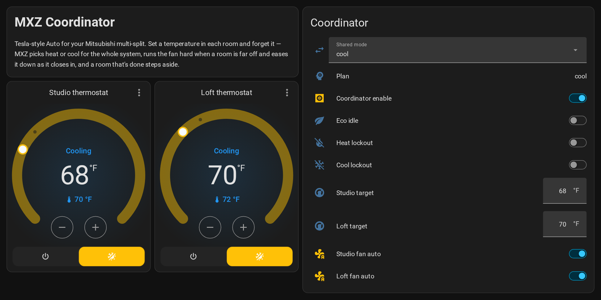

**Start here:** [Install](#install), then [set up your outdoor unit](#set-up-your-outdoor-unit).
Use [Reconfigure](#reconfigure-heads-rooms-and-sensors) to change the room list and
[Configure](#configure-comfort-and-sensor-settings) to tune it. No YAML is required.

**Contents**

- [What it does](#what-it-does), and
  [the problem it solves](#the-problem-stock-auto-starves-rooms)
- [What's new in 3.11.0](#whats-new-in-3110)
- [Before you install](#before-you-install) · [Install](#install)
- [Set up your outdoor unit](#set-up-your-outdoor-unit) ·
  [If setup stops or warns](#if-setup-stops-or-warns)
- [Reconfigure heads, rooms, and sensors](#reconfigure-heads-rooms-and-sensors)
- [Configure comfort and sensor settings](#configure-comfort-and-sensor-settings) ·
  [Choose a sensor freshness contract](#choose-a-sensor-freshness-contract)
- [Everyday control](#everyday-control) · [Who drives the fan](#who-drives-the-fan) ·
  [How a satisfied head idles](#how-a-satisfied-head-idles)
- [Best practice: give the firmware your room sensor too](#best-practice-give-the-firmware-your-room-sensor-too)
- [Diagnose a room that is waiting](#diagnose-a-room-that-is-waiting) ·
  [FAQ and troubleshooting](#faq-and-troubleshooting)
- [Remove the integration](#remove-the-integration)
- [Developer setup and tested support](#developer-setup-and-tested-support)
- [Credits & prior art](#credits--prior-art) · [License](#license)

## What it does

In brief:

- **One target per room.** Each room gets its own thermostat, read from the
  temperature sensor you pick for that room.
- **One explicit shared mode.** MXZ requests `cool` or `heat` for the rooms that need
  conditioning, using room temperatures and targets. It never requests hardware AUTO.
- **A satisfied room steps aside.** By default its head dries the coil after cooling,
  then turns off (`off_after_dry`); `fan_only` and `off` are available. These are
  software commands;
  [How a satisfied head idles](#how-a-satisfied-head-idles) explains their hardware
  boundary.
- **Priority settles a standoff.** Among rooms voting for opposing modes (heat versus
  cool), the higher-priority room wins, subject to mode dwell and lockouts. The other
  waits. A room whose head stays unavailable until a time limit runs out stops
  holding the mode (see
  [When a head goes unavailable](#when-a-head-goes-unavailable)).
- **Bounded by your settings.** Mode dwell, seasonal heat/cool lockouts, away limits,
  and an optional standby hold signal limit what it commands.
- **Set up in the UI.** Setup, Reconfigure, and Configure are Home Assistant dialogs.

> Shared as-is; support is best-effort. Automated checks use invented heads and sensors.
> They establish software behavior, not physical performance on your equipment.

### The problem: stock AUTO starves rooms

**What the manual says.** For the cited
[MSZ-FH25VE/FH35VE/FH50VE indoor units, PDF page 7](https://library.mitsubishielectric.co.uk/pdf/download_full/56),
COOL/DRY/FAN and HEAT cannot run at the same time when several indoor units share one
outdoor unit: "the unit selected last goes into standby mode." AUTO selects from that
indoor unit's room temperature and setpoint, and changes mode only after a sustained
difference. The manual does not recommend AUTO on an MXZ outdoor unit and warns that a
unit may be unable to switch between COOL and HEAT and enter standby.

By default that is first come, first served, not one room governing the system. Some
outdoor units can be set up otherwise. For the MXZ-4C36NAHZ to 8C60NA families in
[OCH573E, PDF page 127](https://www.mitsubishitechinfo.ca/sites/default/files/SH_MXZ-%284%29%285%29%288%29C%2836%29%2842%29%2848%29%2860%29NA%28HZ%29_PAC-MKA%2830%29%2831%29%2850%29%2851%29BC_OCH573E_1.pdf),
outdoor switch SW9-1 (off by default, set before power-on) "enables the indoor unit with
the minimum address to select AUTO mode, and switches the operation mode of the other
indoor units to the same mode." The same manual's
[page 108](https://www.mitsubishitechinfo.ca/sites/default/files/SH_MXZ-%284%29%285%29%288%29C%2836%29%2842%29%2848%29%2860%29NA%28HZ%29_PAC-MKA%2830%29%2831%29%2850%29%2851%29BC_OCH573E_1.pdf)
shows a CN3N external input that sets heating or cooling through an adapter
(PAC-SC36NA-E). Whether either is set on your system is an installer question; the
manuals do not say how other models behave.

**What I saw at home.** A room 6 °F past its cooling target drew **~26 W for over an
hour** while the other head was satisfied. After I turned that head off, the room
ramped to ~460 W and cooled. This is a household observation, not a controlled
comparison or a measured energy, comfort, noise, or equipment-life result.

**The same scenario, coordinated:** both rooms served within minutes instead of an hour
of starvation.

```
elapsed    draw       what's happening
0:20       675 W      hot room cooling hard; satisfied room idle in fan_only
1:20–3:40   45 W      compressor anti-short-cycle pause (~2.5 min — normal)
4:00–6:20  101→609 W  both rooms served, sustained
```

<details>
<summary>Mitsubishi's own alternative: kumo cloud changeover groups</summary>

Basic AUTO is not the only manufacturer option. The [kumo cloud® 2.22 technician manual,
pages 15–17](https://www.mitsubishitechinfo.ca/sites/default/files/TM_Kumo_Cloud_2.22_ver.13_FINAL-2-20250917.pdf)
documents optional changeover groups for some MXZ systems, including zone priorities,
maximum standby, and minimum run time. That is a relevant alternative where its
supported hardware and setup apply. It is not tested for parity with this integration.

</details>

## What's new in 3.11.0

Released October 23, 2026.

- **A lost head's vote goes stale, then expires.** When a head drops off the network
  (`unavailable` in Home Assistant, or gone from it), its room's last vote keeps
  counting, marked stale, for a time limit, and then expires. While it's stale, a room
  run from its own remote keeps the heat or cool its head last showed, and an enabled
  room keeps its demand in the heat-versus-cool decision, so a short dropout doesn't
  swing the shared mode. Once it expires, the room stops holding the shared mode, so
  MXZ can switch it for a room that needs the other mode. A head that comes back counts
  again at once. Before this, a room run from its own remote lost its vote the moment
  its head went unavailable, and an enabled room held the shared mode for as long as
  its head was gone. An enabled room whose Safety priority sensor is `on` keeps its
  want after the limit, and a tripped freeze floor or overheat ceiling is never dropped
  by it. None of it is saved: after a restart or reload, each head starts `unknown`
  until it is seen. The approach, and its live, stale, expired, and unknown votes, are
  adapted from [@csingley](https://github.com/csingley)'s MIT-licensed
  [ha-climate-zone-sequencer](https://github.com/csingley/ha-climate-zone-sequencer)
  (commit
  [f911e4a](https://github.com/csingley/ha-climate-zone-sequencer/commit/f911e4a1cb70ea247205491719bb2295e2a8ebbd));
  [NOTICE](NOTICE) carries its MIT notice. See
  [When a head goes unavailable](#when-a-head-goes-unavailable) and
  [When a head goes unavailable (3.11.0)](docs/MIGRATION.md#when-a-head-goes-unavailable-3110).
- **Keep a lost head's vote for**, a new setting in Configure → Comfort → Advanced: how
  long a lost head's vote counts, 1 to 240 minutes. Blank uses 30 minutes, the same
  default as ha-climate-zone-sequencer's, and leaving it untouched stores nothing.
- **Each room shows its vote status.** Each room in the plan sensor's `zones` list
  shows `vote_status` (`live`, `stale`, `expired`, or `unknown`) and `lost_since`, the
  time MXZ lost sight of its head. See
  [Diagnose a room that is waiting](#diagnose-a-room-that-is-waiting).
- **A lost head keeps running its last command.** A head that loses its connection to
  Home Assistant doesn't take MXZ's commands, and Mitsubishi's outdoor unit stays in
  that head's mode. So after the vote expires, a room that needs the other mode may
  wait in standby until the head reconnects or is turned off at the unit.
- **Hardware test.** On our house, running this release's code before the version
  bump, with Keep a lost head's vote for set to 3 minutes: the bedroom, heating, held
  the shared mode while the rec room waited to cool. We took the bedroom head offline
  by disabling its ESPHome entry. Its vote went stale and kept holding heat, then
  expired after the limit, and MXZ switched the shared mode to cool and sent the rec
  room cool. The rec room still sat in standby for nearly 5 minutes, because the
  offline bedroom head kept heating the whole time it was gone, about 7.5 minutes, so
  the outdoor unit stayed in heat. When the head reconnected, MXZ turned it off and the
  rec room started cooling. No faults were seen. With the bedroom head offline across a
  reload of MXZ, its vote read `unknown`, then expired after the limit, and it was
  `live` again once the head returned. A 60-minute run with both heads connected kept
  every vote `live`, and every plan update in it came from a room sensor, with no timed
  recomputes added. Saving the setting's page untouched changed nothing, and 0 and 241
  were refused. After the test, the house's previous install was put back, and its MXZ
  settings matched the backup apart from their saved time. **Not tested on hardware:**
  a room run from its own remote (none is set up on our house), a head reading
  `unknown` (tests cover it), and a full Home Assistant restart with a head offline.

From 3.10.0:

- **Opt-in dual setpoint, per room.** For power users who'd rather give a room a range,
  the way an ecobee or a Nest does: each room's page in Configure → Rooms → (room) has
  a new, collapsed **Dual setpoint** section with **Use separate heat and cool
  setpoints**. It's off by default, so nothing changes unless you turn it on, and a room
  that never turns it on is exactly as before. Turned on, the room gets **Heat to** and
  **Cool to** numbers, and its thermostat shows a range instead of one target (still
  `heat_cool`, with MXZ choosing heat or cool for the shared outdoor unit). It heats
  when it falls below Heat to by its drift and runs back up to Heat to, and it cools
  when it rises above Cool to by its drift and runs back down to Cool to. The two stay
  at least 2 °F (1 °C) apart, and moving one too close pushes the other. The room's
  target number stays: it shows the middle of the range, and writing it slides the
  whole range, keeping its width, so presence automations keep working. Assist can't
  set a range; write the room's target number instead. The idea comes from
  [@csingley](https://github.com/csingley)'s dual-setpoint proposal
  ([#35](https://github.com/dkpnw/ha-mxz-coordinator/pull/35)). See
  [Give a room separate heat and cool setpoints](#give-a-room-separate-heat-and-cool-setpoints-dual-setpoint)
  and [Dual setpoint (3.10.0)](docs/MIGRATION.md#dual-setpoint-3100).
- **Switching it on or off applies in place.** A room page saved with only the toggle
  changed is applied without a reload: the room's thermostat stays available, the other
  rooms keep their runs, and Apple Home picks up the range (or the single target again)
  without a reload of the HomeKit bridge. A save that mixes it with other changes, such
  as the room's uneven drift on the same page, reloads the integration as every other
  save does. After such a save, reload the HomeKit bridge (Settings → Devices &
  services → HomeKit Bridge → Reload) or restart Home Assistant so Apple Home shows the
  change.
- **One target stays the default.** [CONTRIBUTING.md](CONTRIBUTING.md) now says a dual
  setpoint is supported as a per-room opt-in, in place of 3.9.0's stance that MXZ
  wouldn't add one. MXZ won't make it the default, and won't add simultaneous heat and
  cool or the heads' hardware Auto.
- **Hardware test: the heat side.** On our two-head MXZ (Home Assistant 2026.10.2),
  running an earlier build of this release with one room, the bedroom, switched on:
  turning it on started the room's 65 °F target as 64–66 °F, with its Heat to and Cool
  to numbers, and left the other room as it was. With eco off, the bedroom at
  62.2–62.4 °F, and the outdoor unit already heating, a 62–64 °F range stayed idle
  (heat starts below 61.5), and a 63–65 °F range started heating it at once, with the
  head set to 63–65 °F. At 64–66 °F the room also asked the outdoor unit for heat, and
  the head got 64–66 °F. The minimum gap, the push, and the refusals worked as
  described; writing the target number slid the range and kept its width; eco ignored
  the range and showed the eco band, 50 and 78; and turning it off set the target to 65
  and removed the two numbers. That run also found that the HomeKit bridge didn't
  rebuild its accessory with the range: the reload after the save left the thermostat
  briefly unavailable, and the bridge's store wasn't rewritten. That's why a switch
  saved on its own now applies in place. A recheck of the release code on the house kept the thermostat available
  through the switch on and off, and the HomeKit bridge's store was rewritten with the
  heating and cooling thresholds, with no bridge reload and no restart. **The cool side
  isn't hardware-tested yet**: the room was at 62 °F in October, so no cooling run and
  no switch between heating and cooling were tried (tests cover those). Apple Home was
  checked from the HomeKit bridge's store, not on an iPhone, and Google Home and Alexa
  weren't checked in their apps. °C and two dual-setpoint rooms at once weren't tested
  on hardware.

From 3.9.0:

- **Per-room uneven drift.** Each room's page in Configure → Rooms → (room) has a
  collapsed **Uneven drift** section with that room's own **Let it get cooler by** and
  **Let it get warmer by**, blank by default. At release, only a room's own Let it get
  cooler by had been tested on hardware. See
  [Per-room uneven drift](#per-room-uneven-drift) and
  [Per-room uneven drift (3.9.0)](docs/MIGRATION.md#per-room-uneven-drift-390).
- **Each room shows its start points** (`heat_start`, `cool_start`,
  `heat_demand_below`, and `cool_demand_above`, with where its drift comes from) on its
  thermostat and in the plan sensor's `zones` list. See [Uneven drift](#uneven-drift)
  and [Start points (3.9.0)](docs/MIGRATION.md#start-points-390).
- **Oxford commas** in the remaining docs and the setup and Configure screen text.

From 3.8.0:

- **Let it get cooler by and Let it get warmer by** in Configure → Comfort → Advanced:
  how far below target before heating starts, and how far above target before cooling
  starts, blank by default (from 3.9.0, a room can also set either side itself). The
  idea grew out of [@csingley](https://github.com/csingley)'s dual-setpoint proposal
  ([#35](https://github.com/dkpnw/ha-mxz-coordinator/pull/35)). At release, only the
  heat side's start decision had been tested on hardware. See
  [Uneven drift](#uneven-drift) and
  [Uneven drift (3.8.0)](docs/MIGRATION.md#uneven-drift-380).
- **CONTRIBUTING.md** explains MXZ's design principles and what to do before opening a
  pull request.

From 3.7.1:

- **The mode-change wait, the coil-drying wait, and the floor's own timers run on a
  monotonic clock**, so a jump in the host's clock can no longer end them early or hold
  them late. The mode-change wait change is by
  [@csingley](https://github.com/csingley) in
  [#32](https://github.com/dkpnw/ha-mxz-coordinator/pull/32). See
  [Mode-change wait on a monotonic clock (3.7.1)](docs/MIGRATION.md#mode-change-wait-on-a-monotonic-clock-371)
  and
  [Coil-drying wait and floor timers on a monotonic clock (3.7.1)](docs/MIGRATION.md#coil-drying-wait-and-floor-timers-on-a-monotonic-clock-371).

From 3.7.0:

- **Safety priority**, designed and written by
  [@csingley](https://github.com/csingley) in
  [#31](https://github.com/dkpnw/ha-mxz-coordinator/pull/31), and the **freeze floor
  and overheat ceiling**: optional per-room settings in Configure → Rooms → (room),
  unset for every room until you set them. At release, only the freeze floor had been
  tested on hardware. See [Safety priority](#safety-priority),
  [Freeze floor and overheat ceiling](#freeze-floor-and-overheat-ceiling),
  [Safety priority (3.7.0)](docs/MIGRATION.md#safety-priority-370), and
  [Freeze floor and overheat ceiling (3.7.0)](docs/MIGRATION.md#freeze-floor-and-overheat-ceiling-370).

From 3.6.0:

- **Run one room from its own remote**, built from
  [@csingley](https://github.com/csingley)'s
  [#27](https://github.com/dkpnw/ha-mxz-coordinator/pull/27) and
  [#28](https://github.com/dkpnw/ha-mxz-coordinator/pull/28): with **Let its own
  remote run it while disabled** on, disabling a room turns its head off, then leaves
  it to its own remote; its heat or cool counts below every enabled room unless the
  room is marked Safety priority. Off for every room until you turn it on, and
  hardware-tested by @csingley on a 4-zone MXZ-4C36NA2. See
  [Run one room from its own remote](#run-one-room-from-its-own-remote) and
  [Run one room from its own remote (3.6.0)](docs/MIGRATION.md#run-one-room-from-its-own-remote-360).

From 3.5.0:

- **New setups dry the coil, then turn off** (`off_after_dry`); an upgraded entry keeps
  `fan_only`. See [Idle action default](docs/MIGRATION.md#idle-action-default-350).
- **FAQ and troubleshooting**, and **stock AUTO as the Mitsubishi manuals describe it**.
  See [FAQ and troubleshooting](#faq-and-troubleshooting) and
  [the problem it solves](#the-problem-stock-auto-starves-rooms).

From 3.4.1 and 3.4.2:

- **No startup warning for a sensor that is still loading**; MXZ warns once if it is
  still unusable 40 seconds after start. See
  [Startup warning for a sensor that is still loading](docs/MIGRATION.md#startup-warning-for-a-sensor-that-is-still-loading-342).
- **Configure is a menu.** Six pages, each saving only what it shows. A **Needs
  attention** line names any older saved value a page would now refuse. See
  [Configure is a menu of pages](docs/MIGRATION.md#configure-is-a-menu-of-pages-341).
- **No more setpoint re-sends** to heads that only hold 0.5 °C steps (ESPHome CN105).
  See [Setpoints on °C-native heads](docs/MIGRATION.md#setpoints-on-c-native-heads-in-a-f-system-341).
- **A new logo and icon**: the dial above, shipped in the integration's `brand/` folder.

> **Upgrading from 3.3.0 or earlier?** **3.4.0** changed setup, sensor handling, the
> room lifecycle and command delivery. Read
> [Migration](docs/MIGRATION.md#upgrading-to-340) before you upgrade.

**About the screenshots.** The setup, Reconfigure, and Configure screenshots come from
Home Assistant 2026.10.0 in its dark theme, with invented heads (Studio, Loft, Den,
Nook) and invented sensors. The Configure menu screenshots show 3.4.1; the setup,
Reconfigure, and Configure error screenshots are 3.4.0 captures. The dashboard image
near the top shows an earlier release.

## Before you install

| You need | Details |
| --- | --- |
| Home Assistant | **2024.12.0 or newer**. |
| Heads | **2–8 heads on one outdoor unit.** Add a separate coordinator entry for each outdoor unit. |
| Head modes | Each selected `climate` entity must advertise `heat`, `cool`, and a common idle action. |
| Idle action support | `fan_only` needs `fan_only`; `off` needs `off`; `off_after_dry` needs both. |
| Fan control | The advertised fan-mode feature. **Fan auto** requires the exact `auto` token. |
| Room sensors | A separate temperature `sensor` entity for each room. The picker uses device class **temperature**. |

A head's own temperature sensor can be selected. On my installation it read warmer than
the occupied room while idle; placement and firmware can differ.

**What it's built for and tried on.** MXZ is built against
[echavet/MitsubishiCN105ESPHome](https://github.com/echavet/MitsubishiCN105ESPHome).
Earlier releases have field experience on two- and three-zone hardware, with six-zone
and multiple-outdoor-unit reports. Other climate integrations, including Kumo Cloud
and MELCloud, remain unvalidated here. Compatible advertised features alone do not
prove equivalent timing or hardware behavior.

**Out of scope:** simultaneous heat/cool and branch-box VRF.

## Install

1. [Add this repository to HACS](https://my.home-assistant.io/redirect/hacs_repository/?owner=dkpnw&repository=ha-mxz-coordinator&category=integration)
   and select **Download**. If the link does not open, add
   `https://github.com/dkpnw/ha-mxz-coordinator` as a custom repository of type **Integration**.
2. Restart Home Assistant to load the integration.
3. Open **Settings → Devices & services → Add integration → MXZ Coordinator**.
4. Complete the setup below. Installation alone does not enable control.

**Without HACS:** copy the release's `custom_components/mxz_coordinator` directory into
Home Assistant's `custom_components` directory, restart, then add the integration.

**Coming from the YAML package?** The shipped
[YAML package](packages/mxz_coordinator.yaml) is a separate legacy option. To move from
it, follow [Migration](docs/MIGRATION.md#moving-from-the-yaml-package). Stop its
automations before letting the integration control the same heads.

## Set up your outdoor unit

Setup has four steps. Only **Save and finish** creates the entry.

1. **Heads.** Select every head on this outdoor unit once, in priority order.
   Position 1 wins a heat-versus-cool standoff. Give the outdoor unit an optional
   name and choose an optional drift-alert notification service. The outdoor-unit
   name labels the entry; it does not form entity IDs.
2. **Rooms.** Check each pre-filled **Room N name**. Use distinct, non-empty names;
   comparison ignores case. These names label the room entities.
3. **Room temperature sensors.** Pick one sensor per room. Check the room/head
   mapping and the displayed reading. Vane and airflow entities are detected from
   the head's device when matching registry records exist. Missing records or no
   matching device leave those optional controls unset; edit them later in Configure.
4. **Check this before you save.** Read each priority, head, and sensor line, then
   choose:
   - **Save and finish** when it is right.
   - **Change advanced settings** to tune comfort on the same pages Configure uses,
     then **Back to summary**.
   - **Go back to heads and rooms** to correct the mapping.

The summary's reporting age is information only: setup adds no sensor timeout. Heads,
ownership, sensors, and the chosen idle action are checked again at the final save, so
a change while the summary is open can send you back to correct it.

<table>
<tr>
<td width="50%">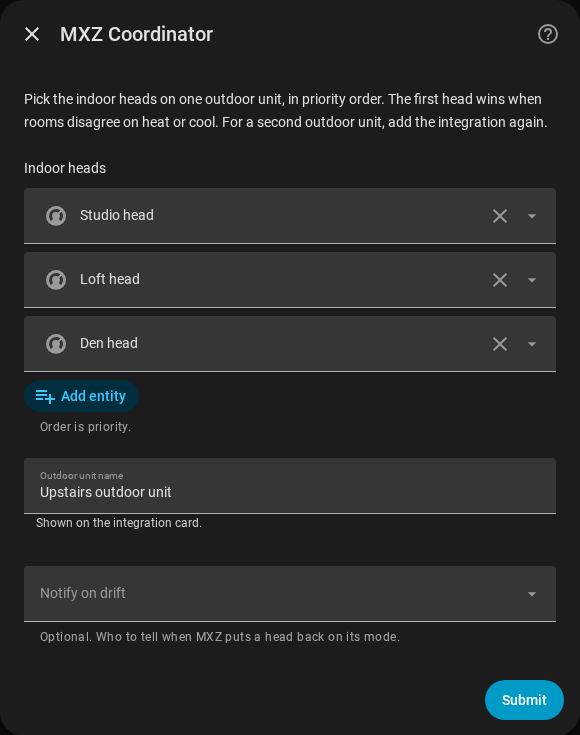</td>
<td width="50%">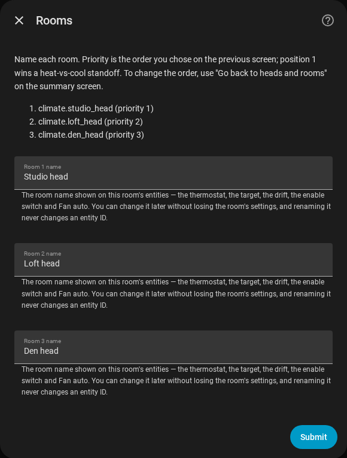</td>
</tr>
<tr>
<td>1. Heads: three heads in priority order and an outdoor-unit name.</td>
<td>2. Rooms: each name is pre-filled from its head's name and can be edited.</td>
</tr>
<tr>
<td>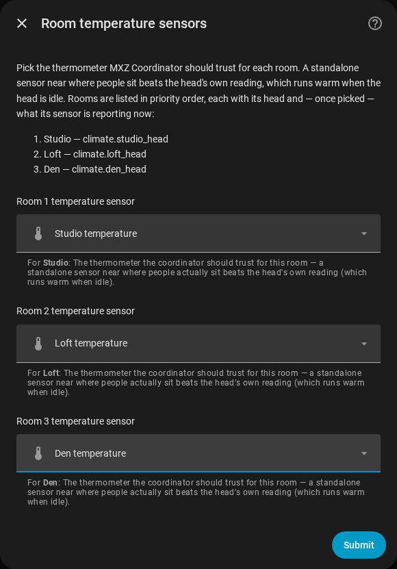</td>
<td>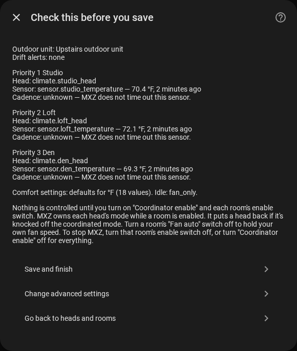</td>
</tr>
<tr>
<td>3. Sensors: each room with its head, and one temperature sensor picked per room, before submit.</td>
<td>4. Summary: each room's priority, head, sensor, reading, and cadence, then the three choices.</td>
</tr>
</table>

**Advanced settings are optional.**

- Skip them and MXZ uses defaults for your HA temperature unit.
- **Change advanced settings** opens a menu of the Comfort, Fan and idle, Seasons, Away
  and setpoint limits, and Standby hold pages, pre-filled with those defaults.
- Submitting a page keeps its answers and returns to that menu. Nothing is saved until
  **Save and finish**.
- If the selected heads cannot all use the default Off after drying idle action (it
  needs both `fan_only` and `off`), **Save and finish** opens Fan and idle so you can
  choose a supported alternative. It does not silently replace that default.

<details>
<summary>Setup's advanced step as it looked in 3.4.0 (one form)</summary>

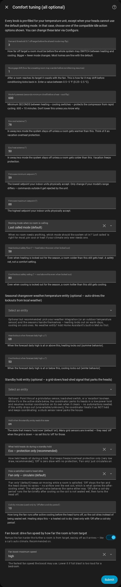

3.4.0's single form, pre-filled with °F defaults. From 3.4.1 the same fields are split
across the advanced pages described above.

</details>

After **Save and finish**, Home Assistant shows its own device **Name and assign** step.

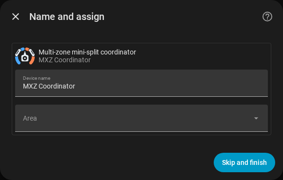

**Then turn it on.** New room enables and Coordinator enable start off.

1. Open the integration's device page.
2. Set the room targets.
3. Enable the rooms you want to coordinate.
4. Turn on **Coordinator enable**.

Expose the per-room thermostats to HomeKit/Google, or use them in HA. Avoid exposing a
second raw-head control for the same room.

### If setup stops or warns

| What you see | What to do; what MXZ saves |
| --- | --- |
| A missing head or unknown capabilities | Let the head integration load and publish its modes. Unknown support blocks saving. |
| A head lacks heat/cool, or there is no common idle action | Choose compatible heads. Setup does not invent a mode. |
| A head belongs to another entry | Reconfigure that entry first. Setup names the conflict and saves nothing. |
| A head is reserved by an open flow | Finish or cancel that setup/Reconfigure flow. Reservations have no timeout; HA restart clears an abandoned in-memory flow. |
| Duplicate heads or room names, or an empty room name | Correct the selection/name. Setup keeps you on that step. |
| Two rooms share a sensor, a sensor has no HA state, or its unit cannot convert | Pick a distinct, existing temperature sensor with a supported unit. Saving is blocked. |
| A sensor is `unknown`, `unavailable`, non-numeric, or non-finite | You may finish setup. The summary warns; that room makes no automatic demand until its reading is valid. |
| A sensor's unit attribute is absent or `null` | MXZ reads it in HA's system unit. Verify that interpretation. Celsius, Fahrenheit, and kelvin convert to the system unit. An empty string (`""`), another unsupported string, or a non-string unit is invalid and blocks saving. |

<details>
<summary>Screenshots of setup errors and warnings</summary>

<table>
<tr>
<td width="50%">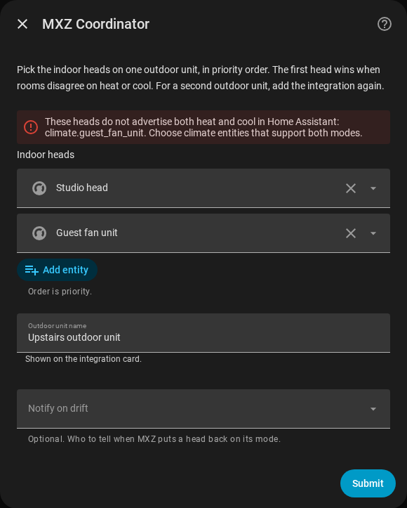</td>
<td width="50%">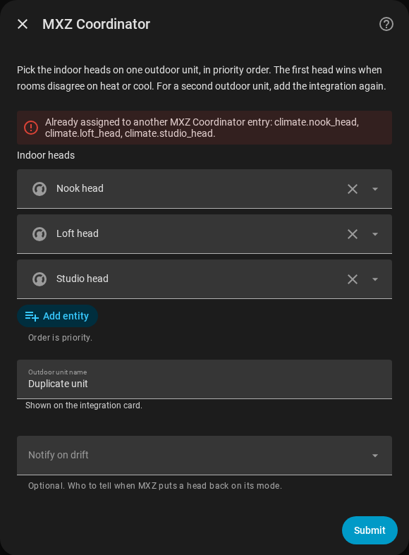</td>
</tr>
<tr>
<td>A fan-only guest unit is rejected because it lacks heat and cool.</td>
<td>The heads belong to another entry. The error names them, and the heads step stays open.</td>
</tr>
<tr>
<td>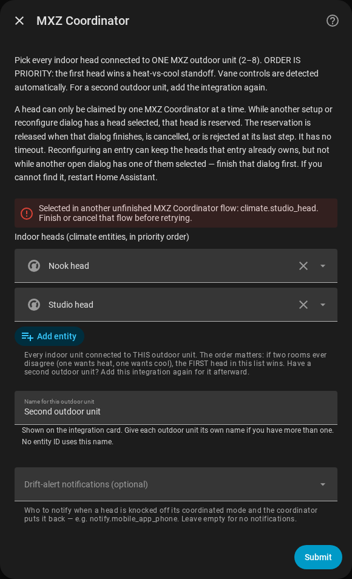</td>
<td>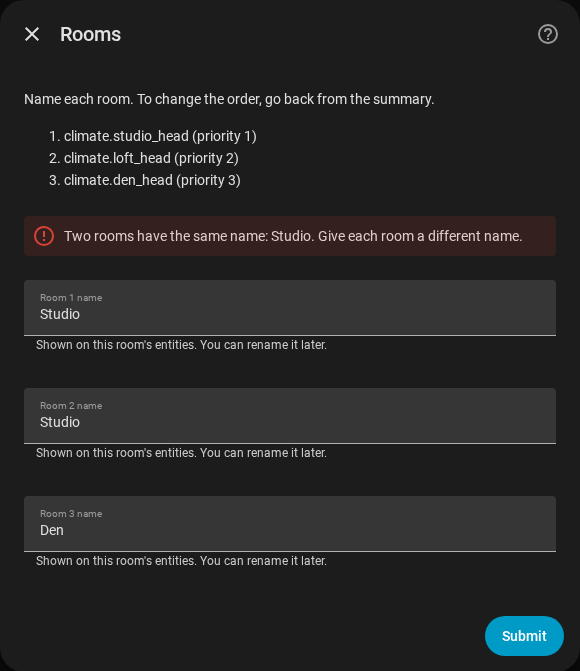</td>
</tr>
<tr>
<td>A head is reserved by another open setup dialog.</td>
<td>Two rooms have the same name.</td>
</tr>
<tr>
<td>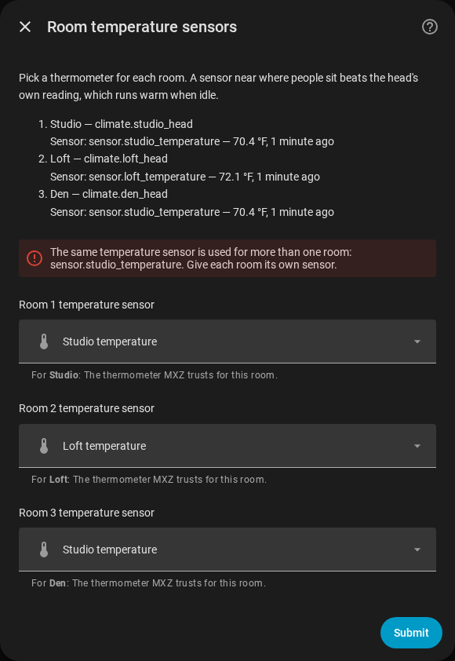</td>
<td>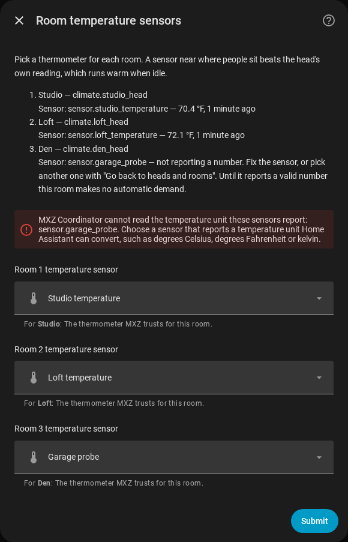</td>
</tr>
<tr>
<td>One sensor picked for two rooms is blocked.</td>
<td>A sensor whose unit cannot be converted is blocked.</td>
</tr>
<tr>
<td>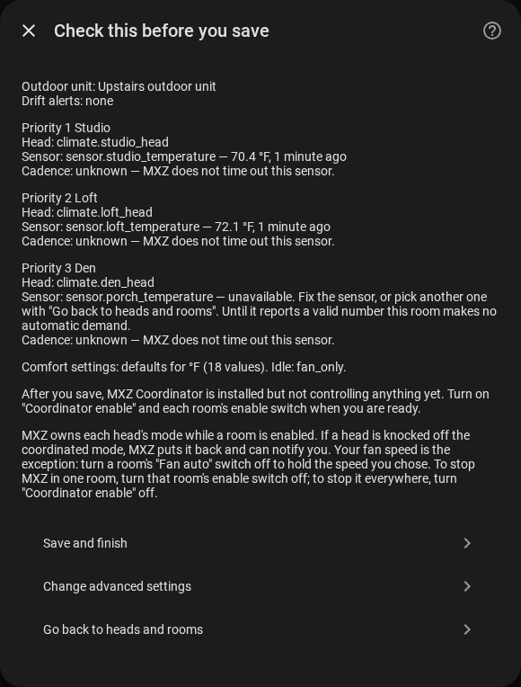</td>
<td></td>
</tr>
<tr>
<td>An unavailable sensor is accepted. The summary warns that the room makes no automatic demand until it reads a valid number.</td>
<td></td>
</tr>
</table>

</details>

## Reconfigure heads, rooms, and sensors

Open **Settings → Devices & services → MXZ Coordinator → ⋮ → Reconfigure**. Use it to:

- add or remove heads, or change their priority;
- rename rooms or change their sensors;
- change the outdoor-unit title and the drift-alert service.

It follows heads → rooms → sensors → summary, pre-filled from the entry. Select **Save
and finish** to apply it. Comfort and sensor-freshness settings stay in
[Configure](#configure-comfort-and-sensor-settings).

<table>
<tr>
<td width="50%">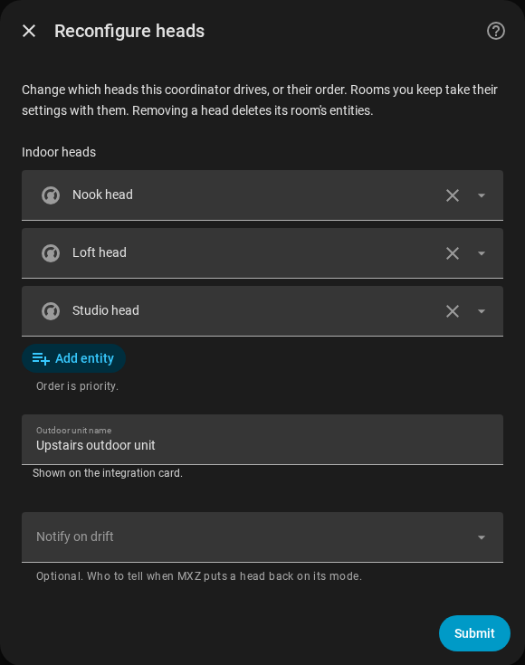</td>
<td width="50%">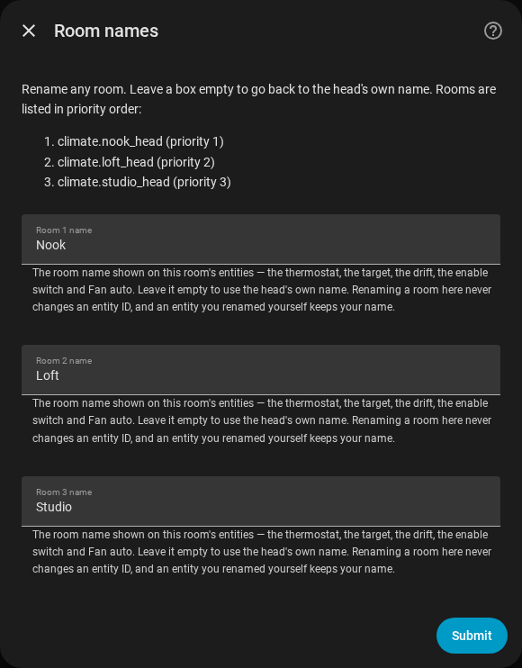</td>
</tr>
<tr>
<td>Heads: Nook added at priority 1, Loft kept at 2, Studio moved from 1 to 3, Den dropped.</td>
<td>Room names in the new priority order. An empty box uses the head's own name.</td>
</tr>
<tr>
<td>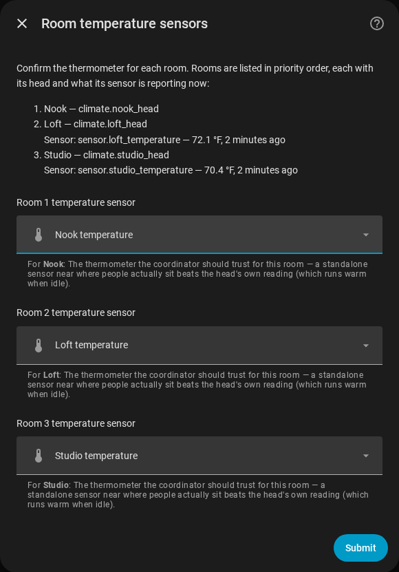</td>
<td>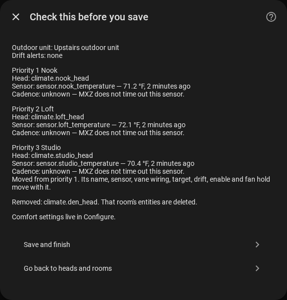</td>
</tr>
<tr>
<td>Sensors: kept rooms show their current sensors; Nook temperature is picked for the new room.</td>
<td>Summary: Studio's move with its settings, Den's removal, and a pointer to Configure for comfort settings. Only <b>Save and finish</b> and <b>Go back to heads and rooms</b> are offered.</td>
</tr>
</table>

**What carries over**

- For a kept head, submitted room names and sensors replace the old ones. Vane wiring
  and other stored room fields are retained.
- Reordering moves existing registry records with their room. That preserves entity
  IDs, restored target/enable/drift/fan-hold settings, and registry customizations.
  Their slot-derived unique IDs change to the new priority.
- Plan attributes such as `primary_demand` and `zones[0]` follow priority, so check any
  slot-based automation after a reorder.
- Missing or manually removed records cannot be carried.
- A removed room's records are pruned on setup; a newly added room starts disabled.

**Room names**

- Clear a room name to use the head's current name. Duplicate names are still rejected.
- An entity name you set in HA takes precedence over the room label.
- Renaming a head alone does not update a saved room name.
- A room rename does not change its entity ID.

**If the idle action no longer fits.** Reconfigure checks the entry's saved idle action
against the submitted heads. If it is incompatible, change **When a room reaches
target** (Configure → Fan and idle) while the current heads still support that choice,
or select compatible heads and retry.

**Overlapping entries.** Existing overlapping entries may keep or remove heads they
already stored; they cannot expand that overlap. Another open flow can still reserve
those heads. MXZ does not repair or disable the other entry for you.

**Reloads.** A save that changes entry data, title, or identity triggers one reload. A
save that leaves them unchanged triggers none. Reload rebuilds the coordinator and
restarts sensor-health observation. Reconfigure finishes by closing the flow after a
successful save with MXZ's own completion text.

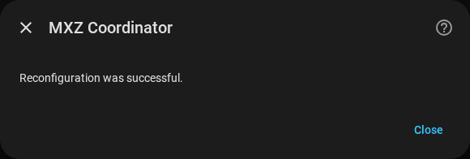

## Configure comfort and sensor settings

Open **Settings → Devices & services → MXZ Coordinator → Configure**. Configure opens
on a menu of six pages. Some settings sit in a collapsed section on their page.

| Page | Settings | What they're for |
| --- | --- | --- |
| **Comfort** | Allowed drift, Mode switch threshold, Resting mode. Collapsed **Advanced**: Minimum time between mode switches, Let it get cooler by, Let it get warmer by, Keep a lost head's vote for | **Mode switch threshold / Allowed drift**: shared-mode voting, and how far a satisfied room drifts before calling again. Per-room drift numbers can override the global drift. **Resting mode**: Last used, Cool, or Heat when no room is calling. **Minimum time between mode switches**: minimum dwell between shared heat/cool changes; default 600 seconds. **Let it get cooler by / warmer by**: optional; see [Uneven drift](#uneven-drift). **Keep a lost head's vote for**: optional, 1 to 240 minutes, blank for 30; see [When a head goes unavailable](#when-a-head-goes-unavailable). |
| **Fan and idle** | Fan boost, Fan boost top speed, When a room reaches target, Coil drying time | **Fan boost / Fan boost top speed**: the automatic fan ladder and its ceiling. A manual hold takes precedence. **When a room reaches target / Coil drying time**: Fan only, Off, or Off after drying (fan only after cooling for a dwell, then off). Choices depend on common head support. |
| **Seasons** | Weather source, Lock out heat when the high is at least, Lock out cool when the high is at most. Collapsed **Safety overrides**: Heat anyway below, Cool anyway above | Weather/outdoor-temperature input and seasonal heat/cool lockouts, with the heat-anyway and cool-anyway limits. |
| **Away and setpoint limits** | Away low limit, Away high limit. Collapsed **Head setpoint range**: Lowest setpoint, Highest setpoint | **Away low / high limit**: protection thresholds used by eco and the default standby hold. Keep the equipment's own safeguards. **Lowest / Highest setpoint**: the head's allowed range. Commands are also bounded by usable head limits. |
| **Standby hold** | Hold signal, Active state, During a hold | An external signal that holds enabled coordination in `eco`, `off`, or `fan_only`. Missing/unknown/unavailable input releases the hold. |
| **Rooms** | A submenu with one page per room, in priority order, titled by the room's name: Airflow sensor, Vertical vane, Horizontal vane, Safety priority sensor, Let its own remote run it while disabled. Collapsed **Uneven drift**: Let it get cooler by, Let it get warmer by. Collapsed **Sensor freshness**: the six freshness fields. Collapsed **Freeze floor and overheat ceiling**: Freeze floor, Overheat ceiling | **Room vanes and airflow sensor**: correct detection, select another entity, or clear a field to remove that optional wiring. **Safety priority sensor**: see [Safety priority](#safety-priority). **Let its own remote run it while disabled**: off by default; see [Run one room from its own remote](#run-one-room-from-its-own-remote). **Uneven drift**: optional, this room's own sides; see [Per-room uneven drift](#per-room-uneven-drift). **Sensor freshness**: see [Choose a sensor freshness contract](#choose-a-sensor-freshness-contract). **Freeze floor and overheat ceiling**: optional, empty by default; see [Freeze floor and overheat ceiling](#freeze-floor-and-overheat-ceiling). |

**How saving works**

- Submitting a page saves that page and closes the dialog. Open Configure again for
  the next page.
- A save merges the page's values into the existing options, mirrors them into entry
  data, and reloads once. It never touches a setting on another page.
- A save that leaves entry data and options unchanged needs no reload.
- A room page saved with only **Dual setpoint** turned on or off is applied without a
  reload; see
  [Give a room separate heat and cool setpoints](#give-a-room-separate-heat-and-cool-setpoints-dual-setpoint).
- Units are shown in each number box: temperatures use your HA unit, the mode switch
  time is in seconds, and coil drying and freshness durations are in minutes.

<table>
<tr>
<td width="50%">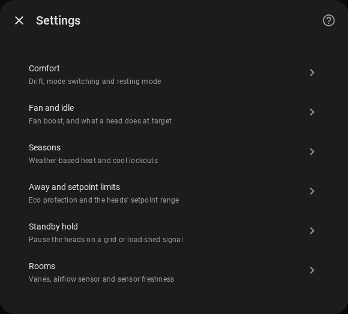</td>
<td width="50%">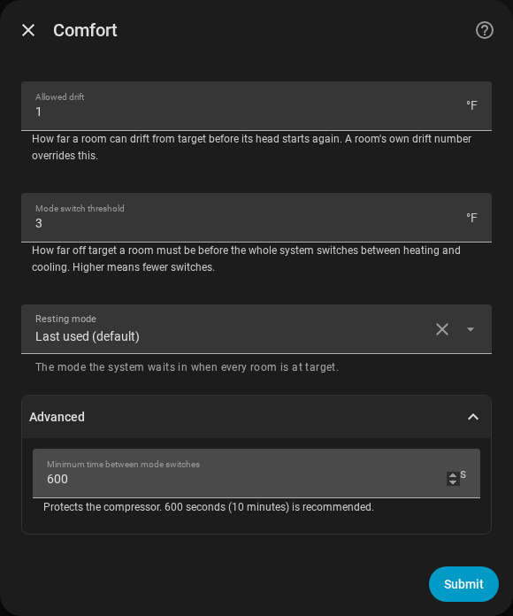</td>
</tr>
<tr>
<td>The menu: one page per group of settings.</td>
<td>Comfort, with its <b>Advanced</b> section opened.</td>
</tr>
<tr>
<td>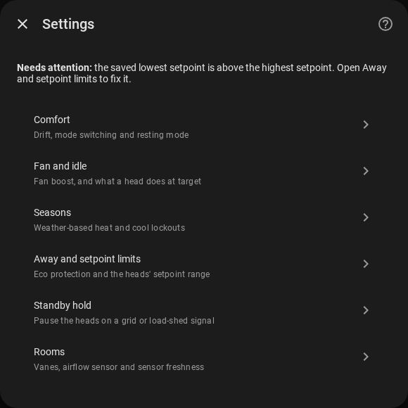</td>
<td>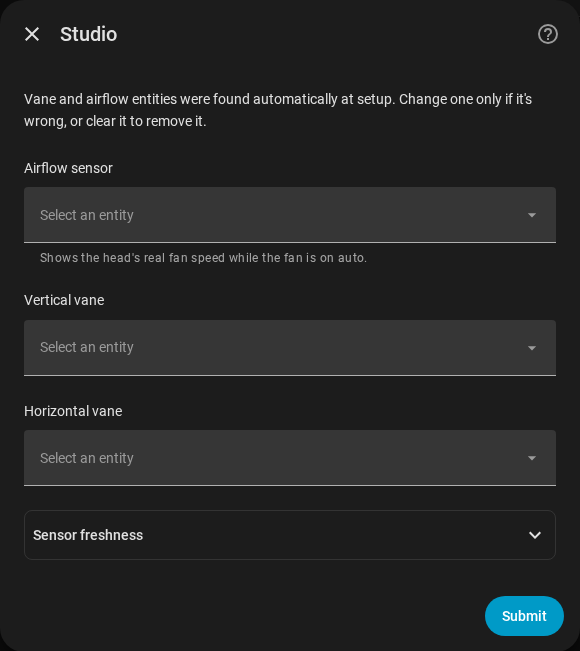</td>
</tr>
<tr>
<td><b>Needs attention</b> names an older saved value and the page that fixes it.</td>
<td>A room page, titled by the room's name.</td>
</tr>
</table>

<details>
<summary>Screenshots of the 3.4.0 single form (the menu replaced it)</summary>

These show 3.4.0's one-form Configure. The fields are the same; their labels, grouping,
and order changed in 3.4.1.

<table>
<tr>
<td width="50%">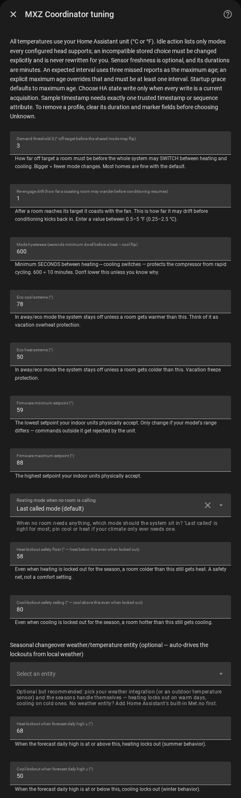</td>
<td width="50%">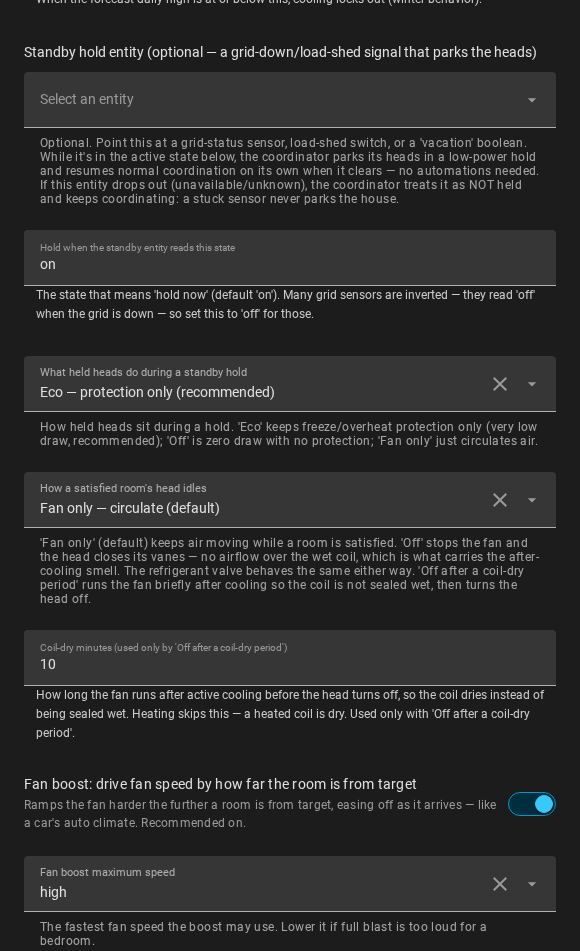</td>
</tr>
<tr>
<td>3.4.0: comfort, setpoint range, resting mode, lockouts, and seasonal changeover.</td>
<td>3.4.0: standby hold, idle action, coil drying, and fan boost.</td>
</tr>
<tr>
<td>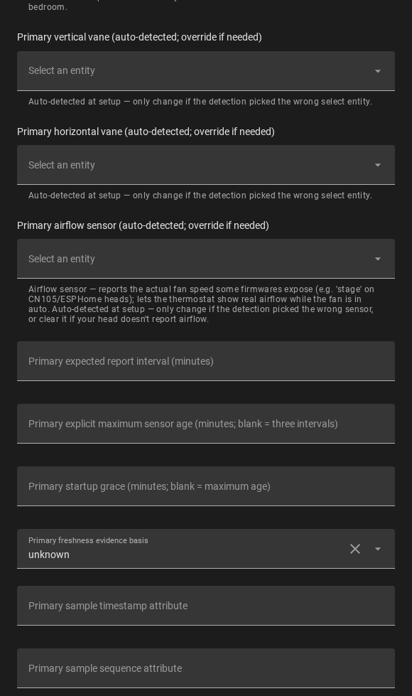</td>
<td>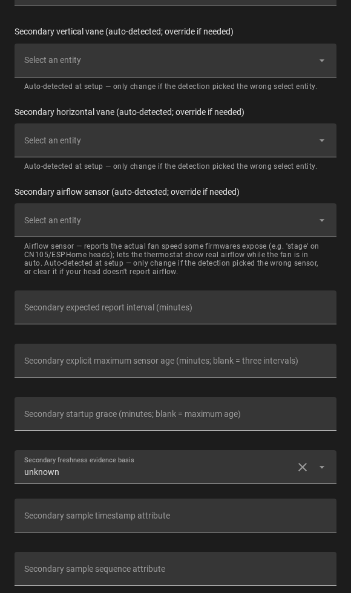</td>
</tr>
<tr>
<td>3.4.0: the priority 1 room's vanes, airflow, and freshness fields.</td>
<td>3.4.0: the priority 2 room's fields. Each room now has its own page.</td>
</tr>
<tr>
<td>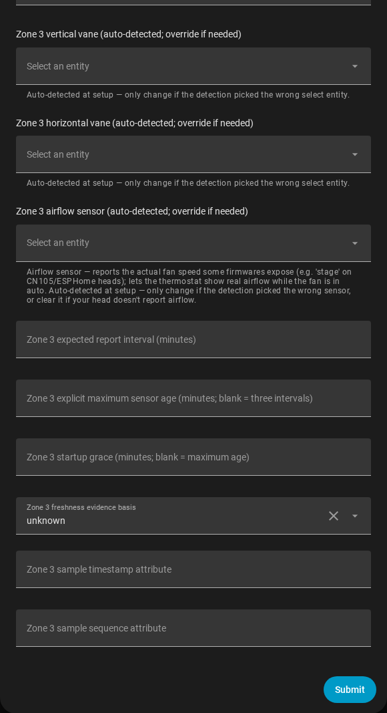</td>
<td></td>
</tr>
<tr>
<td>3.4.0: the priority 3 room's fields, then Submit.</td>
<td></td>
</tr>
</table>

</details>

### Saving rules, warnings, and clearing fields

**Numbers.** All numeric comfort temperatures, thresholds, and durations must be finite
numbers: `nan` and `±inf` are rejected.

- Mode switch threshold, Allowed drift, Minimum time between mode switches, and Coil
  drying time cannot be negative.
- Zero is allowed for the threshold and the two durations.
- Allowed drift also has its selector's 0.5–5 °F / 0.25–2.5 °C bounds, and so do
  Let it get cooler by and Let it get warmer by. Those two may be left blank; emptying
  one removes its saved value.
- Negative Celsius temperatures are legitimate in temperature fields.

**Pairs.** Each pair sits on one page:

| Labels (in HA's temperature unit) | Page | Accepted order |
| --- | --- | --- |
| Away low limit / Away high limit | Away and setpoint limits | Low ≤ high; equality is allowed. |
| Lowest setpoint / Highest setpoint | Away and setpoint limits → Head setpoint range | Lowest ≤ highest; equality is allowed. |
| Heat anyway below / Cool anyway above | Seasons → Safety overrides | Heat ≤ cool; equality is allowed. |
| Lock out cool when the high is at most / Lock out heat when the high is at least | Seasons | Cool threshold < heat threshold; equality is rejected to retain a shoulder band. |

**When a page refuses a save**

- A page checks only the values it shows.
- A refused page saves none of its edits, keeps what you typed, and does not reload the
  entry.
- An error on a field inside a collapsed section is shown above that section, which
  opens: Home Assistant does not show field errors inside a section.
- An invalid freshness profile is one error for the room page: “Nothing was saved.”

<details>
<summary>Screenshots of Configure errors and a successful save</summary>

<table>
<tr>
<td width="33%">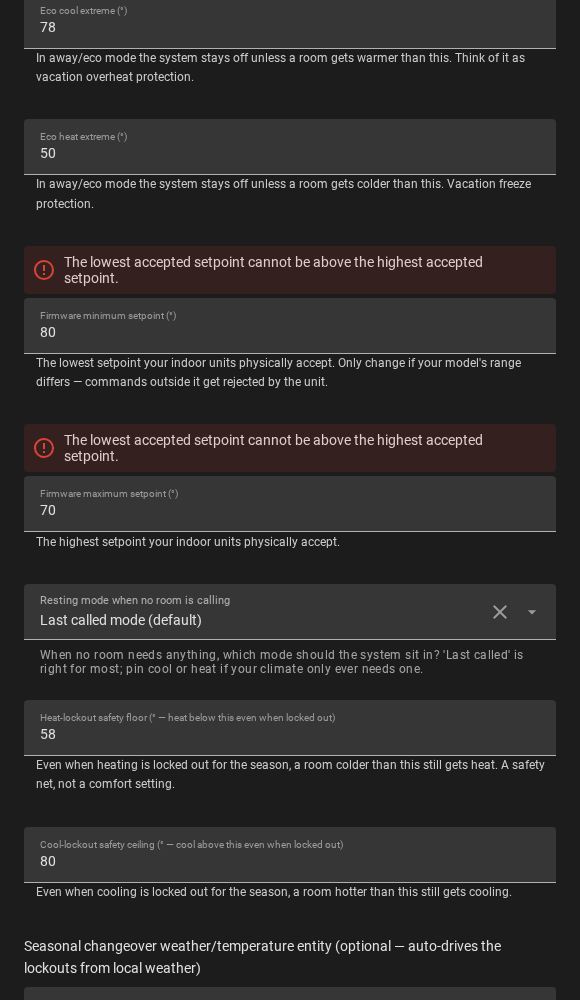</td>
<td width="33%">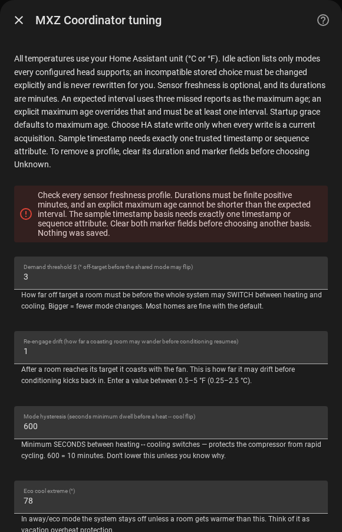</td>
<td width="33%"></td>
</tr>
<tr>
<td>3.4.0: a minimum setpoint above the maximum marked both fields. In 3.4.1 the error shows above the Head setpoint range section.</td>
<td>3.4.0: an invalid freshness profile rejected the form. In 3.4.1 it rejects that room's page.</td>
<td>A valid page saves and closes.</td>
</tr>
</table>

</details>

**Older saved values: Needs attention.** Values saved by 3.3.0 or earlier are not
silently rewritten on upgrade. A stored value that a page would now refuse does not
block the other pages. Instead, the menu shows a **Needs attention** line naming each
such value and the page that fixes it:

- an idle action the heads no longer support,
- an inverted pair, or
- a room's freshness profile that doesn't fit together.

The line is empty when nothing needs fixing. Open the named page, correct the value, and
save.

**When heads block every save.** Configure shows an error instead of its menu when:

- a head has no HA state or unknown `hvac_modes`,
- a head is missing either `heat` or `cool`, or
- the heads have no common idle mode.

A page opened just before the head changed shows the same error. Restore the head
integration's capability reports, or use Reconfigure to select compatible heads, then
reopen Configure. An `unavailable` head that still reports the required capabilities
can pass this check; availability alone does not determine it.

**Clearing optional fields**

- On a room page, a cleared vane or airflow field removes that wiring from that room
  only.
- On the Standby hold page, a cleared Hold signal explicitly removes the hold. On the
  Seasons page, a cleared Weather source stops the lockouts following the forecast. No
  other page can clear either.
- Do not infer that every optional field has the same clearing behavior.

**Recovered values.** The data mirror can recover tuned values when options are empty,
but does not prove how they became empty. Review and save Configure if that warning
appears.

### Choose a sensor freshness contract

Each room's profile is on its page (Configure → Rooms → the room → **Sensor freshness**).

**No contract? Leave it empty.** Leave the profile empty if you cannot establish a
reporting contract. MXZ shows `cadence_unknown`, displays age, and applies no age
cutoff. Giving only an interval, or keeping `evidence_basis: unknown`, does not make a
sensor trustworthy.

**To enable age checking**, supply a positive **Report interval** or **Maximum age**,
then choose a **Freshness evidence** basis.

- With only an interval, the maximum is three intervals.
- An explicit maximum must be at least the interval.
- Startup grace defaults to that maximum.

| Evidence basis | Choose it when |
| --- | --- |
| Every update is a new reading (`ha_state_write`) | The source guarantees each HA write is a current reading, even when its numeric value is unchanged. Cached/restored replays can defeat this basis. |
| Sensor reports a sample time or counter (`sample_timestamp`) | The source supplies a trustworthy advancing sample marker. Enter exactly one timestamp or sequence attribute. Timestamps need a timezone and cannot be in the future; sequences must increase. |
| Not set (`unknown`) | No reliable reporting contract exists. Clear durations and marker fields to remove the profile. |

**When a reading goes bad**

- An invalid reading steps aside immediately.
- A valid but stale room leaves automatic demand and parks by the configured idle
  action (`off` under eco), while its recognized manual fan hold stays intact.
- Its tile keeps the valid reading; age/health in the plan explain why it is no longer
  calling.
- A qualifying fresh report recovers the room. A cached marker does not extend a
  deadline or recover an unhealthy room.

**After a reload or restart**

- Reload/restart does not persist health.
- A valid recent sample timestamp can start healthy.
- Other valid profiled readings start `awaiting_report` for one grace period; a
  sequence found at load is only a baseline.
- An unusable reading gets no grace.

See [Migration](docs/MIGRATION.md#stale-room-sensors-340) for deadline and recovery
edges.

## Everyday control

**Your room thermostat.** Use each room's thermostat for one target and
`heat_cool`/`off`. A room you switch to a dual setpoint shows a range instead; see
[Give a room separate heat and cool setpoints](#give-a-room-separate-heat-and-cool-setpoints-dual-setpoint).

- `heat_cool` means the coordinator chooses a shared direction. It does not send
  hardware AUTO or heat/cool simultaneously.
- Turning the tile off disables that room. Disabling a room relinquishes its
  coordination; it does not promise to power the raw head off.
- By default a disabled room's head is held off: MXZ turns it off on every update,
  including after someone turns it on from its own remote or timer. To run one room
  from its own remote instead, turn on **Let its own remote run it while disabled**
  for it; see [Run one room from its own remote](#run-one-room-from-its-own-remote).

**What the coordinator does.** It commands mode and bounded setpoints for enabled
rooms. Rooms run to target, then coast until their drift band is crossed. A fresh
target uses the head's setpoint when readable; 70 °F / 21 °C is the fallback.

| Value | °F | °C |
| --- | --- | --- |
| Default demand | 3 °F | 1.5 °C |
| Default drift | 1 °F | 0.5 °C |
| Fallback for a fresh target (head's setpoint unreadable) | 70 °F | 21 °C |
| Range of each room's drift number | 0.5–5 °F | 0.25–2.5 °C |

**Per-room drift.** Writing a room's drift number creates an override, even if you
enter today's global value. Press **Follow global drift** to remove that override. The
number updates immediately; the ordinary debounced recompute can then change demand and
head output. The button is unavailable until its drift number is loaded and available.
To let rooms drift further one way than the other, see [Uneven drift](#uneven-drift).

**Shared mode** offers `cool` and `heat`.

- A changed choice stamps the ordinary mode-flip dwell. Automatic arbitration can
  change direction again after that dwell.
- Selecting the current direction adds no hold or new dwell.
- The selector does not enable the coordinator, enable rooms, or lift lockouts/standby
  holds.

**Stepping back: Coordinator enable and standby hold**

- Turn **Coordinator enable** off to stop new coordinated control and use the heads'
  own controls. Heads keep their last commanded state.
- A handler already accepted by another integration can return late; turning MXZ off
  cannot retract it.
- A standby hold instead parks coordinated heads for as long as its signal is active.
  Its default `eco` action allows conditioning at protection extremes; `off`/`fan_only`
  are fixed parks.
- These are software policies, not certified freeze protection or guarantees of zero
  draw.

<details>
<summary>After a restart: how a room resumes its run</summary>

After restart, MXZ can resume an observed `cool`/`heat` run when both Coordinator enable
and that room's enable restore ON. It waits for usable head evidence and a valid room
reading that is not stale under an enforced freshness profile. Construction and a live
enable do not adopt a previous run.

Changing a target while the coordinator is OFF or the room is disabled clears that
run's latch; when enabled again, the room starts coasting and uses the ordinary
re-engage band. This fixes the restart intent that 3.3.0's construction-time compute
could spend too early. After a room coasts, a follow-up refresh lets it progress
without needing a head echo.

</details>

### Uneven drift

Allowed drift is the same distance either way. To let rooms wander further one way
than the other, set **Let it get cooler by** (how far below target before heating
starts) and **Let it get warmer by** (how far above target before cooling starts) in
Configure → Comfort → Advanced. Each takes 0.5–5 °F / 0.25–2.5 °C. Leave one blank to
use Allowed drift on that side; both blank is ordinary Allowed drift.

These only move where a run starts. A run always goes back to the target. With target
70 and warmer by 5, cooling starts above 75 and runs down to 70. To have it stop at 73,
set the target to 73.

A room's own drift number, once you or an automation set it, replaces both values for
that room, the same distance either way; **Follow global drift** hands the room back to
them. A room's drift number keeps showing Allowed drift even while the room is using
**Let it get cooler by** or **Let it get warmer by**, until you give that room its own
drift; the values in use are `drift_heat` and `drift_cool` on the plan sensor and on
the drift number itself. A room can also have its own values for either side; see
[Per-room uneven drift](#per-room-uneven-drift). A room still needs to be off
target by the mode switch threshold, or that side's drift if it is wider, before the
whole system switches between heating and cooling for it. The plan sensor's `zones`
list shows the values in use per room as `drift_heat` (cooler by) and `drift_cool`
(warmer by), beside `drift`. Nothing changes on the room's tile, which keeps one
target.

Each room's plan also shows where it will start heating and cooling, worked out from
its target, these settings, Allowed drift, its own drift number, and the mode switch
threshold. `heat_start` and `cool_start` are where the room's head starts heating or
cooling while the outdoor unit is already in that mode. `heat_demand_below` and
`cool_demand_above` are where the room asks the outdoor unit to switch to heating or
cooling. They are the numbers MXZ is using right now, in your temperature unit: with
eco on, they are **Away low limit** and **Away high limit**, and a heat or cool lockout
moves its side out to **Heat anyway below** or **Cool anyway above**.
`start_points_mode` reads `comfort` or `eco`, and
`start_points_lockouts` lists any lockout in use (`heat`, `cool`, or both).
`drift_heat_from` and `drift_cool_from` say where each side's drift comes from
(`room_cooler_by`, `room_warmer_by`, `room`, `cooler_by`, `warmer_by`, or
`allowed_drift`; see [Per-room uneven drift](#per-room-uneven-drift)), and
`drift_source` is `room` when either side comes from the room, else `global`. A disabled room shows no start points. The room's thermostat carries the
same values as extra attributes. They are read-only, and the tile, Apple Home, Google
Home, and Alexa still see one target.

#### Per-room uneven drift

For power users: any room can have its own **Let it get cooler by** and **Let it get
warmer by**, in Configure → Rooms → (room), in the collapsed **Uneven drift** section.
Each takes 0.5–5 °F / 0.25–2.5 °C and is blank by default. A blank side stores nothing,
and emptying a box removes that side.

For each side, MXZ uses the first of these that is set:

1. The room's own value on this page.
2. The room's drift number, but only once you or an automation set it. A room that
   was never set, or that you handed back with **Follow global drift**, is not set,
   even though its drift number shows Allowed drift. Setting the number to exactly
   Allowed drift does count as set, because someone chose it; press **Follow global
   drift** to undo that.
3. **Let it get cooler by** or **Let it get warmer by** in Configure → Comfort →
   Advanced.
4. Allowed drift.

Each side falls through on its own. For example, with Comfort's cooler by 3 and warmer
by 5, a room with its own warmer by 2 starts cooling 2 above target and heating 3
below. Write 1.5 to that room's drift number, and it starts heating 1.5 below while
still cooling at 2 above. Leave both of a room's sides blank and nothing changes for
it. As with the global settings, a run still goes back to the target, and the room asks
the whole system to switch only past the mode switch threshold, or that side's drift
if it is wider.

The room's drift number still shows a single value, so presence automations that write
to it work as before. Its `drift_heat` and `drift_cool` attributes, like the plan
sensor's, show the drift in use on each side. `drift_heat_from` and `drift_cool_from`
read `room_cooler_by` or `room_warmer_by` for a side that comes from this page, and
`room` for one that comes from the room's drift number. `drift_source` is `room` when
either side comes from the room, else `global`.

### Give a room separate heat and cool setpoints (dual setpoint)

For power users. One target is the default, and most rooms never need more. If you'd
rather give a room a range, the way an ecobee or a Nest does, open Configure → Rooms →
(room), expand the collapsed **Dual setpoint** section, and turn on **Use separate heat
and cool setpoints**. It's off by default and set per room, so the other rooms keep one
target.

**What the room gets.** Two numbers, the room's **heat to** and **cool to** (for example
`number.mxz_coordinator_bedroom_heat_to` and `number.mxz_coordinator_bedroom_cool_to`),
and its thermostat shows a range: two handles on the Home Assistant tile,
`target_temp_low` (heat to) and `target_temp_high` (cool to), and no single
`temperature`. The thermostat still offers only `heat_cool` and `off`, and MXZ still
picks heat or cool for the shared outdoor unit; there's no heat or cool mode to choose,
and nothing runs both at once. The plan sensor's `zones` row for the room gains
`target_low` and `target_high`.

**How it runs.** The room heats when it falls below heat to by its drift, and runs back
up to heat to. It cools when it rises above cool to by its drift, and runs back down to
cool to. In between, it rests. With the default drift of 1 °F, a 68–74 °F room heats
below 67 and stops at 68, and cools above 75 and stops at 74. That's the one difference
from a single target, where every run goes back to the target. Everything else works
the same way, per side:

- Drift, uneven drift, per-room uneven drift, and the room's drift number set how far
  past each edge the room can get before a run starts.
- The room asks the outdoor unit to switch between heating and cooling only past the
  mode switch threshold (or that side's drift, if it's wider), measured from heat to on
  the heat side and from cool to on the cool side.
- The heads get setpoints built from heat to while heating and from cool to while
  cooling.
- Fan boost speeds up by how far the room is outside the range (0 inside it).
- `heat_start`, `cool_start`, `heat_demand_below`, and `cool_demand_above` are worked
  out from heat to and cool to, and they're the numbers MXZ uses.
- Eco ignores heat to and cool to and uses **Away low limit** and **Away high limit**,
  as it always has. A heat lockout moves the heat side out to **Heat anyway below**, and
  a cool lockout moves the cool side out to **Cool anyway above**. The freeze floor,
  the overheat ceiling, priority, and hands-off are unchanged.

**The rules for heat to and cool to.** Both move in steps of 1 °F (0.5 °C) and stay
inside the room's limits (its thermostat's `min_temp` and `max_temp`). They stay at
least 2 °F (1 °C) apart. Move one too close to the other, or past it, and the other one
is pushed along to keep the gap, the way an ecobee or a Nest does. If pushing it would
take it past a limit, the change is refused. Setting both at once closer than the gap,
or crossed, is refused too. A refused change shows an error and changes nothing;
nothing is ever clamped quietly.

**The room's target number stays.** It shows the middle of the range, which can be a
half degree (for example 71.5 °F). Writing it moves the whole range so it's centered on
the new value, keeping its width, and slides it back inside the limits if needed. So a
presence automation that sets the guest room to 66 when nobody's home keeps working
after you switch that room to a range.

**Turning it on and off.** Turning it on starts the range around the room's target at
the minimum gap: a 70 °F target becomes 69–71 °F, and 21 °C becomes 20.5–21.5 °C.
Turning it off while the integration is loaded sets the target to the middle of the
range, rounded to the step (exact halves round to the even step, as the tile does:
68–73 °F becomes 70), and removes the heat to and cool to numbers. A restart keeps the
range. If a restored range no longer fits the head's limits with the gap, it's
re-centered at the gap, and the room's `control_reasons` say so until you next change
it.

A save that only turns the option on or off is applied in place, with no reload: the
room's thermostat stays available, and its features, range, and target change in one
step. That's what lets Apple Home pick up the change (see below), and the rest of the
system isn't disturbed: the other rooms keep their runs, and the mode-change wait isn't
restarted. A save that also changes something else (for example, the room's uneven
drift on the same page) reloads the integration, as every other save does, with the
same result for the room. After such a save, reload the HomeKit bridge (Settings →
Devices & services → HomeKit Bridge → Reload) or restart Home Assistant so Apple Home
shows the change. To avoid that, save the toggle on its own.

**Voice and other apps.** These follow Home Assistant's own bridges:

- **Apple Home** shows the room in Auto with a heating and a cooling threshold. Home
  Assistant's HomeKit bridge rebuilds a thermostat when its features change while it
  stays available, so a toggle saved on its own reaches Apple Home without reloading the
  bridge; one saved with other changes needs a bridge reload or a restart (see above).
  This is read from the bridge's code and tested against a copy of its rule. On our
  house, the bridge's store was rewritten with the two thresholds after a toggle saved
  on its own, with no bridge reload; it hasn't been checked on an iPhone yet. Apple
  Home sends a threshold change as a pair with the other one unchanged, so the push
  rule applies. When you drag one threshold past the other, though, Home Assistant's HomeKit bridge
  pushes first: it sets the other one 5 °C (9 °F) away, within the room's limits, so
  you see that wider push rather than MXZ's 2 °F (1 °C).
- **Google Home** shows the low and high setpoints in heat-cool, and setting the range
  sets both. A single number for the room ("set the living room to 70") reaches it as
  one temperature, which Home Assistant refuses for a range, so nothing changes. Google
  hears about the refusal only when Report state is off; with it on, Home Assistant
  answers Google before the refusal.
- **Alexa** shows a lower and an upper setpoint in Auto, and "make it two degrees
  warmer" moves both. A single target from Alexa is refused by Home Assistant after
  Alexa has already answered, so Alexa may say OK while nothing changes.
- **Turning it on or off, for Google and Alexa.** Through Home Assistant Cloud, the
  thermostat's changed features make Google sync and Alexa rediscover it on their own,
  with or without a reload. A manually set up Google Assistant or Alexa skill isn't told,
  so ask it to sync or discover devices, as for any new device. Neither app was checked
  on a phone.
- **Assist** (Home Assistant's own voice) can't set a range: its set-temperature intent
  only matches thermostats with one target. `climate.set_temperature` with only
  `temperature` is refused for a range room too; send `target_temp_low` and
  `target_temp_high`. For one number in an automation or a script, write the room's
  target number, which moves the range.

### Run one room from its own remote

**Let its own remote run it while disabled** is a per-room setting in Configure →
Rooms → (room). It is off for every room, and for every room of an existing install
after upgrading, so nothing changes until you turn it on: a disabled room's head is
held off, as always.

With it on, when you disable that room (its switch, or its tile set to `off`):

- MXZ sends `off` and keeps sending it until the head reports `off`. A command the
  head's integration rejects, or one that returns while the head still reports a
  running mode, does not count. If the head is already off, nothing is sent.
- From then on MXZ sends that head nothing. Use its own remote, timer, or app. This
  holds across a Home Assistant restart. Enabling the room hands the head back to the
  plan; disabling it again sends `off` again, until it lands.
- MXZ cannot tell an `off` that never arrived from one someone undid a moment later,
  so the first `off` the head reports, with no other command of MXZ's still in
  flight, ends the parking. That includes an `off` the head's integration reports for
  a moment while it reconnects, if it does that.
- The room tile stays `off`, because its mode is the room's coordinator switch:
  turning the tile on still enables the room. Its action shows what the head is
  doing: the head's own action if it reports one, else heating, cooling, fan, or
  drying from its mode. In Apple Home that is the current state; the target, and so
  most likely the tile's label, stays Off.
- If the head runs `heat` or `cool`, that counts in the shared direction, below every
  enabled room, unless the room is marked [Safety priority](#safety-priority) and that
  sensor is `on`. Otherwise it decides the direction only when no enabled room is
  calling or still running to its target, and a direction change it causes alone does
  not start the mode-change wait, so an enabled room that then calls the other way is
  not held back by it. Once an enabled room runs in the direction it chose, the wait
  starts, just as if that room had chosen it. `sensor.*_plan` shows the head's vote in
  that room's `hands_off_vote` (its `hands_off` reads `parking` or `released`), and
  `standoff` is true when it and another room want opposite modes. The plan's
  top-level `mode_by_hands_off` is true when the vote, not an enabled room, set the
  shared mode on that update: no enabled room is calling or still running to its
  target and the vote picks a mode the enabled rooms alone would not, or the mode goes
  back after the vote ends. Such a change starts no mode-change wait. With **Resting
  mode** set to Cool or Heat it stays true while the vote holds the mode away from
  rest; on Last used it is true only on the update that makes the change. With no room
  opted in it is always false.
- If the head goes unavailable, its last heat or cool keeps counting for **Keep a lost
  head's vote for** (30 minutes by default), then stops. See
  [When a head goes unavailable](#when-a-head-goes-unavailable).
- A standby hold still holds this head too: at the hold's park mode, or `off` under
  an `eco` hold, for as long as the hold lasts. Afterwards the head is left alone
  again. MXZ does not "heal" this head out of `dry` or `auto`.

Two heads on one outdoor unit asking for opposite modes is still a standoff that the
outdoor unit settles its own way (see
[the problem it solves](#the-problem-stock-auto-starves-rooms)): the room you run by
hand can make an enabled room wait, or wait itself.

### Safety priority

Any room, enabled or run from its own remote, can be marked **Safety priority** in
Configure → Rooms → (room): an optional binary sensor reference. It is unset for every
room, so nothing changes until you wire one.

While that sensor reads `on`, the room's want for heat or cool outranks every other
room's, enabled or run from its own remote, regardless of room priority. That includes
an enabled room that is calling or still running to its target, which an ordinary
vote never overrides. If two rooms marked Safety priority are `on` and want opposite
modes, room priority decides between them.

Taking the direction from an enabled room that is calling or still running to its
target parks that room's head, so it starts the mode-change wait like any other
reversal: a sensor that flaps on and off cannot reverse the compressor twice inside one
wait. Deciding the direction while no enabled room is calling or still running does not
start the wait, the same as an ordinary vote. A wait already running still applies to
the safety room's want too. `sensor.*_plan` shows each room's sensor in its
`safety_priority`, and the top-level `mode_by_safety` is true while a room marked
Safety priority is asserting and its want is the shared mode.

What the sensor should mean:

- **It raises a want the room already has, and creates none.** It only makes the
  room's own heat or cool want win: an enabled room's call, or the heat or cool a head
  run from its own remote is running. An enabled room that is not calling (including
  one coasting to its target inside its band), or a head that is off, fan-only, or
  drying, has no want to raise, and the sensor does nothing for it. It never starts
  heat or cool by itself, so it is not freeze protection.
- **A standby hold still silences it.** The hold parks heads as usual, the safety
  room's included, and a head run from its own remote is held and casts no vote.
- **Only the exact state `on` counts.** `off`, `unavailable`, `unknown`, or a missing
  entity is no priority.
- **A sensor stuck `on` keeps that room's want on top for as long as it is on**, and a
  room wanting the other mode waits the whole time. Drive it from an automation or
  template with a clear `off` condition, and consider what happens if it sticks.
- Reserve it for a real floor or ceiling condition in that room, not everyday comfort:
  an override that is on every day defeats the priority order.

For a disabled room that must not freeze or overheat, use
[Freeze floor and overheat ceiling](#freeze-floor-and-overheat-ceiling) instead: that
does start heat or cool.

### When a head goes unavailable

A head that drops off the network reads `unavailable` in Home Assistant, or disappears
from it. MXZ can neither see what that head is doing nor send it anything, but it may
still be running on the shared outdoor unit. So MXZ keeps counting what it last saw for
a while, then lets go:

- **For a time limit, its last vote still counts (`stale`).** A room run from its own
  remote keeps the heat or cool its head last showed. An enabled room keeps its demand
  and its run to target in the heat-versus-cool decision, as before. If a room run
  from its own remote has its Safety priority sensor `on`, its last heat or cool keeps
  its safety rank while stale, so for up to the limit it can take the mode from an
  enabled room that is calling. Holding the last vote keeps a short dropout from
  swinging the shared mode.
- **Then it expires (`expired`).** After **Keep a lost head's vote for** (Configure →
  Comfort → Advanced: 1 to 240 minutes, or blank for 30), the vote stops counting. A
  room run from its own remote no longer sets the direction, and an enabled room stops
  holding the shared mode, so MXZ can switch it for a room waiting for the other mode.
  MXZ keeps sending an enabled room's lost head its usual commands, but a head that
  loses its connection to Home Assistant doesn't take them: it keeps running its last
  command. Mitsubishi's outdoor unit stays in that head's mode, so a room that needs
  the other mode may wait in standby until the head reconnects or is turned off at the
  unit. On our house, a lost bedroom head kept heating for about 7.5 minutes, the other
  room sat in standby after the vote expired, and when the head reconnected, MXZ turned
  it off and the other room started cooling, with no faults.
- **A head that comes back counts again at once (`live`).** Any reversal that follows
  waits out the mode-change wait as usual.
- **Kept as before:** an enabled room whose Safety priority sensor is `on` keeps its
  want after the limit, and a tripped freeze floor or overheat ceiling is never dropped
  by it. A floor whose own head is unavailable already casts no want, as before.
- **Only a lost head counts.** `unknown` means the head is there without a mode: it is
  in sight, and it has no vote, as before. A head that only reports nothing new is in
  sight too.
- **Nothing about it survives a restart or reload.** Each head starts `unknown` until
  it is seen. A room run from its own remote then has no last vote, so it holds
  nothing. An enabled room's demand counts for the same time limit from the start
  (heads are briefly unavailable while Home Assistant starts), then expires.

`sensor.*_plan` shows each room's `vote_status` (`live`, `stale`, `expired`, or
`unknown`) and `lost_since`. Before this, a room run from its own remote lost its vote
the moment its head went unavailable, and an enabled room held the shared mode for as
long as its head was gone.

### Freeze floor and overheat ceiling

Each room can have a **Freeze floor** and an **Overheat ceiling**: two optional numbers
in Configure → Rooms → (room) → **Freeze floor and overheat ceiling**, in your Home
Assistant temperature unit (floor 35-65 °F / 2-18 °C, ceiling 75-100 °F / 24-38 °C).
Both are empty for every room, including every room of an existing install, and an
empty field stores nothing, so nothing changes until you fill one in. Saving a room
page for anything else never sets one. 50 °F (10 °C) is a typical freeze floor.

What it does:

- **It acts only while the room is disabled**, held off, or run from its own remote.
  An enabled room below its floor just calls heat as an ordinary room; the floor does
  not lift it.
- **Below the floor MXZ heats the room; above the ceiling it cools it.** This can turn
  on a head you hold off. It runs the head until the room sensor reaches the clear
  line, 3 °F (1.5 °C) back inside (a 50 °F floor clears at 53 °F), then turns the head
  off. It trips again only past the floor or ceiling again.
- **The setpoint is the clear line**, clamped to your setpoint range and the head's own
  limits: with the default 59 °F lowest setpoint, a 50 °F floor commands 59 °F. Never
  the away band. Over a person's own heat it keeps their setpoint if it is warmer
  (below). MXZ ends the run on the room sensor; if the head reads warmer than the
  room, its own thermostat can stop before the room reaches the clear line, and the
  no-progress limit below then ends the run.
- **Where it ranks.** Freeze first. A tripped freeze floor's heat beats every other
  want in any room order, including a [Safety priority](#safety-priority) room that
  wants cool, earlier in the order or not. A tripped overheat ceiling's cool beats
  every ordinary want; against a Safety priority room that wants heat, the earlier
  room in priority order wins. Two trips of the same kind want the same mode, so both
  run. The mode-change wait still
  applies; while the room waits for its mode its head is held `off` (never `fan_only`),
  and a flip a floor causes starts the wait like any other.
- **It never writes the fan.** A floor run sends only the mode and the setpoint, so a
  fan speed someone picked on that head stays.
- **It hands back with the head off.** A held-off room goes back to being held off. A
  room run from its own remote is parked off and then left alone again, as when you
  first disable it; MXZ's own heat or cool never counts as that room's vote.
- **Unless someone was already running it that way.** If a person was running a room
  run from its own remote in the floor's direction when it tripped (heat for a freeze
  floor, cool for an overheat ceiling), MXZ runs the head at the higher of each of
  their setpoints and the clear line's (for a ceiling, the lower), so a person heating
  at 70 °F keeps 70 °F and one heating at 55 °F gets the clear line's 59 °F. It gives
  the head back in their mode, at their latest setpoint (a setpoint they change during
  the run counts, below), when the run ends: the room clears, its sensor or head is
  lost, or the run stalls. The room is theirs again at once. Their latest setpoint
  survives a Home Assistant restart during the run. If they change the head's mode
  during the run, MXZ stands down (below) and forgets their earlier setting. A run MXZ
  started from `off` or from another mode runs at the clear line and still hands back
  with the head off.
- **If the head refuses the hand-back**, MXZ tries once more at the next update, but
  only while the room is still theirs and the head still shows MXZ's command; a change
  anyone made to the head since cancels it. That one retry is dropped, with no notice,
  if the next update cannot reach the room: Coordinator off, a standby hold, a vane
  kick on that head, the plan not ready, the head unavailable, or a command to that
  head still in flight. Refused again, MXZ leaves the head as it is and sends a notice
  saying it could not be handed back. That notice counts toward the limit of one
  notice per room per hour (below): if it is held back, it goes out after the hour
  only while the room is still released and the head still shows MXZ's command, and
  is dropped otherwise. A hand-back that could not be sent at all is not sent later:
  with Coordinator off the head keeps what it last had. A hand-back that lands during
  an `eco` standby hold is dropped, the head is turned off, and the person's heat does
  not come back when the hold ends. An `off` or `fan_only` hold parks the head as it
  parks every head. A known limitation: if the floor trips again before a refused
  hand-back lands, what MXZ remembers and hands back at the next clear is what the
  head shows then, MXZ's setpoint in the person's mode, not the setpoint they had.
- **A person at the head.** On a held-off room, MXZ puts its heat or cool back at the
  next room-sensor report or the 15-minute check. On a room run from its own remote,
  changing the head's mode during a run hands it to that person at once: MXZ stands
  down until the room reaches the clear line or 4 hours pass, then the floor is armed
  again, so someone who keeps turning the head off in a freezing room is overridden
  again every 4 hours. Changing only the setpoint is not handing it over. On a room
  whose person was already running it that way when it tripped (above), the new
  setpoint becomes their setting: MXZ runs the head at the higher of it and the clear
  line's, as at the trip, and gives it back when the run ends. A person heating at
  70 °F who turns the head up to 74 °F during the run keeps 74 °F, and gets 74 °F
  back at the end; one who turns it down to 55 °F gets the clear line's 59 °F at the
  next update, and 55 °F back at the end. For a ceiling it is the mirror: a lower
  cool setpoint stays, a higher one is held at the clear line's and given back at the
  end. On a held-off room, or a run MXZ started from `off` or another mode, MXZ writes
  the run's setpoint (the clear line's) back at the next update, until the run ends.
  MXZ does not take its own commands for a person's, with one limitation (last
  below): while a command of its own to the head is in flight, nothing the head shows
  counts. After it, three readings do
  not count: the head showing MXZ's last command, the head showing the run's clear
  line at any time in the run (MXZ may have sent it at any point, so a late report of
  it is MXZ's own even after the person changed the setpoint since), and a late report
  of what the head showed just before MXZ's last command. The command and the clear
  line are read as the head holds them: on its own setpoint steps, within its own
  setpoint range, and on a single-setpoint head as its one setpoint. After a Home
  Assistant restart nothing the head shows counts until MXZ's first update of the
  restored run. What that means for a person:
  - A setpoint changed while MXZ's command to the head is in flight counts only if
    the head still shows it once that command is done. If MXZ's command lands after
    it, the change is lost and the person has to set it again.
  - A setpoint changed at the head while Home Assistant is down is not followed:
    after the restart, MXZ writes the floor run's setting back over it at its first
    update. Setting that same value again by hand is not recognised either (MXZ
    writes its setting back again) for the rest of the run, until MXZ's command to
    the head changes. Another value they set is followed as usual and changes MXZ's
    command, so after that the first value counts again too.
  - A person who sets exactly the run's clear line cannot be told from MXZ's own
    write of it, so it does not become their setting: their previous setting is what
    they get back at the end. If that one is warmer (for a ceiling, cooler), MXZ puts
    it back on the head at the next update.
  - A setpoint set to exactly what the head showed just before MXZ last changed it is
    not taken either; in practice that is almost always the person's recorded
    setting already.
  - A known limitation: when a person's setting is above the clear line at one edge
    and below it at the other, MXZ's command mixes the two (59/64 °F for their
    58/64 °F). That command is neither the clear line nor, once they change the
    setpoint again, MXZ's last command, so a late report of it after their change is
    taken as their setting, and is what they get back at the end.
- **Standby hold and Coordinator.** It still runs under an `eco` standby hold, the
  default for a load-shed, so a held-off or own-remote head can start during one. It
  never runs under an `off` or `fan_only` hold. With Coordinator off it sends nothing;
  a head it was running keeps its last command.
- **Notices.** MXZ notifies when a floor trips, when it cannot protect the room
  (`blind`, below), when a head rejects a floor command, and when a head refuses to be
  handed back twice, through the service you set as **Notify on drift**. With no
  notification service set, or one Home Assistant does not have (a removed phone app,
  a typo), each notice appears in Home Assistant's own notifications instead, one per
  room and kind (trip, blind, stalled, rejected, handback), so a repeat replaces the
  last one rather than piling up.
  Nothing is sent when the room clears. Every notice is also written to the Home
  Assistant log as a warning.
- **At most one notice per room per hour**, whatever its kind, so a flapping sensor
  or head cannot flood you. A notice held back is still logged as a warning that says
  it was rate-limited. A held-back notice goes out at the first update after the hour
  if it is still true then: a blind, stalled, or rejected room still in that state, a
  trip whose run is still going (a run that clears, ends, or stalls first never sends
  it), a refused hand-back whose room is still released and whose head still shows
  MXZ's command. The plan always shows the current state.
- **Restarts.** A run in progress, with its progress record, survives a Home Assistant
  restart. Time Home Assistant is down does not count toward the 2-hour limit. Which
  notices were sent and the hourly limit are kept only in memory, so after a restart
  a room that is still stalled or blind notifies once more; that is intended.
  Held-back notices and a hand-back's one retry are also kept only in memory, and
  losing them is a known limitation of 3.7.0, which I accepted for this release; a
  fix is planned after 3.7.0. After a restart a held-back notice, a held-back trip
  notice included, or a pending hand-back retry is lost. A run restored after a
  restart is not a new trip, so a trip notice held back before the restart is never
  sent, although the plan sensor shows the run throughout.

When it does not act (fail safe):

- **No usable reading, no action.** A room sensor that is unavailable, unknown,
  missing, not a number, or stale under its [freshness contract](#choose-a-sensor-freshness-contract)
  never trips the floor, and a run whose sensor is lost ends at once. The room shows
  `blind`. A sensor that flaps in and out ends and restarts the run each time.
- **Head unavailable.** A tripped room whose head is unavailable casts no want, so it
  cannot hold the other rooms' direction for a head that cannot run. It shows `blind`.
- **No-progress limit.** A sensor can be stuck at a valid number, and a room whose
  sensor has no freshness contract is never stale. So a run that has actually driven
  the head for **2 hours without 1 °F (0.5 °C) of new best reading** ends as `blind`
  (stalled), with a notice. Waiting for the mode, losing to a higher-ranked want, a
  standby hold, and Coordinator off do not count. It is armed again only when the room
  reaches the clear line or a new low (a new high for a ceiling): one full step past
  its worst reading in the last hour of driving before the stall, so a room that
  heated from 40 °F to 44 °F and then stalled is armed again at 43 °F. A dip earlier
  than that hour does not count: a room that heated to 44 °F, dipped to 41 °F when a
  door opened, recovered to 43.5 °F and stalled there more than an hour of driving
  later is armed again at 42.5 °F; had the dip been within that hour, at 40 °F. That
  hour counts only the run's own driving time, the same time the 2-hour limit counts,
  not time on the clock: waits do not move it, so a dip read during a long wait still
  counts until an hour of driving has passed since. A sensor flickering between two
  adjacent values does neither while its lower value comes back within each hour of
  driving. A reading held steady for over an hour of driving and then one step lower
  does count as a new low: a stalled room that read 45 °F, and nothing lower, through
  its last hour of driving is armed again when it reads 44 °F. A real but
  slow room cycles: 2 hours on, stalled until it falls another degree, on again, with a
  notice each time. A stuck sensor stays `blind` after one notice (one more after
  each Home Assistant restart).

What it does not do:

- **It only ever touches the room's own Mitsubishi head**, the one configured for that
  room. It never controls a Carrier Infinity system, a furnace, or any other climate
  entity, and it does not change the room's target, enable switch, or fan.
- It is not a substitute for freeze protection that works without Home Assistant. If
  Home Assistant, the room sensor, the head, or the outdoor unit is down, nothing here
  can act. Whether the outdoor unit can cool at a low outdoor temperature is not known
  here; if it cannot make progress, the 2-hour limit ends the run.
- There is no automation recipe for it, and nothing about it applies to enabled rooms.

On `sensor.*_plan` each room in `zones` shows `floor_low`, `floor_high`, `floor_want`
(the direction its floor asks of the outdoor unit, or null), `floor_state`, and
`floor_reason`:

| `floor_state` | Meaning |
| --- | --- |
| `none` | No floor or ceiling set. |
| `enabled` | One is set, but the room is enabled, so it does not act. |
| `armed` | Watching; not tripped. |
| `heat` / `cool` | Tripped, and MXZ is running the head that way now. |
| `held` | Tripped and asking for its mode, but not running: the mode-change wait, a higher-ranked want, a standby hold, Coordinator off, or the head rejecting MXZ's command. `floor_reason` says which. A rejected command still counts toward the 2-hour no-progress limit, so a head that never accepts one stalls the run and releases the other rooms' direction. |
| `blind` | Cannot protect the room: no usable reading, head unavailable, or stalled by the 2-hour limit. `floor_reason` says which. |
| `yielded` | A room run from its own remote that a person changed during a run; `floor_reason` says when the floor re-arms. |

The top-level `mode_by_floor` is true while a tripped floor's direction is the shared
mode, and `mode_by_safety` is true then too. `standoff` counts a floor's want. A room
run from its own remote reads `floor` in `hands_off` during a run. The room tile stays
`off` (the room is still disabled); while a floor is tripped its action follows the
head, as it does for a room run from its own remote.

### Who drives the fan

Fan boost starts enabled. On compatible heads it follows the supported ladder
`quiet < low < medium < middle < high`, skipping absent rungs. To take over:

| You do | What happens |
| --- | --- |
| Pick a recognized manual speed | It becomes a hold. |
| Turn **Fan auto** OFF | Requests a hold at the current speed. At `auto` that action is a no-op. |
| Turn **Fan auto** ON, or set the head's fan to `auto` | Releases the hold. |
| Change targets or room drift | Nothing: they do not release the hold. The hold has no timeout. |

**What the controls show**

- The room thermostat exposes the head's exact settable fan names. Without advertised
  fan control it offers no fan control.
- The separate Fan auto switch stays registered but is unavailable without exact
  `auto` support, or after a coordinator update failure.
- An optional airflow `stage` sensor maps the firmware's reported blower stage to a
  displayed speed while automatic. It is display information, not physical
  verification of a sent command. Without that sensor the tile uses the reported fan
  token.
- The thermostat's fan feature follows the head's reported capabilities. HomeKit/Google
  bridge behavior when those capabilities arrive after accessory creation is untested;
  entity tests do not prove the fan control appears in the bridge without a reload.

<details>
<summary>Fan edge cases: missing reports, queued picks, and restore</summary>

**Missing reports and queued picks**

- If support exists but current speed is missing, intent is retained and fan writes
  wait for a usable report. An explicit ON can remain pending; OFF cancels that
  handback.
- Manual fan picks on the room thermostat queue behind the current service call to
  that same head; a hung handler can delay the pick. Other heads can progress
  concurrently.

**Restore after a restart**

- A stored hold restores as held. Stored automatic ownership recognizes supported
  coordinator residue, including the issue 25 idle/delayed-report case.
- Clean switch states and unavailable-state extra restore data are distinct restore
  channels. Neither is a command journal or an arbitrary-crash guarantee.
- Missing, invalid, or stale restore records use conservative reported-speed fallback.
  With no reported speed, fallback still sends no fan write.
- A fresh install or newly added room has no saved fan record, so nothing was lost and
  no fan-hold reason is shown.
- A record that exists but cannot be used still explains itself in `control_reasons`:
  it belongs to an older entry, or it is missing or malformed. Use ON when you want
  automatic control back.
- A wall-remote speed change while HA was down may be treated as residue if the room
  was previously automatic.
- Reselecting a speed already reported can be invisible; use Fan auto OFF to express a
  hold.

</details>

## How a satisfied head idles

`fan_only` idle keeps the indoor fan moving. On my heads, idle air smelled off and the
smell stopped while the coil was actively cooling. That pattern does not diagnose its
cause; it is why **When a room reaches target** (Configure → Fan and idle) offers three
parks:

| Setting | Requested idle action |
| --- | --- |
| `Fan only` | circulates in `fan_only`. The default through 3.4.2. |
| `Off` | sends `off`, asking the head to stop. |
| `Off after drying` (default) | requests `fan_only` for a dwell after **cooling** (default 10 min), then `off`. After heating it requests `off` immediately. |

**Upgrading keeps what you had.** An entry that never chose an idle action was running
`Fan only`; the upgrade stores `Fan only` for it, so it keeps idling that way. A
choice you saved is kept. Only new setups start on `Off after drying`. See
[Idle action default](docs/MIGRATION.md#idle-action-default-350).

Facts to know before you switch:

- **What `off` does not prove.** The idle choice commands airflow and power; it is not
  a refrigerant-seal setting. See the service-manual note below.
- **The room's thermostat tile still reads *Idle*, not *Off*.** The room is enabled and
  coordinated; only the head is parked. Crossing the re-engage band requests
  conditioning through the ordinary debounced delivery path.
- **Fan holds survive.** A head parked off keeps a manual fan hold and comes back
  holding it. On the way into an `off` park the coordinator first returns a
  boost-driven fan to `auto`. A delayed or missing report still needs the restore
  reconciliation and conservative fallback described in
  [Who drives the fan](#who-drives-the-fan).
- **Vane changes still work.** Changing a louvre on a parked-off head briefly wakes it
  (the usual [vane kick](#diagnose-a-room-that-is-waiting)), then parks it again.
- **Standoff losers park the same way.** A room waiting for the other mode idles in
  the same configured action as a satisfied room.

<details>
<summary>Service-manual note: a model-specific explanation for a parked room warming in heating season</summary>

For the MXZ-4C36NAHZ, 5C42NAHZ, 8C48NAHZ, 8C48NA, and 8C60NA families covered by
[OCH573E, PDF page 126](https://www.mitsubishitechinfo.ca/sites/default/files/SH_MXZ-%284%29%285%29%288%29C%2836%29%2842%29%2848%29%2860%29NA%28HZ%29_PAC-MKA%2830%29%2831%29%2850%29%2851%29BC_OCH573E_1.pdf),
Mitsubishi documents SW5-8 as a countermeasure against room-temperature rise in parked
indoor units. Enabling it before power-on fully closes the indoor electronic expansion
valve in FAN, COOL, STOP, or thermo-OFF. The same row warns that refrigerant can collect
in thermo-OFF units, reducing capacity and raising discharge temperature.

This supports a model-specific explanation for why a parked room can warm in heating
season. It does not show whether SW5-8 is enabled, prove the actual valve position, or
measure the temperature effect in your installation.

</details>

## Best practice: give the firmware your room sensor too

The coordinator reads your room sensors, but each head's own control loop still runs on
its internal thermistor. On my setup, that reading was several degrees warmer than the
occupied room while idle; other models and placements can differ.

Feed the SAME room sensor to the firmware so both layers use one reading. On
CN105/ESPHome that is a `homeassistant` sensor bound via `remote_temperature_source`:

```yaml
sensor:
  - platform: homeassistant
    id: remote_temp_ha
    entity_id: sensor.your_room_temperature   # the same sensor you give the coordinator
    filters:
      - lambda: return (x - 32) * (5.0/9.0);  # only if your HA runs °F
      - clamp:                                # the firmware accepts 1–40 °C
          min_value: 1
          max_value: 40
          ignore_out_of_range: true

climate:
  - platform: cn105
    # ...
    remote_temperature_source:
      sensor_id: remote_temp_ha
    remote_temperature_timeout: 30min
    remote_temperature_keepalive_interval: 20s
```

The timeout is the safety: if the sensor drops out, the head falls back to its internal
reading instead of holding a stale number.

## Diagnose a room that is waiting

Open `sensor.*_plan` on the device page. Start with the room's entry in `zones`, then
compare it with the raw head and room sensor. Top-level primary/secondary attributes
refer to priority slots, not permanent room identities.

| Observation | Meaning and next step |
| --- | --- |
| `standoff`, demand/engage, mode dwell | Another room's priority or dwell may be holding the direction. Check targets and priority before changing a raw head. |
| room `drift_heat`, `drift_cool` | How far below (heat) and above (cool) target the room may get before a run starts: per side, the room's own Let it get cooler by or Let it get warmer by, else the room's drift number once set, else the global Let it get cooler by or Let it get warmer by, else Allowed drift. The room's drift number still shows one value, with these two as its attributes. See [Uneven drift](#uneven-drift). |
| room `heat_start`, `cool_start`, `heat_demand_below`, `cool_demand_above` | Where the room starts a run (heats below `heat_start`, cools above `cool_start`) and where it asks the whole system to switch (below `heat_demand_below`, above `cool_demand_above`), as MXZ uses them now. `start_points_mode` is `comfort` or `eco`, `start_points_lockouts` lists a heat or cool lockout in use, and `drift_source`, `drift_heat_from`, and `drift_cool_from` say where the drift came from. For a disabled room, the four edges and `start_points_mode` are `null`, and `start_points_lockouts` is `[]`. The edges are shown rounded to six decimal places; MXZ compares the unrounded values. Also on the room's thermostat. See [Uneven drift](#uneven-drift). |
| `mode_by_hands_off`, room `hands_off_vote` | True when a disabled room run from its own remote set the shared mode, with no enabled room calling or still running to its target, or the mode went back after its vote ended; that change starts no mode-change wait. Always false with no room opted in. See [Run one room from its own remote](#run-one-room-from-its-own-remote). |
| room `vote_status`, `lost_since` | `stale` or `expired` means MXZ has lost sight of the room's head (`unavailable` or missing) since `lost_since`. While `stale` its last vote still counts; once `expired` it no longer holds the shared mode. `unknown` means not seen since MXZ started. Check the head's integration and network. See [When a head goes unavailable](#when-a-head-goes-unavailable). |
| `mode_by_safety`, room `safety_priority` | True while a room marked Safety priority is asserting and its want is the shared mode, or a tripped freeze floor or overheat ceiling's is. Taking the mode from an enabled room that is calling or still running to its target starts the mode-change wait like any real reversal; deciding while no enabled room is calling or running does not. Always false with no sensor wired and no floor tripped. See [Safety priority](#safety-priority). |
| `mode_by_floor`, room `floor_state`, `floor_reason`, `floor_want`, `floor_low`, `floor_high` | `mode_by_floor` is true while a tripped freeze floor or overheat ceiling's direction is the shared mode. Each room's `floor_state` is `none`, `enabled`, `armed`, `heat`/`cool` (running), `held` (waiting, or the head rejecting the command), `blind` (cannot protect: no reading, head unavailable, stalled), or `yielded`, and `floor_reason` says why. Always false and `none` with no floor set. See [Freeze floor and overheat ceiling](#freeze-floor-and-overheat-ceiling). |
| `inhibited`, room enable, lockouts, eco | A configured gate may be parking the room. Check the controlling switch/input. |
| `sensor_health`, `sensor_age`, `sensors_ok` | Check validity and the freshness contract. Age of an HA write can differ from age of a sample. |
| `fan_hold`, `control_reasons` | Check ownership, capability, restore, and settings warnings with their suggested next step. |
| `command_status: pending`, `command_deferred` | A service handler has not returned. New intent waits for that head; independent rooms can continue. |
| `command_status: rejected` | Read `command_error` and repair the head integration. A later ordinary update may retry. |
| `command_status: returned` | The HA handler returned. This does not prove the hardware applied the command. |
| `cancelled; outcome unknown`, retired ownership | External work may still finish. Check the head's report before relying on its outcome. |

**What these readings can't tell you**

- Command timestamps and `head_state_updated_at` are HA software observations. They do
  not show physical receipt, compressor operation, or energy use. A missing date reads
  `not yet recorded`.
- `head_state_updated_at` is only on the plan's `zones`, as of the plan's last update;
  the head entity shows its own live time.
- A per-head power sensor alone may not report outdoor-unit draw. Check your equipment
  before interpreting an idle report as a fault or an energy measurement.

**Fan settings warnings.** Absent fan settings use defaults; the plan names that
absence without guessing why. Invalid stored fan values also receive a diagnostic.
Review Configure to set supported values.

**Failures and what they reach**

- A global update failure can make the plan and coordinator-listening entities
  unavailable, even while heads remain registered.
- Room isolation covers independent head delivery failures; it is not a guarantee
  against every coordinator, core, or transport failure.
- Reload/unload suppresses retired follow-on work, but cannot undo an accepted external
  call.
- A vane kick on a parked head briefly wakes it, sends the requested vane change, and
  requests parking; software cleanup still needs hardware confirmation.

**If Home Assistant goes down**, heads use their own loops. A head last commanded
cooling can continue cooling; one last parked stays parked. Their thermistors and
firmware safeguards still matter. On my system compressor pauses and reversal lag
outlast the HA mode report.

**Diagnostics and your automations.** The thermostat, Fan auto switch, and plan's
`zones` include added diagnostics listed in
[Entity map](docs/ENTITY-MAP.md#integration-diagnostic-surfaces-340).

- Delivery changes publish immediately, even outside refresh completion.
- A head update the room thermostat does not display, such as the head's own
  temperature reading, adds no thermostat `state_changed` event.
- Delivery progress, fan state, and reason changes still update these attributes, which
  can add recorder history/storage and fire automations with a bare state trigger. Use
  an explicit state transition or selected attribute when that is your automation's
  intent.
- Exact database rows, bytes, and hourly growth have not been measured.

<details>
<summary>How refreshes are coalesced</summary>

Sensor refreshes already covered by a newer decision are coalesced by generation.
Pending delivery can prompt a follow-up outside the ordinary debounce; several requests
can collapse into that follow-up. There is no one-compute-per-sensor-write guarantee.

</details>

**Presets and manual refresh.** Example presets: [day/night/away](examples/presets.yaml).
The `mxz_coordinator.recompute` service requests refreshes for loaded entries; the
`mxz_recompute` event is also honored. Neither bypasses safety gates or proves delivery.

## FAQ and troubleshooting

Short answers to things people have asked about or tripped over. Each one links to the
section with the detail. For anything else, start with
[Diagnose a room that is waiting](#diagnose-a-room-that-is-waiting).

<details>
<summary><b>My head looks off and its vanes are closed, but the coordinator says it is on / the room is enabled</b></summary>

That is a satisfied room parked by its idle action. It is not a fault, and the room has
not been dropped.

- With **Off after drying** (the default for new setups) or **Off**, a room that reaches
  its target asks its head to turn off, so the fan stops and the head closes its vanes.
  After cooling, **Off after drying** first runs the fan for the coil drying time
  (default 10 min). After heating it asks for `off` straight away.
- The coordinator stays in control. The room thermostat stays `heat_cool` and its
  action reads *Idle*. On `sensor.*_plan` the room's `engage` reads `satisfied`, and the
  top-level `idle_action` shows the setting.
- When the room drifts past its re-engage band (default 1 °F / 0.5 °C), the coordinator
  wakes the head in the shared mode. A room that needs the other mode has to win it
  first; see [A room needs heating or cooling but its head waits](#faq-waiting) below.
- A head the plan parked off is not treated as drift, so the coordinator leaves it
  alone. A head someone turns off while the plan wants it running is turned back on
  after about 30 seconds.
- A room waiting for the other mode parks the same way. While eco/away is on, a
  satisfied room parks off at once, with no drying run.

Want air moving instead? Choose **Fan only** in Configure → Fan and idle. See
[How a satisfied head idles](#how-a-satisfied-head-idles).

</details>

<details>
<summary><b>I want to run one room from its own remote</b></summary>

Turn on **Let its own remote run it while disabled** for that room in Configure →
Rooms, then disable the room (its switch, or set its tile to `off`). MXZ turns the head
off once, retrying until the head reports `off`. Then MXZ leaves it alone until you
enable the room again, across restarts too. With the setting off (the default), a
disabled room's head is held off, and MXZ turns it back off whenever someone turns it on.
See [Run one room from its own remote](#run-one-room-from-its-own-remote).

</details>

<details>
<summary><b>One room needs to win every time, not just by priority order</b></summary>

Wire a `binary_sensor` to that room's **Safety priority** field in Configure → Rooms.
While it reads exactly `on`, that room's want for heat or cool outranks every other
room's, including an enabled room that is calling or still running to its target,
which an ordinary vote from a room run on its own remote never overrides. It only
raises a want the room already has; it never starts heat or cool by itself, so it is
not freeze protection. Reserve it for a real floor or ceiling condition, not everyday
comfort: it is an override, not a priority bump. See [Safety priority](#safety-priority).

</details>

<details>
<summary><b>Keep a disabled room from freezing (or overheating)</b></summary>

Fill in that room's **Freeze floor** (and, if you want, **Overheat ceiling**) in
Configure → Rooms → (room). Both are empty by default. While the room is disabled,
MXZ heats it when its sensor falls below the floor (cools it above the ceiling), runs
it 3 °F (1.5 °C) back inside, then turns the head off again. A freeze floor wins over
every other room's want in any room order, a Safety priority room's cool included; an
overheat ceiling against a Safety priority room goes by room order. It does nothing on
a lost or stale sensor, gives up after 2 hours of running without progress, and never
touches anything but that room's own head. Each of those sends a notice through
**Notify on drift**, or, with none set, a Home Assistant notification; at most one an
hour per room. During a run, changing only the head's setpoint does not stop it: MXZ
puts its run's setpoint back at the next update. If someone was already heating a
room run from its own remote, MXZ keeps their setpoint when it is warmer than the
clear line's, follows a setpoint they change during the run (a raise to 74 °F stays
at 74 °F), and gives them their own heat back at their latest setpoint at the end; a
hand-back that lands during an `eco` standby hold is dropped, the head is turned off,
and their heat does not come back when the hold ends. See
[Freeze floor and overheat ceiling](#freeze-floor-and-overheat-ceiling).

</details>

<details>
<summary><b>The fan is running but the room is not heating or cooling</b></summary>

Check the head's own mode first.

- **The head reads `fan_only`.** MXZ is idling it:
  - **Off after drying**: after cooling, the fan runs for the coil drying time (default
    10 min) to dry the coil, then the head is asked to turn off.
  - **Fan only**: a satisfied or waiting room keeps its fan moving until it needs
    conditioning again. Installs that never chose an idle action before Off after
    drying became the default keep Fan only.
  - **Standby hold** with *During a hold* set to Fan only parks every head this way
    while the hold signal is active.
  - **A vane change** on a head parked off runs it briefly in `fan_only` so the louvre
    moves, then parks it again.
- **The head reads `cool` or `heat`.** MXZ has asked for conditioning; the outdoor unit
  decides when the compressor runs, and short pauses are normal (a ~2.5 min
  anti-short-cycle pause in [my logs](#the-problem-stock-auto-starves-rooms)). If the
  head never took the requested mode, read `command_status` in
  [Diagnose](#diagnose-a-room-that-is-waiting).

</details>

<a id="faq-waiting"></a>

<details>
<summary><b>A room needs heating or cooling but its head waits</b></summary>

One outdoor unit runs one direction at a time, so a room that needs the other direction
waits. Its thermostat reads *Idle* and its head parks by the idle action. What decides
when it gets its turn:

| Plan sensor shows | Why the room waits |
| --- | --- |
| `standoff: true` | Rooms want opposite modes; the higher-priority room wins. Change the order in [Reconfigure](#reconfigure-heads-rooms-and-sensors). |
| room `demand: neutral` | A room votes to flip the shared mode only once it is past the mode switch threshold (default 3 °F / 1.5 °C), or its own drift if that is wider. Closer than that, it waits. |
| `mode_change_allowed: false` | The last flip was less than the minimum time between mode switches ago (default 600 s); see `seconds_since_mode_change`. |
| `inhibited`, lockouts, eco, `sensor_health` | A standby hold, a seasonal lockout, away limits, or an invalid or stale room sensor is keeping the room out. |

[Diagnose a room that is waiting](#diagnose-a-room-that-is-waiting) has the full list.
Mitsubishi's own standby lamp means something else: a head set, by its remote or stock
AUTO, to the mode the system is not running. Under MXZ a waiting head is parked by
command instead.

</details>

<details>
<summary><b>The room reached its target, drifted away, and the head did not start again</b></summary>

Rooms run to target, then coast until they drift past the re-engage band (default 1 °F /
0.5 °C). Each room's drift number widens or tightens
that band; **Follow global drift** hands it back to the global value. See
[Everyday control](#everyday-control).

</details>

<details>
<summary><b>The setpoint on the head is not the room's target</b></summary>

Usually expected:

- **Range heads** (`target_temp_low`/`high`) get a band: target − 2 °F to the target
  when cooling, the target to target + 2 °F when heating (a 1 °C band on a °C system).
  **Single-setpoint heads**, common on MXZ indoor units, get the target itself.
- Setpoints are rounded to 1 °F or 0.5 °C and kept within Configure's Lowest/Highest
  setpoint and the head's own limits.
- A head that only holds 0.5 °C steps (ESPHome CN105) in a °F system shows some whole-°F
  setpoints 0.5 °F off, such as 64.5 for 64. Since 3.4.1 MXZ compares on the head's own
  steps and does not re-send. See
  [Setpoints on °C-native heads](docs/MIGRATION.md#setpoints-on-c-native-heads-in-a-f-system-341).
- While eco/away is on, heads get fixed eco setpoints instead of the room target.
- A parked head (`fan_only` or `off`) is sent a mode only, so it keeps its last setpoint.

The head also reads its own thermistor, which can differ from your room sensor; see
[Best practice: give the firmware your room sensor too](#best-practice-give-the-firmware-your-room-sensor-too).

</details>

<details>
<summary><b>The fan is stuck on one speed</b></summary>

Picking a speed makes it a hold, and a hold has no timeout. Changing targets or drift
does not release it. Turn **Fan auto** on, or set the head's fan to `auto`. The room's
`fan_hold` on the plan sensor shows whether a hold is set. If Fan auto is unavailable,
the head may not advertise an exact `auto` fan mode. See
[Who drives the fan](#who-drives-the-fan).

</details>

<details>
<summary><b>I changed a head with its remote or app and it changed back</b></summary>

While the coordinator is enabled it is the head's writer. A head switched to `auto`,
`heat_cool`, or `dry` is put back after about 20 seconds; a head turned off while the
plan wants it running, after about 30 seconds. If you set up drift alerts, you get one.
Other changes, such as a setpoint, are corrected on a later update. A fan speed you pick
is kept as a hold. To run the heads by hand, turn **Coordinator enable** off; MXZ then
leaves them alone. See [Everyday control](#everyday-control).

</details>

<details>
<summary><b>I set it up and nothing happens</b></summary>

A new entry starts with **Coordinator enable** and every room's enable switch off, so it
commands nothing. Turn on Coordinator enable, then each room (its enable switch, or set
its thermostat to `heat_cool`).

</details>

<a id="removing"></a>

## Remove the integration

1. Delete the entry through **Settings → Devices & services → MXZ Coordinator → ⋮ →
   Delete**.
2. Then remove its download from HACS. Removing files first leaves a broken entry.

The shared recompute service is removed after the last loaded entry is gone. Heads
retain their last commanded state; use their controls if they remain parked.

**Correcting a room?** Prefer Reconfigure to delete/re-add: old HA restore-cache values
can linger, and MXZ filters records from before the new entry's creation.

## Developer setup and tested support

The declared HA floor is 2024.12.0. The full test suite runs on these exact targets with
invented entities; it covers software behavior, not physical behavior on equipment.

| Python | Home Assistant | Dependency setup |
| --- | --- | --- |
| 3.12.14 | 2024.12.0 | `requirements/constraints-py312-ha2024.12.0.txt` |
| 3.13.16 | 2026.2.3 | `requirements/constraints-py313-ha2026.2.3.txt` |
| 3.14.8 | 2026.9.0 | `requirements/constraints-py314-ha2026.9.0.txt` |
| 3.14.8 | 2026.10.0 | [Exact generated stable test environment](requirements/ha2026.10/README.md) |

Cutting a release? Follow [docs/RELEASING.md](docs/RELEASING.md).

- The first three locks belong to the existing CI lanes. Each lane, and the .10
  qualification, also runs the full suite a second time with `-p tools.fakeboot` and
  `FAKE_UPTIME=120`, on a clock that reads as if the runner had booted two minutes ago.
  The mode-change wait, the coil-dry wait, and the floor's own clocks are timed on the
  monotonic clock, which counts from boot, so a test that only passes on a long-running
  host fails there.
- The .10 recipe uses public immutable core/plugin inputs, a pinned Python archive, and
  actual locally built artifact hashes. Public plugin `0.13.370` requires beta4;
  installing it by version alone does not reproduce the stable .10 environment.
- Use the linked recipe on Linux x86-64 with glibc 2.41 or newer. Its local evidence
  does not establish genuine hosted qualification.
- The form screenshots were captured on HA 2026.10.0 only; the floor's rendering of the
  forms was not captured.
- This source does not implement the separate HA 2026.11 restore changes, and no .11
  support claim follows from .10 results.

<details>
<summary>Run the 2024.12.0 floor locally</summary>

For a small local floor environment, use a new work directory outside the checkout
and an installed Python 3.12.14. This command is for your development machine; it does
not impersonate GitHub runner context or run the CI-only installer.

```bash
work="$HOME/mxz-floor-work"
mkdir -p "$work/home" "$work/tmp" "$work/cache"
export HOME="$work/home" TMPDIR="$work/tmp" XDG_CACHE_HOME="$work/cache"
export PYTHONDONTWRITEBYTECODE=1 PIP_CONFIG_FILE=/dev/null
export PIP_NO_CACHE_DIR=1 PIP_DISABLE_PIP_VERSION_CHECK=1
unset PIP_INDEX_URL PIP_EXTRA_INDEX_URL PIP_TRUSTED_HOST PYTHONPATH
python3.12 -m venv "$work/venv"
"$work/venv/bin/python" -m pip install --index-url https://pypi.org/simple \
  -c requirements/constraints-py312-ha2024.12.0.txt \
  -r requirements/constraints-py312-ha2024.12.0.txt -r requirements_test.txt
"$work/venv/bin/python" -m pip check
"$work/venv/bin/python" tools/check_lock.py \
  requirements/constraints-py312-ha2024.12.0.txt \
  0d0031ddca8bb870560ca4d4bcafd34233e23e9dd6f0470dc31f7bd888eb7403 3.12.14
"$work/venv/bin/python" -m pytest -p tools.pytest_phases tests/ -q -s -p no:cacheprovider
FAKE_UPTIME=120 "$work/venv/bin/python" -m pytest -p tools.fakeboot -p tools.pytest_phases \
  tests/ -q -s -p no:cacheprovider
"$work/venv/bin/ruff" check --no-cache custom_components/ tests/ tools/
```

Use the floor when your platform cannot run the exact .10 bundle, and label the result
with its actual floor versions. It does not validate .10. Do not disable ordinary HA
plugin loading, replace failed phases with collection, or infer hardware results from
mock entities.

</details>

<details>
<summary>Restore, flow schemas, and abort text</summary>

Restore uses normal `RestoreEntity` state/extra data; flow schemas use Voluptuous. MXZ
raises its own `reconfigure_successful` and `already_configured` aborts without HA's
central translation domain (the floor has no such parameter), so both strings ship
locally in `strings.json`/`translations/en.json`. Tests resolve every flow reason
through HA's translation loader on each lane.

On HA 2026.10.0 (frontend 20260930.2) the real frontend rendered the local text,
“Reconfiguration was successful.” with its trailing period, not HA's central text,
which has none ([screenshot](images/mxz-3.4.0-reconfigure-complete-c1007a.png)). The
floor's rendering of local abort text was not captured, and `already_configured` was
not rendered.

</details>

## Credits & prior art

MXZ Coordinator got this good because people ran it on their own systems, found the edges, and took the time to write them up. Some sent the fix too. Thank you all.

- [@calvindomenico](https://github.com/calvindomenico) found the restart bug where a `fan_only` idle room came back with a fan hold that never cleared, with timing across three zones that pinned it down ([#25](https://github.com/dkpnw/ha-mxz-coordinator/issues/25)). He then sent [#26](https://github.com/dkpnw/ha-mxz-coordinator/pull/26), which found the no-record restart path. His idea and test were ported into 3.4.0 with co-author credit. Before that, he caught a ducted air handler's phantom vane and sent the fix ([#9](https://github.com/dkpnw/ha-mxz-coordinator/pull/9), 3.0.2). He traced a rejected setpoint on °C-native heads down to the rounding step ([#10](https://github.com/dkpnw/ha-mxz-coordinator/issues/10), fixed in 3.0.2). And he proposed, designed, and built the standby hold ([#12](https://github.com/dkpnw/ha-mxz-coordinator/issues/12), [#13](https://github.com/dkpnw/ha-mxz-coordinator/pull/13), 3.1.0).
- [@amosyuen](https://github.com/amosyuen) caught that the room tile dropped `hvac_mode` from `climate.set_temperature`, and came with the root cause and the exact line of code ([#17](https://github.com/dkpnw/ha-mxz-coordinator/issues/17), 3.1.3). He asked for per-room drift, and his presence-tier idea shaped its design ([#18](https://github.com/dkpnw/ha-mxz-coordinator/issues/18), 3.2.0). He also caught the entry showing up under Helpers instead of Integrations ([#19](https://github.com/dkpnw/ha-mxz-coordinator/issues/19), 3.1.3). His push to consolidate entities ([#20](https://github.com/dkpnw/ha-mxz-coordinator/issues/20)) got a written explanation of why each room's number and switch are the source of truth.
- [@andrewblane](https://github.com/andrewblane) found on a 6-zone system that the first two zones ignored their own names, and sent the fix ([#8](https://github.com/dkpnw/ha-mxz-coordinator/pull/8), 3.0.0-beta.16). He also caught a parked room's tile showing heating or cooling during a standoff, and sent that fix too ([#16](https://github.com/dkpnw/ha-mxz-coordinator/pull/16), 3.1.3).
- [@helicopterrun](https://github.com/helicopterrun) validated it on 3-zone hardware and did relentless, root-caused QA through the v3 beta ([#4](https://github.com/dkpnw/ha-mxz-coordinator/issues/4), [#5](https://github.com/dkpnw/ha-mxz-coordinator/issues/5), [#6](https://github.com/dkpnw/ha-mxz-coordinator/issues/6), [#7](https://github.com/dkpnw/ha-mxz-coordinator/issues/7)). Those reports led to the removal docs, single-setpoint head support, and entry-scoped restore.
- [@oliverbrandmueller](https://github.com/oliverbrandmueller) asked for metric units ([#2](https://github.com/dkpnw/ha-mxz-coordinator/issues/2)). Since 2.8.0 the coordinator runs in your Home Assistant temperature unit from end to end.
- **mw1029** on the [Home Assistant forum](https://community.home-assistant.io/t/1018382) tried MXZ with the cloud-based `comfort_HA` integration and posted both entity dumps, which showed exactly where the two don't line up. Support for it is in progress.
- [@csingley](https://github.com/csingley) (Chris Singley) noticed that a room left to its own remote is invisible to the heat-versus-cool standoff, even while it is really heating or cooling on the shared outdoor unit, and sent a fix with a test ([#27](https://github.com/dkpnw/ha-mxz-coordinator/pull/27)). He followed it with [#28](https://github.com/dkpnw/ha-mxz-coordinator/pull/28), which lets a disabled room's head stay under its own remote. The per-room **Let its own remote run it while disabled** setting is built from both, with him as co-author, and he tested it on his own 4-zone MXZ-4C36NA2 before release. It shipped in 3.6.0. He then designed and wrote the safety-priority arbitration ([#31](https://github.com/dkpnw/ha-mxz-coordinator/pull/31)): every room's heat or cool want ranked in one priority order, with an optional per-room **Safety priority** sensor that lifts a room's own want above every other room's. It shipped in 3.7.0, not yet tested on hardware. The 3.7.0 freeze floor and overheat ceiling build on his safety tier: a tripped floor or ceiling is one more want in that same priority order, with the freeze floor ranked first. He also wrote [#32](https://github.com/dkpnw/ha-mxz-coordinator/pull/32), which times the mode-change wait with a monotonic clock so a wall-clock jump (an NTP correction, a clock set by hand) can't shorten or stretch it. It shipped in 3.7.1. His native dual-setpoint proposal ([#35](https://github.com/dkpnw/ha-mxz-coordinator/pull/35)) was declined at first to keep one target, but the discussion led to **Let it get cooler by** and **Let it get warmer by**, which give heat and cool different tolerances around that one target. They shipped in 3.8.0. [#35](https://github.com/dkpnw/ha-mxz-coordinator/pull/35) is also the origin of the opt-in per-room **dual setpoint** (separate Heat to and Cool to): it carries forward his idea and Home Assistant's range contract (the range feature, `heat_cool`, and writes through the room's own numbers), rebuilt as an opt-in on the room's page. It shipped in 3.10.0, with only the heat side tested on hardware so far. The stale, then expired, vote of a head that goes unavailable (see [When a head goes unavailable](#when-a-head-goes-unavailable)) adapts the observed-vote model from his [ha-climate-zone-sequencer](https://github.com/csingley/ha-climate-zone-sequencer) (commit [f911e4a](https://github.com/csingley/ha-climate-zone-sequencer/commit/f911e4a1cb70ea247205491719bb2295e2a8ebbd); MIT License; see [NOTICE](NOTICE)). It shipped in 3.11.0, tested on hardware with an enabled room but not with a room run from its own remote.

**Prior art and references**

- [BarrettPalmer/Smart-HVAC-Automation-for-Home-Assistant-Mini-Splits](https://github.com/BarrettPalmer/Smart-HVAC-Automation-for-Home-Assistant-Mini-Splits)
- [bjrnptrsn/climate_group_helper](https://github.com/bjrnptrsn/climate_group_helper)
- [bartmachielsen/smart_climate](https://github.com/bartmachielsen/smart_climate)
- The [Mitsubishi Electric FH operating instructions](https://library.mitsubishielectric.co.uk/pdf/download_full/56), the [kumo cloud® 2.22 technician manual](https://www.mitsubishitechinfo.ca/sites/default/files/TM_Kumo_Cloud_2.22_ver.13_FINAL-2-20250917.pdf), and the [OCH573E service manual](https://www.mitsubishitechinfo.ca/sites/default/files/SH_MXZ-%284%29%285%29%288%29C%2836%29%2842%29%2848%29%2860%29NA%28HZ%29_PAC-MKA%2830%29%2831%29%2850%29%2851%29BC_OCH573E_1.pdf), for the scoped AUTO, changeover, and LEV references above.

## License

[MIT](LICENSE).

---

*Not affiliated with, endorsed by, or associated with Mitsubishi Electric Corporation.
"Mitsubishi Electric" and the three-diamond logo are trademarks of their respective owner,
used here for identification/compatibility only.*
