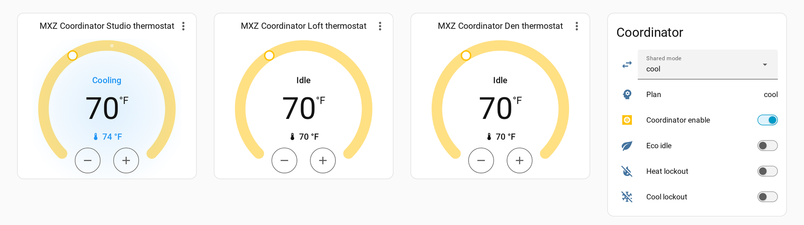
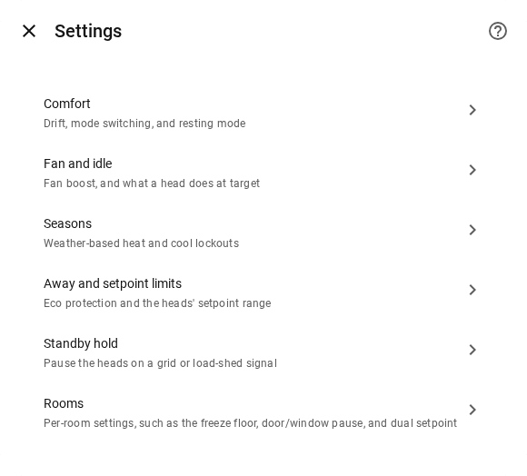

  

<b>Tesla-style Auto for your Mitsubishi multi-split.</b> 
Set a temperature in each room and forget it. Like a Tesla's climate Auto, MXZ picks heat or cool and runs the fan for you.

<picture>
  <source media="(prefers-color-scheme: dark)" srcset="https://raw.githubusercontent.com/dkpnw/ha-mxz-coordinator/main/images/demo-stock-vs-mxz-dark.gif">
  
</picture>

Simulation, sped up 25×. The heads and rooms are invented, and a running head moves its room an invented 1 °F a minute. The top row follows one rule from Mitsubishi's manual for heads that share an outdoor unit: "the unit selected last goes into standby mode." The bottom row is MXZ Coordinator at its default settings. Neither row measures real equipment. [What stock AUTO does, with sources](docs/HOW-IT-WORKS.md#the-problem-in-detail).

  
  

  
  
  
  
  

**Contents:** [What it does](#what-it-does) · [Supported units](#supported-units-and-adapters) ·
[Quick start](#quick-start) · [Everyday use](#everyday-use) ·
[Troubleshooting](#troubleshooting) · [What's new](#whats-new) · [Tune it](#tune-it) ·
[Documentation](#documentation) · [Remove](#remove-the-integration) ·
[Credits](#credits--prior-art)

<!-- Anchors below keep links to sections of the older, longer README working. -->

## What it does

In a Tesla you set a temperature and leave the climate in Auto. Auto picks heating or
cooling, and the fan runs hard while the cabin is far from your number and settles as
it gets close. MXZ Coordinator gives a Mitsubishi multi-split the same Auto.

- **You set temperatures. MXZ picks the mode.** Each room's thermostat takes one target.
  MXZ chooses heat or cool for the whole system and never asks a head for its own AUTO.
- **The fan follows the gap.** A room 4 °F (2 °C) or more off target runs its fan on
  high, or the top speed you allow. The fan steps down through middle, medium, and low to quiet as the room closes
  in. Pick a speed yourself and MXZ holds it until you hand it back.
- **A room that is done steps aside.** Its head stops, so the outdoor unit serves the
  room that still needs it.
- **Nudge it at the wall** (3.22.0 beta). Change a room's setpoint with the head's own
  remote, as you would turn the car's temperature dial, and the room keeps your number.
- **It decides on the room sensor you choose,** not the thermistor in a head mounted up
  near the ceiling. The head's own loop still reads its thermistor unless you
  [feed the firmware the same sensor](docs/HOW-IT-WORKS.md#best-practice-give-the-firmware-your-room-sensor-too).
- **It knows the season and when you're away.** Optional weather lockouts, away limits,
  and a standby hold signal (say, from your utility).
- **One thermostat per room** for Home Assistant dashboards, Apple Home, or Google Home,
  all set up in the UI with no YAML.

One outdoor unit still runs one mode at a time. When rooms want opposite modes, they take
turns in the order you rank them.

Stock, a head set to the mode the outdoor unit isn't running waits in standby. On the
maintainer's two-head system, a room 6 °F past its cooling target drew about 26 W for over
an hour while the other head sat satisfied
([a household observation, with sources](docs/HOW-IT-WORKS.md#the-problem-in-detail)).

| | Stock AUTO | MXZ Coordinator |
| --- | --- | --- |
| Heat or cool | Each head decides alone; the head selected last waits in standby. Some outdoor units have an installer switch that lets the lowest-address head decide for all ([sources](docs/HOW-IT-WORKS.md#the-problem-in-detail)) | One mode for the system, chosen by your room priority |
| A room that's done | Stays in its own mode, which can block the other | Steps aside: fan only, off, or dry the coil (fan only), then off |
| Fan | The head's own fan setting | Speeds up when far off, eases down near target |
| Temperature it decides on | Thermistor in the head | The room sensor you pick |
| Seasons and away | Manual | Weather lockouts, away limits, standby hold |

<picture>
  <source media="(prefers-color-scheme: dark)" srcset="https://raw.githubusercontent.com/dkpnw/ha-mxz-coordinator/main/images/mxz-dashboard-dark.png">
  
</picture>

One target per room, one shared mode: Studio cools while Loft and Den, already at target,
sit idle.

> Shared as-is; support is best-effort. Automated checks use invented heads and sensors.
> They establish software behavior, not physical performance on your equipment.

[How it works](docs/HOW-IT-WORKS.md) walks through each decision, cites the Mitsubishi
manuals on stock AUTO, and has the full list of what MXZ does and why.

## Supported units and adapters

| Unit or adapter | How it is known | Note |
| --- | --- | --- |
| Mitsubishi heads on [echavet/MitsubishiCN105ESPHome](https://github.com/echavet/MitsubishiCN105ESPHome), local | Built for it. Hardware-tested on the maintainer's two-head system. | 2 to 8 heads on one outdoor unit. |
| 4-zone MXZ-4C36NA2 | Tested by a user. | |
| 3-zone and 6-zone systems | Reported by users. Models not stated. | |
| Home Assistant `melcloud`, `kumo_cloud` ([comfort_HA](https://github.com/jjustinwilson/comfort_HA)), `kumo` ([hass-kumo](https://github.com/dlarrick/hass-kumo)) | [Cloud (beta)](#cloud-heads-beta). Tested on invented heads only. One forum report, for comfort_HA. | Fan boost moves one speed every 5 minutes. Timing is minutes, not seconds. |
| Any other `climate` entity with heat and cool | [Generic (beta)](#generic-heads-beta). None verified. | Same fan limit. |
| Simultaneous heat and cool, branch-box VRF | Out of scope. | |
| Cool-only units | Refused in setup. | |

### Cloud heads (beta)

A head that reaches Home Assistant through a cloud integration can be coordinated as a
beta, opt-in for each room: setup suggests **Cloud (beta)** for a `melcloud`,
`kumo_cloud` or `kumo` head, and a room page's **Head type** sets it later. MXZ then
writes each head at most once a minute by default, sends one setpoint past your target,
and steps the fan at most once every 5 minutes. [Cloud heads (beta)](docs/FEATURES.md#cloud-heads-beta)
has the details. If you try it, please
[report how it went](https://github.com/dkpnw/ha-mxz-coordinator/issues/new?template=cloud_beta_report.yml).

### Generic heads (beta)

Any Home Assistant `climate` entity that offers `heat` and `cool`, such as another brand's
mini-split, can be coordinated too: turn on **Generic heads (beta)** on setup's first
page. It is tested only on invented heads, with no user reports yet
([tested by users](docs/FEATURES.md#tested-by-users)).
[Generic heads (beta)](docs/FEATURES.md#generic-heads-beta) has what it needs and what MXZ
does differently. If you try one,
[send a generic head report](https://github.com/dkpnw/ha-mxz-coordinator/issues/new?template=generic-head-report.yml),
good or bad.

## Quick start

You need Home Assistant 2024.12.0 or newer, 2 to 8 heads on one outdoor unit (one entry
per outdoor unit), a `climate` entity for each head that offers heat, cool, and an idle
mode, and a temperature sensor in each room.

1. In HACS, search for **MXZ Coordinator** and select **Download**.
2. Restart Home Assistant.
3. Open **Settings → Devices & services → Add integration → MXZ Coordinator**.
4. **Heads.** Select every head on this outdoor unit, in priority order. Position 1 wins
   when rooms want opposite modes.
5. **Rooms and sensors.** Check each room name, then pick one temperature sensor per
   room.
6. Read the summary, then select **Save and finish**.
7. On the device page, set each room's target, turn on the rooms, then turn on
   **Coordinator enable**. MXZ commands nothing until you do.

**Without HACS:** copy the release's `custom_components/mxz_coordinator` directory into
Home Assistant's `custom_components` directory, restart, then add the integration.
**Coming from the YAML package?** Follow
[Migration](docs/MIGRATION.md#moving-from-the-yaml-package) and stop its automations first.
[Setup in detail](docs/SETUP.md) has a screenshot of every step, what each error means,
and Reconfigure for adding, removing, or reordering heads later.

## Everyday use

Most days you touch nothing. On a cold morning MXZ heats the rooms that are under target,
with the fan highest in the room that is furthest off, and each head stops when its room
reaches your number. If the sun warms one room past its target in the afternoon, MXZ
switches the system to cool for that room and leaves the others alone.

- **Change a temperature** on the room's thermostat, in Home Assistant, Apple Home, or
  Google Home. Leave the mode on Heat/Cool. Expose the room's MXZ thermostat to Apple or
  Google, not the head itself.
- **Or use the head's own remote** (3.22.0 beta). A setpoint set at the head becomes the
  room's target after about 5 seconds. Off at the head turns the room off. MXZ still picks
  heat or cool. To make MXZ the only writer, turn off **Accept changes made at the head**
  in Configure → Comfort.
- **Turn a room off** on its thermostat. MXZ keeps that head off, and the room no longer
  counts toward heat or cool.
- **Pick a fan speed** and MXZ holds it. Turn the room's **Fan auto** switch on to give
  the fan back.
- **Going away?** Turn on **Eco idle**. Rooms ignore their targets, and MXZ heats only
  below 50 °F (10 °C) and cools only above 78 °F (26 °C).
- **Want the heads back?** Turn off **Coordinator enable**. Each head keeps its last state
  and answers to its own controls.

In spring and fall a room can wait. MXZ changes between heat and cool only for a room more
than 3 °F (1.5 °C) off its target, and no sooner than 10 minutes after the last change.
The plan sensor shows which room is waiting and why.

The [feature guide](docs/FEATURES.md#everyday-control) covers every control, including the
shared mode, each room's drift, the lockouts, [who drives the fan](docs/FEATURES.md#who-drives-the-fan),
and [how a satisfied head idles](docs/FEATURES.md#how-a-satisfied-head-idles).

## Troubleshooting

- **Nothing happens after setup?** Turn on **Coordinator enable** and each room.
  [More](docs/TROUBLESHOOTING.md#faq-nothing-happens)
- **A head looks off but its room is enabled?** Usually that room reached its target and
  its head stepped aside. On `sensor.*_plan`, check the room's `sensor_health`, the standby
  hold (`inhibited`), whether it is waiting for the other mode, and its `command_status`.
  [More](docs/TROUBLESHOOTING.md#faq-parked)
- **A room needs heating or cooling but its head waits?** One outdoor unit runs one
  direction at a time. On `sensor.*_plan`, check `standoff`, the room's `demand`, and
  `mode_change_allowed`. [More](docs/TROUBLESHOOTING.md#faq-waiting)
- **I changed a head with its remote and it changed back?** A setpoint or off set at the
  head is kept (3.22.0 beta), but heat instead of cool is not: MXZ picks the mode.
  `auto`, `heat_cool`, and `dry` are put back. [More](docs/TROUBLESHOOTING.md#faq-changed-back)
- **The fan is stuck on one speed?** A speed you pick is held until you turn **Fan auto**
  on. [More](docs/TROUBLESHOOTING.md#faq-fan-stuck)

[Troubleshooting and FAQ](docs/TROUBLESHOOTING.md) has these and more, with what every
plan attribute means. Questions, ideas or a setup to show off? Use
[GitHub Discussions](https://github.com/dkpnw/ha-mxz-coordinator/discussions). Bugs go in
[issues](https://github.com/dkpnw/ha-mxz-coordinator/issues). Everyone taking part follows
the [Code of Conduct](CODE_OF_CONDUCT.md).

### Repair issues

MXZ raises a repair issue in **Settings → System → Repairs** when something it was set up
with has gone and stayed gone. Each one must last 15 minutes without a break, so a blip or
a head that keeps dropping out and coming back raises nothing, and each clears by itself
when the fault does. Issues only inform you: they change nothing about how MXZ runs.

| Issue | What it means | What to do |
| --- | --- | --- |
| **Head is missing or unavailable** | The head has no state, or reads unavailable. | Check the head's integration and connection. If you renamed, disabled, or replaced it, pick the current one in Reconfigure. |
| **Room sensor is missing** | A room's temperature sensor, or the door or window sensor of a room with the pause on, has no state. A sensor that is only unavailable or unknown is not missing: see the room's `sensor_health`. | Check that its integration is loaded and the entity is enabled. If you renamed or replaced it, pick the current one (temperature sensor: Reconfigure; door or window sensor: Configure → Rooms → the room → **Door/window pause**). |
| **Entity no longer exists** | Any entity MXZ is set up to use, such as a vane or a Safety priority sensor, was deleted or renamed. | Pick the current entity or clear the setting (heads and temperature sensors: Reconfigure; everything else: Configure). |

Cloud and generic heads keep their own "not responding" issue instead of the first row.
Restarting Home Assistant or reloading MXZ clears these issues and starts the 15 minutes
again, so one that still applies comes back after that wait.

### Download diagnostics for a bug report

Attach a diagnostics file to a [bug report](https://github.com/dkpnw/ha-mxz-coordinator/issues/new?template=bug_report.yml).
Download it while the problem is happening, or as soon after as you can, because most of
what it holds is MXZ's state at that moment.

Go to **Settings → Devices & services → MXZ Coordinator**, open the ⋮ menu on the entry,
and choose **Download diagnostics**. The device page's ⋮ menu has the same download. This
needs 3.21.0 or newer.

The file has your MXZ settings and, for each room, the head's mode and capabilities, votes,
holds, manual fan picks, door or window pause, mode-change wait, sensor health, and the last
decision with its reasons and times. If one part can't be read, it says why and the rest
still downloads.

- **Removed:** tokens, passwords, API keys, user names, e-mail addresses, MAC addresses,
  serial numbers, IP addresses, host names and URLs, latitude and longitude, cloud account
  identifiers, and notify service names (these are often named after a person's phone).
- **Kept:** room names, the outdoor unit's name, and entity IDs, because a report is hard to
  read without them. Open the file and replace any you'd rather not share. It's plain JSON.

<!-- "whats-new" stays above the newest What's new section; the others are old links. -->

## What's new in 3.21.0

**A °F/°C switch keeps what you saved.** Switch Home Assistant's temperature unit and MXZ
reloads by itself, so its entities show the new unit at once. Room targets and the
temperatures in Configure stay the same temperature (59 °F becomes 15 °C), and drift settings
only scale. A manual fan speed, the shared mode and the mode-change wait carry over. See
[Configuration](docs/CONFIGURATION.md) and [Migration](docs/MIGRATION.md).

**A slow local head no longer reads as a manual fan pick.** MXZ remembers its older fan writes
per head until the head's reports pass them, so a late report doesn't put the room on hold. A
speed MXZ didn't recently write is still held at once. The
[limits](docs/formal/PARKED-FINDINGS.md#f1-limits) are listed.

**Diagnostics and repair issues.** [Download diagnostics](#download-diagnostics-for-a-bug-report)
gives you a file for a bug report, with secrets removed. A [repair issue](#repair-issues)
appears once a head, room sensor or configured entity has been a problem for 15 minutes, and
clears when the fault does. Control and defaults are unchanged.

**Cloud and generic heads (beta).** A fan step no longer stalls behind a new setpoint when the
last fan write wasn't confirmed yet.

3.22.0 is in beta, with Accept changes made at the head; see the
[changelog](CHANGELOG.md#unreleased). Earlier releases are in the [changelog](CHANGELOG.md).
Upgrading from 3.3.0 or earlier? Read [Migration](docs/MIGRATION.md#upgrading-to-340) first.

## Tune it

The defaults are meant to need no tuning. Open **Settings → Devices & services → MXZ
Coordinator → Configure** for a menu of six pages. Each saves only what it shows.

| Page | What you set |
| --- | --- |
| **Comfort** | Allowed drift, Mode switch threshold, Resting mode, Accept changes made at the head (3.22.0 beta), and (under Advanced) the mode-switch wait, uneven drift, how long a lost head's vote counts, and the Comfort priority stale limit. |
| **Fan and idle** | Fan boost and its top speed, and what a room does when it reaches target. |
| **Seasons** | A weather source and the heat and cool lockout temperatures, with safety overrides. |
| **Away and setpoint limits** | The away band, and the lowest and highest setpoint a head may get. |
| **Standby hold** | An optional hold signal, its active state, and what heads do during a hold. |
| **Rooms** | One page per room: its head type, vanes, priority sensors, own-remote and Dry options, and sections for uneven drift, sensor freshness, freeze floor and overheat ceiling, dual setpoint, cloud or generic head timing, and door/window pause. |

<picture>
  <source media="(prefers-color-scheme: dark)" srcset="https://raw.githubusercontent.com/dkpnw/ha-mxz-coordinator/main/images/mxz-configure-menu-dark.png">
  
</picture>

Optional per-room extras, each off until you set it:
[uneven drift](docs/FEATURES.md#uneven-drift),
[dual setpoint](docs/FEATURES.md#give-a-room-separate-heat-and-cool-setpoints-dual-setpoint),
[freeze floor and overheat ceiling](docs/FEATURES.md#freeze-floor-and-overheat-ceiling)
(a new room starts with a 45 °F / 7 °C floor),
[safety priority](docs/FEATURES.md#safety-priority),
[comfort priority](docs/FEATURES.md#comfort-priority),
[running a room from its own remote](docs/FEATURES.md#run-one-room-from-its-own-remote),
[Allow Dry mode](docs/FEATURES.md#allow-dry-mode),
[sensor freshness](docs/CONFIGURATION.md#choose-a-sensor-freshness-contract), and
[door/window pause](docs/FEATURES.md#doorwindow-pause).
[Configuration](docs/CONFIGURATION.md#every-setting-and-its-default) lists every setting
with its default in °F and °C, and [dashboard cards](docs/FEATURES.md#dashboard-cards) has
a tested Mushroom card.

## Documentation

| Page | What's in it |
| --- | --- |
| [Setup](docs/SETUP.md) | Requirements, install, every setup step with screenshots, Reconfigure, and removal. |
| [Configuration](docs/CONFIGURATION.md) | Every setting and default, saving rules, and sensor freshness. |
| [Features](docs/FEATURES.md) | Everyday control, drift, dual setpoint, own-remote rooms, safety and comfort priority, lost heads, cloud and generic heads, door/window pause, freeze floor, fan, idle, and dashboard cards. |
| [How it works](docs/HOW-IT-WORKS.md) | Stock AUTO in Mitsubishi's manuals, how MXZ decides, [feeding the firmware your room sensor](docs/HOW-IT-WORKS.md#best-practice-give-the-firmware-your-room-sensor-too), and limits of control. |
| [Troubleshooting and FAQ](docs/TROUBLESHOOTING.md) | Diagnosing a waiting room, and answers to common questions. |
| [Entity map](docs/ENTITY-MAP.md) | The integration's diagnostic attributes, and what to edit in the legacy YAML package. |
| [Migration](docs/MIGRATION.md) | Upgrade notes for each release, and moving from the YAML package. |
| [Changelog](CHANGELOG.md) | Release notes, newest first. |
| [Credits](docs/CREDITS.md) | Who found, asked for, or built each part, with links, and prior art. |
| [Contributing](CONTRIBUTING.md) and [Developer setup](docs/DEVELOPMENT.md) | Design principles, pull requests, [tested support](docs/DEVELOPMENT.md#tested-support), test lanes, and releasing. |

## Remove the integration

1. Delete the entry through **Settings → Devices & services → MXZ Coordinator → ⋮ →
   Delete**.
2. Then remove its download from HACS. Removing files first leaves a broken entry.

Heads keep their last commanded state; use their own controls if they stay parked.
[Removal details](docs/SETUP.md#remove-the-integration).

## Credits & prior art

MXZ Coordinator got this good because people ran it on their own systems, found the edges, and took the time to write them up. Some sent the fix too. Thank you all. [Credits](docs/CREDITS.md) has what each person did, with every issue and pull request.

- [@BHSPitMonkey](https://github.com/BHSPitMonkey) (Stephen Eisenhauer): Accept changes made at the head, built first on a fork (3.22.0 beta).
- [@calvindomenico](https://github.com/calvindomenico): restart fixes, the °C setpoint rounding fix, a ducted unit's vane fix, and the standby hold.
- [@amosyuen](https://github.com/amosyuen): the room tile's mode fix, per-room drift, and the Integrations listing fix.
- [@andrewblane](https://github.com/andrewblane): 6-zone room names and the parked-room tile fix.
- [@helicopterrun](https://github.com/helicopterrun): 3-zone validation and v3 beta QA.
- [@oliverbrandmueller](https://github.com/oliverbrandmueller): metric units.
- **mw1029** on the [Home Assistant forum](https://community.home-assistant.io/t/1018382): the comfort_HA report that led to cloud heads (beta).
- [@mikepell007](https://github.com/mikepell007) (Michael Pellegrino): cloud heads (beta), the setpoint drive offset, Allow Dry mode, and the door/window pause, from their MIT [mxz_coordinator_blueprint](https://github.com/mikepell007/mxz_coordinator_blueprint). No blueprint code is used.
- [@csingley](https://github.com/csingley) (Chris Singley): own-remote rooms, safety priority, the monotonic mode-change wait, uneven drift, dual setpoint, lost-head votes, votes only while running, and comfort priority. Lost-head votes adapt his MIT-licensed [ha-climate-zone-sequencer](https://github.com/csingley/ha-climate-zone-sequencer); see [NOTICE](NOTICE).

## License

[MIT](LICENSE).

---

*Not affiliated with, endorsed by, or associated with Mitsubishi Electric Corporation or
Tesla, Inc. Their names and marks belong to their owners and are used here for
identification and comparison only.*
