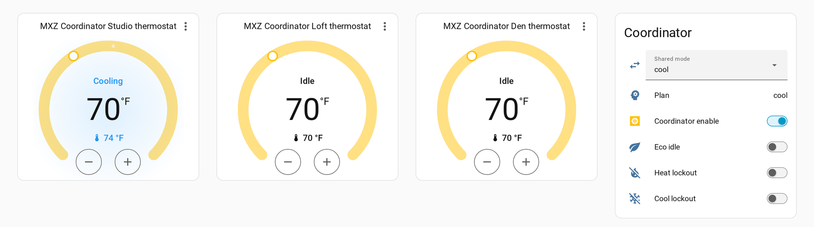
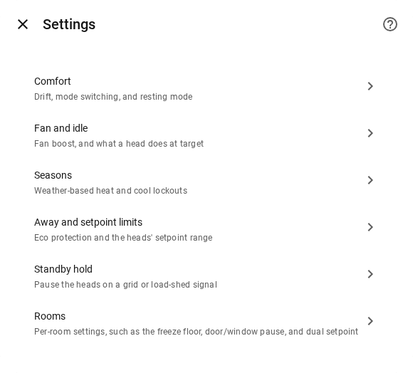

  

<b>Automatic heating, cooling, and fan control for Mitsubishi MXZ multi-zone mini-splits in Home Assistant.</b> 
Set one target temperature in each room. MXZ Coordinator picks a single heat or cool mode for the outdoor unit, scales each head's fan speed with the temperature gap, and parks heads once their rooms reach target.

<picture>
  <source media="(prefers-color-scheme: dark)" srcset="https://raw.githubusercontent.com/dkpnw/ha-mxz-coordinator/main/images/demo-stock-vs-mxz-dark.gif">
  
</picture>

Simulation, sped up 25×. The heads and rooms are invented, and a running head moves its room an invented 1 °F a minute. The top row follows one rule from Mitsubishi's manual for heads that share an outdoor unit: "the unit selected last goes into standby mode." The bottom row is MXZ Coordinator at its default settings. Neither row measures real equipment. [What stock AUTO does, with sources](docs/HOW-IT-WORKS.md#the-problem-in-detail). [More scenarios](docs/HOW-IT-WORKS.md#more-scenarios).

  
  

  
  
  
  
  

**Contents:** [What it does](#what-it-does) · [Supported units](#supported-units-and-adapters) ·
[Quick start](#quick-start) · [Everyday use](#everyday-use) · [Tune it](#tune-it) ·
[Troubleshooting](#troubleshooting) · [What's new](#whats-new) ·
[Documentation](#documentation) · [Remove](#remove-the-integration) ·
[Credits](#credits--prior-art)

<!-- Anchors below keep links to sections of the older, longer README working. -->

## What it does

A Mitsubishi MXZ outdoor unit runs either heating or cooling across all of its indoor heads at once. With Mitsubishi's built-in controls, each head chooses its own mode independently; if one head asks for cooling while another head stays set to heat, the head selected last enters standby and waits. On the maintainer's two-head system, a room 6 °F above its cooling target drew about 26 W for over an hour while the other head sat satisfied in heat ([household observation and manual sources](docs/HOW-IT-WORKS.md#the-problem-in-detail)).

MXZ Coordinator coordinates all indoor heads on an outdoor unit from Home Assistant, with setup and tuning done in the UI and no YAML required:

- **One shared mode for the outdoor unit.** You set one target temperature per room. MXZ Coordinator picks heat or cool for the whole outdoor unit and never sets a head to hardware AUTO. When two rooms want opposite modes, they take turns in the priority order you choose.
- **Parked heads when a room reaches target.** Once a room reaches its target, MXZ Coordinator parks its head—running the fan for 10 minutes to dry the coil after cooling and then turning off by default—so that head does not hold the outdoor unit in its old mode. You can change the idle action to **Fan only** or **Off**.
- **Automatic fan speed.** When a room is 4 °F (2 °C) or more away from its target, MXZ Coordinator sets that head's fan to `high` (or the top speed you allow). As the room approaches target, the fan steps down through `middle`, `medium`, and `low` to `quiet`. If you pick a fan speed yourself, MXZ Coordinator holds it until you hand fan control back.
- **Room-sensor control.** MXZ Coordinator decides when to heat, cool, or park from the Home Assistant temperature sensor you assign to each room rather than the thermistor inside a wall head near the ceiling. Each head's own internal loop still reads its thermistor unless you also [send your room sensor to the ESPHome firmware](docs/HOW-IT-WORKS.md#best-practice-give-the-firmware-your-room-sensor-too).
- **Wall-remote support.** By default, changing a setpoint or turning a head off with its own remote or app updates that room in Home Assistant after about 5 seconds, and turning a head on to heat or cool enables its room again. MXZ Coordinator still owns the shared heat or cool mode.
- **Seasonal lockouts, away limits, and standby holds.** You can connect a weather entity or outdoor sensor to lock out heat in warm weather and cooling in cold weather, switch on **Eco idle** when away, and connect a hold signal such as a utility load-shed or grid-status sensor.
- **One thermostat per room.** Expose each room's MXZ thermostat to Home Assistant dashboards, Apple Home, or Google Home instead of raw head controls.

| Behavior | Mitsubishi built-in AUTO | MXZ Coordinator |
| --- | --- | --- |
| Heat or cool mode | Each head decides alone; the head selected last waits in standby. Some outdoor units have an installer switch (SW9-1) that lets the lowest-address head decide for all ([sources](docs/HOW-IT-WORKS.md#the-problem-in-detail)). | One shared mode for the outdoor unit, settled by your room priority order. |
| Room at target | The head stays in its mode and can block another room from switching. | The head parks in **Dry the coil (fan only), then off** (default), **Fan only**, or **Off**. |
| Fan speed | Controlled by the head's own fan setting. | Steps up when far from target (`quiet` → `low` → `medium` → `middle` → `high`) and eases down near target. |
| Temperature source | The head's built-in thermistor. | The Home Assistant room sensor you pick. |
| Seasons, away, and load shedding | Managed manually. | Optional weather lockouts, away limits, and standby hold. |

<picture>
  <source media="(prefers-color-scheme: dark)" srcset="https://raw.githubusercontent.com/dkpnw/ha-mxz-coordinator/main/images/mxz-dashboard-dark.png">
  
</picture>

Studio cools toward its 70 °F target under the shared cool mode while Loft and Den, already at 70 °F, sit idle.

> Shared as-is with best-effort support. Automated tests use invented heads and sensors, so they verify software behavior rather than physical performance on your equipment.

Read [How it works](docs/HOW-IT-WORKS.md) for the full decision order, Mitsubishi manual citations on built-in AUTO, and limits of control.

## Supported units and adapters

| Unit or adapter | Verification status | Notes |
| --- | --- | --- |
| Mitsubishi heads on [echavet/MitsubishiCN105ESPHome](https://github.com/echavet/MitsubishiCN105ESPHome) (local) | Primary target; hardware-tested on the maintainer's two-head system. | 2 to 8 heads per outdoor unit. |
| 4-zone MXZ-4C36NA2 | Hardware-tested by a user. | |
| 3-zone and 6-zone Mitsubishi systems | Reported working by users; outdoor models not stated. | |
| Home Assistant `melcloud`, `kumo_cloud` ([comfort_HA](https://github.com/jjustinwilson/comfort_HA)), `kumo` ([hass-kumo](https://github.com/dlarrick/hass-kumo)) | [Cloud heads (beta)](#cloud-heads-beta). Tested on invented heads only; one forum report for `comfort_HA`. | Writes at most every 60 s by default (90 s confirm wait); fan boost steps one speed every 5 minutes. |
| Any other `climate` entity with `heat` and `cool` | [Generic heads (beta)](#generic-heads-beta). Tested on invented heads only; no verified user reports yet. | Allows a 1-head entry; 30 s default write interval and confirm wait; same 5-minute fan boost limit. |
| Simultaneous heat and cool, branch-box VRF | Out of scope. | |
| Cool-only units (or heads missing `heat`, `cool`, or a shared idle mode) | Refused during setup. | |

### Cloud heads (beta)

You can coordinate heads connected through a polling cloud integration on a per-room opt-in basis. During initial setup, MXZ Coordinator detects heads from `melcloud`, `kumo_cloud`, or `kumo` and pre-selects **Cloud (beta)** for you to confirm. You can also change a room's **Head type** later under **Configure → Rooms → (room)**. Heads on ESPHome always run as **Local**.

Because cloud integrations poll vendor servers and cannot use your Home Assistant room sensor internally, MXZ Coordinator sends mode and setpoint in batches at most once every **60 seconds** by default (configurable from 30 to 300 seconds), waits **90 seconds** for confirmation (30 to 600 seconds), pushes the commanded setpoint past your target by a **Setpoint drive offset** (default **2 °F / 1 °C**) so the head's own thermistor does not stop it early, and steps fan boost at most one speed every **5 minutes**. Vanes, airflow sensors, dual setpoint, and vote-only-while-running are turned off for cloud rooms. A cloud head unavailable for 15 minutes or silent for 35 minutes raises a repair issue and stops voting until it reports again.

Read [Cloud heads (beta)](docs/FEATURES.md#cloud-heads-beta) for full details. If you test it on real hardware, please [report how it went](https://github.com/dkpnw/ha-mxz-coordinator/issues/new?template=cloud_beta_report.yml).

### Generic heads (beta)

Any Home Assistant `climate` entity that supports `heat`, `cool`, and an idle mode (`off` or `fan_only`)—such as another brand's mini-split, a heating-and-cooling window AC, or a HomeKit-bridged unit—can run under **Generic heads (beta)**. Turn on **Generic heads (beta)** on setup's first page, or choose **Generic (beta)** under **Head type** on a room page. Unlike Mitsubishi entries, a generic entry allows a single head for a unit with its own compressor; select multiple heads in one entry only when they share one outdoor unit. Heads on ESPHome cannot be set to Generic.

Generic heads use the same drive-offset write path and 5-minute fan boost limit as cloud heads, with shorter **30-second** defaults for **Write interval** and **Confirm wait**. Only 15 minutes of `unavailable` marks a generic head unresponsive; staying silent while idle does not. Generic heads have been tested only on invented heads, with no verified user reports yet ([tested by users](docs/FEATURES.md#tested-by-users)). Read [Generic heads (beta)](docs/FEATURES.md#generic-heads-beta) for requirements and limitations, and [send a generic head report](https://github.com/dkpnw/ha-mxz-coordinator/issues/new?template=generic-head-report.yml) if you try one.

## Quick start

HACS became the Marketplace in Home Assistant 2026.11. On an older Home Assistant version, follow [the HACS installation steps](docs/SETUP.md#before-home-assistant-202611-hacs) instead of steps 1–3 below.

Before you start, check that you have:

- Home Assistant **2024.12.0 or newer**.
- **2 to 8 heads** on one outdoor unit (add one MXZ Coordinator entry per outdoor unit), or **1 head** with **Generic heads (beta)** turned on.
- A `climate` entity for each head that advertises `heat`, `cool`, and a shared idle mode (`off` or `fan_only`; the default coil-drying idle action requires both).
- A temperature `sensor` entity for each room (several heads in the same space can share one sensor).

1. Open **Settings → Marketplace** and search for **MXZ Coordinator** (or use the Marketplace badge at the top of this page). The first time you open the Marketplace, read its notice and select **I understand the risks and agree**.
2. Open **MXZ Coordinator**, select **Install**, and select **Install** again in the dialog.
3. Wait for MXZ Coordinator's setup dialog to open. If you close it, open **Settings → Devices & services → Add integration → MXZ Coordinator**. If Home Assistant needs a restart first, a repair in **Settings → System → Repairs** prompts you to restart.
4. **Heads.** Select every indoor head on this outdoor unit in priority order; position 1 wins when rooms want opposite modes. Optionally enter an outdoor unit name and a **Notify on drift** service.
5. **Rooms and sensors.** Confirm each room name (and head type if prompted for cloud heads), then pick a temperature sensor for each room.
6. Review the summary and select **Save and finish**.
7. Open the MXZ Coordinator device page, set each room's target temperature, turn on the rooms you want to coordinate, and turn on **Coordinator enable**. MXZ Coordinator commands nothing until you turn these on.

**Manual installation (without the Marketplace or HACS):** download a release, copy `custom_components/mxz_coordinator` into your Home Assistant `custom_components` directory, restart Home Assistant, and add **MXZ Coordinator** under **Settings → Devices & services → Add integration**.

**Coming from the legacy YAML package?** Follow [Moving from the YAML package](docs/MIGRATION.md#moving-from-the-yaml-package) and stop its automations before enabling this integration on the same heads.

[Setup, Reconfigure, and removal](docs/SETUP.md) includes a screenshot of every setup step, explains setup errors and warnings, and covers **Reconfigure** for adding, removing, renaming, or reordering heads later.

## Everyday use

Most days require no adjustments. On a cold morning, MXZ Coordinator heats the rooms below target, runs the fan fastest in the room furthest off target, and parks each head once its room reaches target. If afternoon sun warms one room past its target, MXZ Coordinator switches the outdoor unit to cool for that room and leaves satisfied rooms parked.

- **Change a room's temperature** on its MXZ thermostat in Home Assistant, Apple Home, or Google Home, leaving the mode on `Heat/Cool`. Expose each room's MXZ thermostat to Apple Home or Google Home rather than the raw head entity so voice or app controls do not compete with the coordinator.
- **Use the head's own remote or app.** With **Accept changes made at the head** enabled (the default), a new setpoint becomes the room's target after about 5 seconds, turning a head off disables its room, and turning a head on to heat or cool enables its room (unless **Let its own remote run it while disabled** is on for that room). MXZ Coordinator still picks the shared heat or cool mode; on cloud or generic heads with a non-zero setpoint drive offset, only on and off are adopted. Turn off **Accept changes made at the head** in **Configure → Comfort** to make MXZ Coordinator the only writer.
- **Turn a room off** on its thermostat or room enable switch. MXZ Coordinator keeps that head off and excludes the room from heat-or-cool decisions.
- **Pick a fan speed** on the room thermostat or head remote and MXZ Coordinator holds it indefinitely. Turn the room's **Fan auto** switch on (or set the head's fan back to `auto`) to return fan control to MXZ Coordinator.
- **Turn on Eco idle when away.** Rooms ignore their normal targets, and MXZ Coordinator heats only below **50 °F (10 °C)** and cools only above **78 °F (26 °C)** by default.
- **Take back manual control** by turning off **Coordinator enable**. Each head keeps its last state and answers directly to its own controls.

In spring and fall, a room asking for the opposite mode can wait before the outdoor unit switches. By default, a room votes to flip between heat and cool only when it is more than **3 °F (1.5 °C)** off target (or wider if its drift is larger), and MXZ Coordinator waits at least **10 minutes (600 seconds)** after the last heat/cool switch. Once a room starts running in the active mode (after drifting more than **1 °F / 0.5 °C** off target by default), it runs all the way back to target before coasting. Check `sensor.*_plan` to see which room is waiting and why.

Read the [Feature guide](docs/FEATURES.md#everyday-control) for every control, including the shared mode selector, per-room drift, seasonal lockouts, [fan control](docs/FEATURES.md#who-drives-the-fan), and [idle parking](docs/FEATURES.md#how-a-satisfied-head-idles).

## Tune it

Most installations work with the defaults. Open **Settings → Devices & services → MXZ Coordinator → Configure** to open a six-page menu where each page saves only the settings it displays.

| Page | What you configure |
| --- | --- |
| **Comfort** | **Allowed drift**, **Mode switch threshold**, **Resting mode**, **Accept changes made at the head**, and under **Advanced**: **Minimum time between mode switches**, uneven drift (**Let it get cooler by** / **Let it get warmer by**), **Keep a lost head's vote for** (default 30 minutes), and **Comfort priority stale limit** (default 12 hours). |
| **Fan and idle** | **Fan boost**, **Fan boost top speed**, **When a room reaches target** (**Dry the coil (fan only), then off**, **Fan only**, or **Off**), and **Coil drying time** (default 10 minutes). |
| **Seasons** | **Weather source** (a weather entity's daily forecast or an outdoor temperature sensor), heat and cool lockout temperatures (default 68 °F / 20 °C and 50 °F / 10 °C), and **Safety overrides** (**Heat anyway below** 58 °F / 14 °C and **Cool anyway above** 80 °F / 27 °C). |
| **Away and setpoint limits** | **Away low limit** (50 °F / 10 °C), **Away high limit** (78 °F / 26 °C), and **Head setpoint range** (**Lowest setpoint** 59 °F / 15 °C and **Highest setpoint** 88 °F / 31 °C). |
| **Standby hold** | **Hold signal** (an optional grid, load-shed, or vacation entity), **Active state** (`on` or `off`), and **During a hold** (`eco`, `off`, or `fan_only`). |
| **Rooms** | One page per room: **Head type**, **Airflow sensor**, **Vertical vane**, **Horizontal vane**, **Safety priority sensor**, **Comfort priority**, **Let its own remote run it while disabled**, **While its own remote runs it, its vote counts**, **Allow Dry mode**, and sections for **Uneven drift**, **Sensor freshness**, **Freeze floor and overheat ceiling**, **Dual setpoint**, **Cloud or generic head (beta)**, and **Door/window pause**. |

<picture>
  <source media="(prefers-color-scheme: dark)" srcset="https://raw.githubusercontent.com/dkpnw/ha-mxz-coordinator/main/images/mxz-configure-menu-dark.png">
  
</picture>

**On by default for new rooms (3.16.0 and newer):** Setup and Reconfigure give each new room a **45 °F (7 °C)** [freeze floor](docs/FEATURES.md#freeze-floor-and-overheat-ceiling) (active while the room is disabled, with no overheat ceiling) and a **6-hour (360-minute)** [sensor freshness limit](docs/CONFIGURATION.md#choose-a-sensor-freshness-contract) using **Every update is a new reading**. If a room's temperature sensor reports only when its reading changes, clear **Maximum age** on that room's page so steady room temperatures do not mark the sensor stale. Rooms created before 3.16.0 keep their existing settings.

**Opt-in per-room extras (off until enabled):** [per-room uneven drift](docs/FEATURES.md#per-room-uneven-drift), [dual setpoint](docs/FEATURES.md#give-a-room-separate-heat-and-cool-setpoints-dual-setpoint), [overheat ceiling](docs/FEATURES.md#freeze-floor-and-overheat-ceiling), [safety priority](docs/FEATURES.md#safety-priority), [comfort priority](docs/FEATURES.md#comfort-priority), [running a room from its own remote while disabled](docs/FEATURES.md#run-one-room-from-its-own-remote), [Allow Dry mode](docs/FEATURES.md#allow-dry-mode), and [door/window pause](docs/FEATURES.md#doorwindow-pause).

See [Configuration](docs/CONFIGURATION.md#every-setting-and-its-default) for every setting and its °F and °C defaults, and [Dashboard cards](docs/FEATURES.md#dashboard-cards) for a tested Mushroom climate card.

## Troubleshooting

- **Nothing runs after setup.** Turn on **Coordinator enable** and each room's enable switch (or set each room thermostat to `Heat/Cool`). [More](docs/TROUBLESHOOTING.md#faq-nothing-happens)
- **A head looks off while its room is enabled.** Usually the room reached its target and parked under the idle action. On `sensor.*_plan`, check the room's `sensor_health`, `inhibited` (standby hold), whether it is waiting for the opposite mode, and `command_status`. [More](docs/TROUBLESHOOTING.md#faq-parked)
- **A room needs heating or cooling, yet its head waits.** One outdoor unit runs one direction at a time. On `sensor.*_plan`, check `standoff`, the room's `demand`, and `mode_change_allowed`. [More](docs/TROUBLESHOOTING.md#faq-waiting)
- **A change made with the head's remote switched back.** MXZ Coordinator keeps a setpoint or `off` set at the head (when **Accept changes made at the head** is on), and restores the coordinated mode if someone picks the opposite direction (`heat` vs. `cool`) or sets `auto`, `heat_cool`, or `dry` (unless **Allow Dry mode** is on for that room). [More](docs/TROUBLESHOOTING.md#faq-changed-back)
- **The fan stays on one speed.** Picking a fan speed sets a hold with no timeout. Turn the room's **Fan auto** switch on (or set the head's fan to `auto`) to hand fan control back. [More](docs/TROUBLESHOOTING.md#faq-fan-stuck)

Read [Troubleshooting and FAQ](docs/TROUBLESHOOTING.md) for the full list of plan sensor attributes and more answers. Ask questions or share setups in [GitHub Discussions](https://github.com/dkpnw/ha-mxz-coordinator/discussions), and report bugs in [GitHub Issues](https://github.com/dkpnw/ha-mxz-coordinator/issues). Everyone participating follows the [Code of Conduct](CODE_OF_CONDUCT.md).

### Repair issues

MXZ Coordinator creates a warning in **Settings → System → Repairs** when a configured entity stays missing, unavailable, or deleted for **15 minutes** continuously. Brief dropouts and flapping connections raise no issue, and each issue clears automatically once the fault resolves. Repair issues only alert you and do not change how MXZ Coordinator runs.

| Issue | What it means | What to do |
| --- | --- | --- |
| **Head is missing or unavailable** | A local head has no state or reads `unavailable`. | Check the head's integration and network connection. If you renamed, disabled, or replaced the entity, pick the current one in **Reconfigure**. |
| **Room sensor is missing** | A room's temperature sensor—or its door/window sensor when the pause is enabled—has no state in Home Assistant. A sensor reading `unavailable` or `unknown` appears in the room's `sensor_health` instead. | Confirm the sensor's integration is loaded and the entity is enabled. If you renamed or replaced it, update it in **Reconfigure** (temperature sensor) or **Configure → Rooms → (room) → Door/window pause** (door/window sensor). |
| **Entity no longer exists** | Any configured entity (such as a vane, airflow sensor, weather source, hold signal, or Safety/Comfort priority entity) was deleted or renamed. | Pick the current entity or clear the setting in **Reconfigure** (heads and temperature sensors) or **Configure** (everything else). |

Cloud and generic heads raise their own **not responding** repair issue (`Cloud head … is not responding` or `Generic head … is not responding`) instead of **Head is missing or unavailable**, though deleting their entity still raises **Entity no longer exists**. Restarting Home Assistant or reloading MXZ Coordinator clears active repair issues and restarts the 15-minute wait.

### Download diagnostics for a bug report

Attach a diagnostics file when filing a [bug report](https://github.com/dkpnw/ha-mxz-coordinator/issues/new?template=bug_report.yml). Download it while the problem is happening—or as soon afterward as possible—because most of the file captures live coordinator state.

Go to **Settings → Devices & services → MXZ Coordinator**, open the ⋮ menu on the integration entry, and choose **Download diagnostics** (the device page's ⋮ menu has the same download). This requires MXZ Coordinator 3.21.0 or newer.

The JSON file contains your MXZ Coordinator settings, active repair issues, and per-room state: head modes and capabilities, votes, holds, manual fan overrides, door/window pause state, mode-change wait timers, sensor health, cloud or generic head status, and the last computed decision with reasons and timestamps. If one section fails to read, it records the error and the rest of the file still downloads.

- **Removed:** tokens, passwords, API keys, user names, e-mail addresses, MAC addresses, serial numbers, IP addresses, host names and URLs, latitude and longitude, cloud account identifiers, and notify service names (which are often named after a person's phone).
- **Kept:** room names, the outdoor unit's name, and entity IDs, which keep the report readable. Because the file is plain JSON, you can inspect and replace any names before posting.

<!-- "whats-new" stays above the newest What's new section; the others are old links. -->

## What's new in 3.23.0

- **One sensor for several heads.** Two or more heads in the same space can now share one room temperature sensor. Setup and Reconfigure accept a sensor already assigned to another room, while each head keeps its own target, switches, freshness limit, freeze floor, and fan hold. Requested by [@danolson1](https://github.com/danolson1) in [Discussion #145](https://github.com/dkpnw/ha-mxz-coordinator/discussions/145); see [One sensor for several heads](docs/SETUP.md#one-sensor-for-several-heads).
- **Crash-safe room state.** MXZ Coordinator now saves each room's targets, switches, manual fan holds, freeze-floor state, and head-write memory in its own store immediately on change, instead of waiting for Home Assistant's 15-minute restore snapshots. A crash or power cut no longer rolls back recent edits, and disabling a helper entity in the entity registry no longer resets its room on the next start.
- **Restart and lockout fixes.** A head that reports MXZ Coordinator's own setpoint late after a restart is no longer read as a manual press at the head, a setpoint MXZ Coordinator sent twice no longer overrides a person's later press, and **Heat lockout** and **Cool lockout** hold their prior states after a restart until the weather source reports (for up to an hour).

When you start Home Assistant after upgrading, MXZ Coordinator migrates your config entry (to v2.3, storing each setting once) and moves existing room state into the new store with every value kept; no manual steps are required. See [Migration](docs/MIGRATION.md#each-rooms-state-is-kept-in-one-store-3230).

Earlier releases are in the [Changelog](CHANGELOG.md). Upgrading from 3.3.0 or earlier? Read [Upgrading to 3.4.0](docs/MIGRATION.md#upgrading-to-340) first.

## Documentation

| Guide | Covers |
| --- | --- |
| [Setup](docs/SETUP.md) | Requirements, Marketplace/HACS/manual install, every setup step with screenshots, Reconfigure, and removal. |
| [Configuration](docs/CONFIGURATION.md) | Every Configure setting with °F and °C defaults, validation and saving rules, and sensor freshness contracts. |
| [Features](docs/FEATURES.md) | Everyday control, drift, dual setpoint, own-remote rooms, safety and comfort priority, unavailable heads, cloud and generic heads, door/window pause, freeze floor and overheat ceiling, fan control, idle parking, and dashboard cards. |
| [How it works](docs/HOW-IT-WORKS.md) | Built-in AUTO in Mitsubishi's manuals, MXZ Coordinator's decision order, [sending your room sensor to the ESPHome firmware](docs/HOW-IT-WORKS.md#best-practice-give-the-firmware-your-room-sensor-too), and limits of control. |
| [Troubleshooting and FAQ](docs/TROUBLESHOOTING.md) | Reading `sensor.*_plan` attributes to diagnose a waiting room, and answers to common questions. |
| [Entity map](docs/ENTITY-MAP.md) | Diagnostic attributes on MXZ Coordinator entities, and entity mapping for the legacy YAML package. |
| [Migration](docs/MIGRATION.md) | Upgrade notes for every release, and moving from the legacy YAML package. |
| [Changelog](CHANGELOG.md) | Release notes, newest first. |
| [Credits](docs/CREDITS.md) | Contributor reports, fixes, and prior art with issue and pull request links. |
| [Contributing](CONTRIBUTING.md) and [Developer setup](docs/DEVELOPMENT.md) | Design principles, pull requests, [tested support](docs/DEVELOPMENT.md#tested-support), test lanes, and releasing. |

## Remove the integration

1. Delete the entry under **Settings → Devices & services → MXZ Coordinator → ⋮ → Delete**.
2. Uninstall the files: in **Settings → Marketplace**, open **MXZ Coordinator**, open the ⋮ menu in the upper-right corner, and choose **Uninstall**. Before Home Assistant 2026.11, remove the download from HACS instead. Always delete the entry before removing files so Home Assistant does not leave a broken entry.

Heads keep their last commanded state after removal; use their own controls if any head stays parked. See [Remove the integration](docs/SETUP.md#remove-the-integration) for details.

## Credits & prior art

Contributors ran MXZ Coordinator on their own systems, reported edge cases, and sent fixes. See [Credits](docs/CREDITS.md) for every issue, pull request, and prior-art link.

- [@danolson1](https://github.com/danolson1) (Daniel Olson): one temperature sensor for several heads (3.23.0).
- [@BHSPitMonkey](https://github.com/BHSPitMonkey) (Stephen Eisenhauer): Accept changes made at the head, built first on a fork (3.22.0).
- [@calvindomenico](https://github.com/calvindomenico): restart fixes, the °C setpoint rounding fix, a ducted unit's vane fix, and the standby hold.
- [@amosyuen](https://github.com/amosyuen): the room tile's mode fix, per-room drift, and the Integrations listing fix.
- [@andrewblane](https://github.com/andrewblane): 6-zone room names and the parked-room tile fix.
- [@helicopterrun](https://github.com/helicopterrun): 3-zone validation and v3 beta QA.
- [@oliverbrandmueller](https://github.com/oliverbrandmueller): metric units.
- **mw1029** on the [Home Assistant forum](https://community.home-assistant.io/t/1018382): the `comfort_HA` report that led to cloud heads (beta).
- [@mikepell007](https://github.com/mikepell007) (Michael Pellegrino): cloud heads (beta), the setpoint drive offset, Allow Dry mode, and the door/window pause, adapted from their MIT [mxz_coordinator_blueprint](https://github.com/mikepell007/mxz_coordinator_blueprint). No blueprint code is used.
- [@csingley](https://github.com/csingley) (Chris Singley): own-remote rooms, safety priority, the monotonic mode-change wait, uneven drift, dual setpoint, lost-head votes, votes only while running, and comfort priority. Lost-head votes adapt his MIT-licensed [ha-climate-zone-sequencer](https://github.com/csingley/ha-climate-zone-sequencer); see [NOTICE](NOTICE).

## License

[MIT](LICENSE).

---

*Not affiliated with, endorsed by, or associated with Mitsubishi Electric Corporation. Its names and marks belong to their owner and are used here for identification only.*
