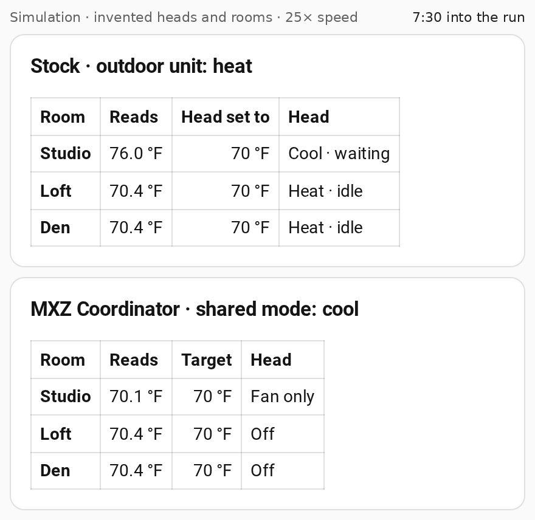

# How it works

Why MXZ exists, how it decides, and where its control stops. The
[README](../README.md) has the short version.

- [The problem in detail](#the-problem-in-detail)
- [How MXZ decides](#how-mxz-decides)
- [Best practice: give the firmware your room sensor too](#best-practice-give-the-firmware-your-room-sensor-too)
- [Service-manual note: a parked room warming in heating season](#service-manual-note-a-parked-room-warming-in-heating-season)
- [Limits of control](#limits-of-control)

## The problem in detail

**What the manual says.** For the cited
[MSZ-FH25VE/FH35VE/FH50VE indoor units, PDF page 7](https://library.mitsubishielectric.co.uk/pdf/download_full/56),
COOL/DRY/FAN and HEAT cannot run at the same time when several indoor units share one
outdoor unit: "the unit selected last goes into standby mode." AUTO selects from that
indoor unit's room temperature and setpoint, and changes mode only after a sustained
difference. The manual does not recommend AUTO on an MXZ outdoor unit and warns that a
unit may be unable to switch between COOL and HEAT and enter standby.

<picture>
  <source media="(prefers-color-scheme: dark)" srcset="https://raw.githubusercontent.com/dkpnw/ha-mxz-coordinator/main/images/demo-stock-vs-mxz-end-dark.png">
  
</picture>

The README's simulation applies only that rule to invented heads: the room selected last,
Studio, is still waiting at the end of the stock row. It says nothing about how long a real
head waits.

By default that is first come, first served, not one room governing the system. Some
outdoor units can be set up otherwise. For the MXZ-4C36NAHZ to 8C60NA families in
[OCH573E, PDF page 127](https://www.mitsubishitechinfo.ca/sites/default/files/SH_MXZ-%284%29%285%29%288%29C%2836%29%2842%29%2848%29%2860%29NA%28HZ%29_PAC-MKA%2830%29%2831%29%2850%29%2851%29BC_OCH573E_1.pdf),
outdoor switch SW9-1 (off by default, set before power-on) "enables the indoor unit with
the minimum address to select AUTO mode, and switches the operation mode of the other
indoor units to the same mode." The same manual's
[page 108](https://www.mitsubishitechinfo.ca/sites/default/files/SH_MXZ-%284%29%285%29%288%29C%2836%29%2842%29%2848%29%2860%29NA%28HZ%29_PAC-MKA%2830%29%2831%29%2850%29%2851%29BC_OCH573E_1.pdf)
shows a CN3N external input that sets heating or cooling through an adapter
(PAC-SC36NA-E). Whether either is set on your system is an installer question; the
manuals do not say how other models behave.

**What it looks like in practice.** On the maintainer's two-head system, a room 6 °F
past its cooling target drew **~26 W for over an hour** while the other head was
satisfied. After that head was turned off, the room ramped to ~460 W and cooled. This is
a household observation, not a controlled comparison or a measured energy, comfort,
noise, or equipment-life result.

**The same scenario, coordinated:** both rooms served within minutes instead of an hour of
starvation.

```
elapsed    draw       what's happening
0:20       675 W      hot room cooling hard; satisfied room idle in fan_only
1:20–3:40   45 W      compressor anti-short-cycle pause (~2.5 min — normal)
4:00–6:20  101→609 W  both rooms served, sustained
```

**Mitsubishi's own alternative: kumo cloud changeover groups.** Basic AUTO is not the
only manufacturer option. The
[kumo cloud® 2.22 technician manual, pages 15–17](https://www.mitsubishitechinfo.ca/sites/default/files/TM_Kumo_Cloud_2.22_ver.13_FINAL-2-20250917.pdf)
documents optional changeover groups for some MXZ systems, including zone priorities,
maximum standby, and minimum run time. That is a relevant alternative where its
supported hardware and setup apply. It is not tested for parity with this integration.

**Mitsubishi's standby lamp** means a head set, by its remote or stock AUTO, to the mode
the system is not running. Under MXZ a waiting head is parked by command instead.

## How MXZ decides

A Tesla's climate Auto takes one temperature and picks heating or cooling for
you. MXZ gives a Mitsubishi multi-split the same Auto, one outdoor unit at a time; the
[README](../README.md#what-it-does) has the short version.

Every core feature exists for a reason someone ran into:

| MXZ does this | So that |
| --- | --- |
| **Picks one heat or cool mode for the whole system**, from every room's temperature and target. It never asks a head for hardware AUTO. | Coordinated rooms stop fighting over heat versus cool, and the shared direction follows the rooms that need it, not whichever head was set first. |
| **Settles a standoff by your room order**, and by default waits 10 minutes between heat/cool switches (Minimum time between mode switches). | The room you rank first wins, and the mode won't flip back and forth. |
| **Has a room that's done step aside.** On a new setup its head runs the fan to dry the coil after cooling, then turns off (**Dry the coil (fan only), then off**); Fan only and Off are also available. This isn't the heads' Dry (dehumidify) mode; see [Allow Dry mode](FEATURES.md#allow-dry-mode). | The rooms that still need conditioning get served, and the coil dries before the head closes up. |
| **Lets a room coast** inside its drift (1 °F / 0.5 °C by default) before it runs again, then runs it all the way back to target. | A room that's close enough rests, and every run finishes where you asked. |
| **Decides on the temperature sensor you pick** for each room. | Heat, cool, and when a room is done follow the room you sit in, not a thermistor up near the ceiling. The head's own loop still reads its thermistor unless you [give the firmware your room sensor too](#best-practice-give-the-firmware-your-room-sensor-too). |
| **Boosts the fan** the further a room is from target, up to a top speed you choose, and eases it down as the room closes in. A speed you pick by hand is kept until you hand it back. | The fan works hard only while a room is far off. |
| **Gives each room one thermostat** for Home Assistant dashboards, Apple Home, or Google Home, all set up in the UI with no YAML. | One clean control per room, instead of raw head controls that can fight the plan. |
| **Puts a head back** if someone switches it to auto, `heat_cool`, or `dry` (unless the room allows Dry mode), and can notify you when that happens. From 3.22.0, a setpoint or off set at the head isn't put back: the room takes it. That is on by default for every install, existing ones included. To have MXZ put those back too, turn off **Accept changes made at the head** in Configure → Comfort. | A stray remote press doesn't quietly break coordination. |
| **Follows the season** from a weather forecast or outdoor sensor, with heat-anyway and cool-anyway safety limits. | No heating on a day forecast to be warm, or cooling on a cold one. |
| **Holds an empty house between away limits** (the Eco idle switch), and can **pause on a standby signal** such as a utility load-shed. | Less running when nobody's home, and a clean response to a grid or utility hold. |
| **Keeps a lost head's last vote for a while** (30 minutes by default), then lets it go. | A short Wi-Fi dropout doesn't swing the shared mode, and a long one doesn't hold it forever. |
| **Shows its reasoning** on one plan sensor: each room's demand, start points, sensor health, and command status. | When a room waits, you can see why. |

On every update (a room sensor or head report, a setting change, and a 15-minute check)
MXZ works out one plan for the outdoor unit:

1. **Each enabled room reads its own sensor.** A room with an invalid reading, or a stale
   one under its [freshness contract](CONFIGURATION.md#choose-a-sensor-freshness-contract),
   makes no automatic demand. Neither does a room [paused for an open door or
   window](FEATURES.md#doorwindow-pause): it has no demand and no run, and its head is
   off. A pause or resume never moves the mode-change wait; a resume that would flip the
   mode waits it out like any room.
2. **Each room asks for a mode only when it is well off target.** Past the **Mode switch
   threshold** (default 3 °F / 1.5 °C), or that side's drift if wider, a room votes for
   heat or cool. Closer than that, it reads `neutral` and waits.
3. **One shared mode is chosen.** Wants are ranked: a tripped
   [freeze floor](FEATURES.md#freeze-floor-and-overheat-ceiling) first; then, by room
   priority, rooms whose [Safety priority](FEATURES.md#safety-priority) sensor is `on`
   and tripped overheat ceilings; then enabled rooms in priority order (position 1 wins a
   standoff, unless a room's [Comfort priority](FEATURES.md#comfort-priority) entity puts
   it ahead of rooms with less). A room [run from its own remote](FEATURES.md#run-one-room-from-its-own-remote)
   counts only when no enabled room is calling or still running to its target, unless its
   Safety priority sensor is `on`. A reversal
   waits out **Minimum time between mode switches** (default 600 seconds). With no room
   calling and none still running to its target in the shared mode, **Resting mode** picks
   the mode.
4. **Rooms in that mode run; the rest step aside.** A room runs once it drifts past its
   band (**Allowed drift**, default 1 °F / 0.5 °C, or its own
   [drift](FEATURES.md#drift-when-a-room-starts-a-run)) and keeps running until it reaches
   its target, even once it is back inside the Mode switch threshold: Resting mode waits
   for it. Only a want ranked in step 3 (another room's call for the other mode, a Safety
   priority room's or a tripped floor's), or your pick on the shared-mode select, takes the
   mode from a running room. A satisfied room, and a room waiting for the other mode, parks
   by [the idle action](FEATURES.md#how-a-satisfied-head-idles).
5. **Your gates bound all of it.** Coordinator enable, room enables, seasonal lockouts,
   eco/away limits, and a standby hold limit what is commanded.
6. **Commands go out.** Mode, a bounded setpoint, and, under fan boost, a fan speed for
   each head. MXZ never requests hardware AUTO, `heat_cool`, or `dry` on a head, and puts
   an enabled room's head back if someone sets one (a `dry` stays in a room with
   [Allow Dry mode](FEATURES.md#allow-dry-mode) on; that head then votes cool).

The plan, with each room's reasons, is on `sensor.*_plan`; see
[Diagnose a room that is waiting](TROUBLESHOOTING.md#diagnose-a-room-that-is-waiting).

**Setpoints sent to the heads.**

- In a room with one target, **range heads** (`target_temp_low`/`high`) get a band:
  target − 2 °F to the target when cooling, the target to target + 2 °F when heating (a
  1 °C band on a °C system). **Single-setpoint heads**, common on MXZ indoor units, get the
  target itself.
- A [dual-setpoint](FEATURES.md#give-a-room-separate-heat-and-cool-setpoints-dual-setpoint)
  room uses its Heat to edge in place of the target while heating, and its Cool to edge
  while cooling. A range head gets the same band built from that edge, and a
  single-setpoint head gets the edge itself.
- Setpoints are rounded to 1 °F or 0.5 °C and kept within Configure's Lowest/Highest
  setpoint and the head's own limits.
- A head that only holds 0.5 °C steps (ESPHome CN105) in a °F system shows some whole-°F
  setpoints 0.5 °F off, such as 64.5 for 64. Since 3.4.1 MXZ compares on the head's own
  steps and does not re-send. See
  [Setpoints on °C-native heads](MIGRATION.md#setpoints-on-c-native-heads-in-a-f-system-341).
- While eco/away is on, heads get fixed eco setpoints instead of the room target.
- A parked head (`fan_only` or `off`) is sent a mode only, so it keeps its last setpoint.

## Best practice: give the firmware your room sensor too

The coordinator reads your room sensors, but each head's own control loop still runs on
its internal thermistor. On the system MXZ was developed on, that reading was several
degrees warmer than the occupied room while idle; other models and placements can
differ.

Feed the SAME room sensor to the firmware so both layers use one reading. On CN105/ESPHome
that is a `homeassistant` sensor bound via `remote_temperature_source`:

```yaml
sensor:
  - platform: homeassistant
    id: remote_temp_ha
    entity_id: sensor.your_room_temperature   # the same sensor you give the coordinator
    filters:
      - lambda: return (x - 32) * (5.0/9.0);  # only if your HA runs °F
      - clamp:                                # the firmware accepts 1–40 °C
          min_value: 1
          max_value: 40
          ignore_out_of_range: true

climate:
  - platform: cn105
    # ...
    remote_temperature_source:
      sensor_id: remote_temp_ha
    remote_temperature_timeout: 30min
    remote_temperature_keepalive_interval: 20s
```

The timeout is the safety: if the sensor drops out, the head falls back to its internal
reading instead of holding a stale number.

## Service-manual note: a parked room warming in heating season

For the MXZ-4C36NAHZ, 5C42NAHZ, 8C48NAHZ, 8C48NA, and 8C60NA families covered by
[OCH573E, PDF page 126](https://www.mitsubishitechinfo.ca/sites/default/files/SH_MXZ-%284%29%285%29%288%29C%2836%29%2842%29%2848%29%2860%29NA%28HZ%29_PAC-MKA%2830%29%2831%29%2850%29%2851%29BC_OCH573E_1.pdf),
Mitsubishi documents SW5-8 as a countermeasure against room-temperature rise in parked
indoor units. Enabling it before power-on fully closes the indoor electronic expansion
valve in FAN, COOL, STOP, or thermo-OFF. The same row warns that refrigerant can collect
in thermo-OFF units, reducing capacity and raising discharge temperature.

This supports a model-specific explanation for why a parked room can warm in heating
season. It does not show whether SW5-8 is enabled, prove the actual valve position, or
measure the temperature effect in your installation. The idle action commands airflow and
power; `off` is not a refrigerant-seal setting.

## Limits of control

**If Home Assistant goes down**, heads use their own loops. A head last commanded cooling
can continue cooling; one last parked stays parked. Their thermistors and firmware
safeguards still matter. On the system MXZ was developed on, compressor pauses and
reversal lag outlast the HA mode report.

**Failures and what they reach**

- A global update failure can make the plan and coordinator-listening entities
  unavailable, even while heads remain registered.
- Room isolation covers independent head delivery failures; it is not a guarantee against
  every coordinator, core, or transport failure.
- Reload/unload suppresses retired follow-on work, but cannot undo an accepted external
  call.
- A vane kick on a parked head briefly wakes it, sends the requested vane change, and
  requests parking; software cleanup still needs hardware confirmation.

**Diagnostics and your automations.** The thermostat, Fan auto switch, and plan's `zones`
include added diagnostics listed in
[Entity map](ENTITY-MAP.md#integration-diagnostic-surfaces-340).

- Delivery changes publish immediately, even outside refresh completion.
- A head update the room thermostat does not display, such as the head's own temperature
  reading, adds no thermostat `state_changed` event.
- Delivery progress, fan state, and reason changes still update these attributes, which
  can add recorder history/storage and fire automations with a bare state trigger. Use an
  explicit state transition or selected attribute when that is your automation's intent.
- Exact database rows, bytes, and hourly growth have not been measured.

**How refreshes are coalesced.** Sensor refreshes already covered by a newer decision are
coalesced by generation. Pending delivery can prompt a follow-up outside the ordinary
debounce; several requests can collapse into that follow-up. There is no
one-compute-per-sensor-write guarantee.
