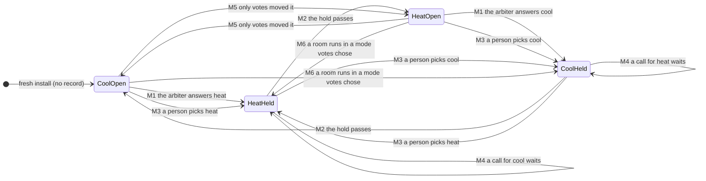
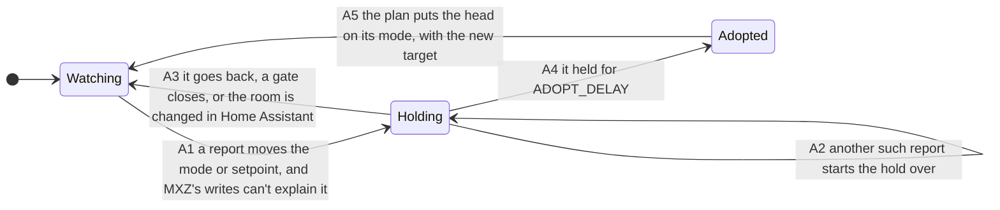
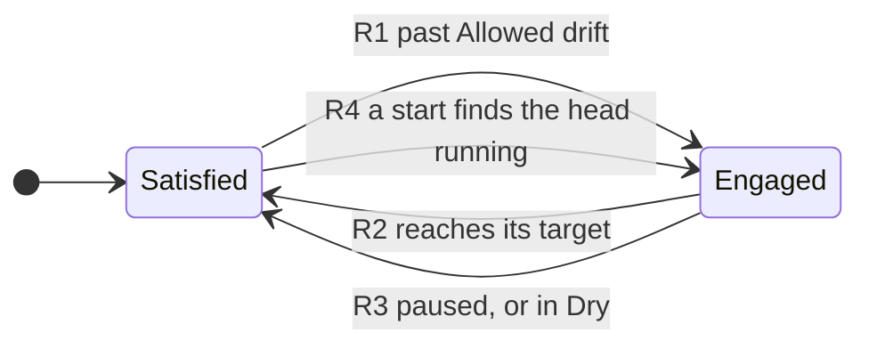
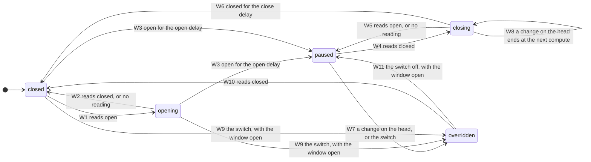
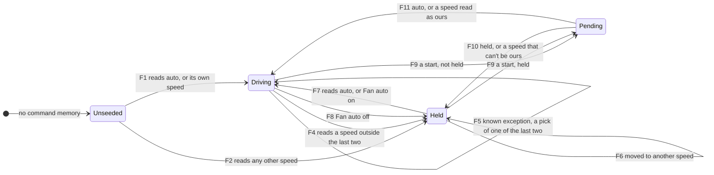
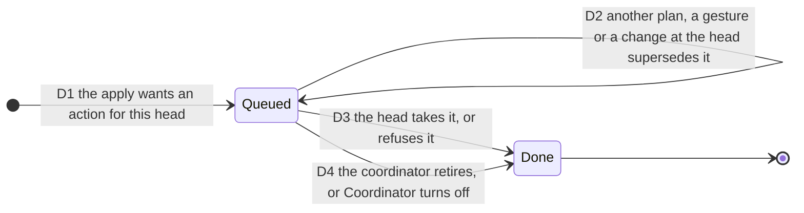
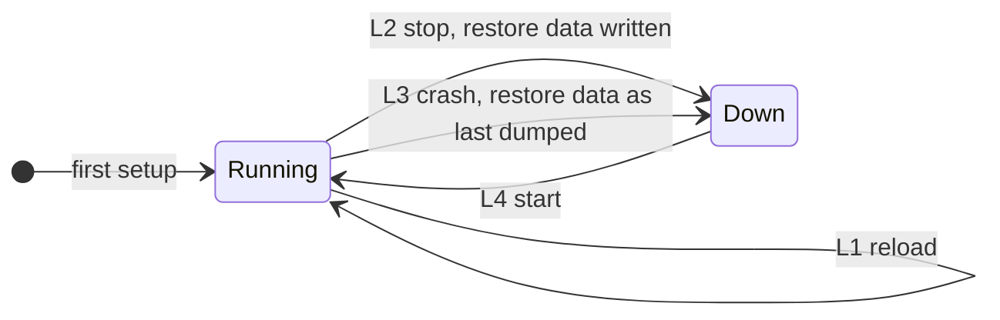

# Statechart of the coordinator

This is the machine [`tla/MXZCoordinator.tla`](tla/MXZCoordinator.tla) checks, as a chart. It
was read from `custom_components/mxz_coordinator/`. It runs as six parallel regions: the
shared mode, each room's run, a room's door/window, a head's fan, an apply's commands, and the
coordinator's lifecycle, with changes made at a head beside them. [README.md](README.md) says what is and isn't modeled, and which rules are
checked on it.

Everything in the key is a `file` and a `function` under `custom_components/mxz_coordinator/`.
`tests/test_formal_contract.py` fails if a name here stops existing.

One compute and apply is one step of the machine. `MXZCoordinator._compute` decides and
commands no head (it does save the door/window store and send notices).
`MXZCoordinator._apply` queues each head's command, records the mode change before any of
them runs, then waits for them. Every region below advances inside that step, except where
the key says a report or a gesture moves it at once, and the
[apply's commands](#an-applys-commands), which are steps of their own in `ci-apply`.

## Shared mode and the hold

One outdoor unit runs one direction. A hold follows every real change of it.

| Id | What happens | Code |
| --- | --- | --- |
| M1 | With the gate open, the first calling room in rank order decides. With nothing calling, Resting mode decides, once no room still runs in the shared mode. The new mode is stamped and stored before any head is sent it. | `coordinator.py` `_compute`, `logic.py` `arbitrate`, `logic.py` `shared_mode`, `coordinator.py` `_apply`, `coordinator.py` `_write_back_mode`, `coordinator.py` `_stamp_mode_change`, `coordinator.py` `_record_mode` |
| M2 | The gate reads `elapsed >= hysteresis` on the monotonic clock. A timer re-renders the entities at the hold's end and decides nothing; another wakes the plan for a flip the hold deferred. | `coordinator.py` `_mode_change_elapsed`, `coordinator.py` `_arm_hold_end_timer`, `coordinator.py` `_sync_dwell_timer` |
| M3 | A person's pick is never gated. A changed direction stamps the hold at once. An apply already running recorded its direction before it sent any head, so the pick is the newer record. | `select.py` `async_select_option`, `coordinator.py` `async_select_shared_mode` |
| M4 | With the gate shut, the mode stays, whatever is asked, at any rank. A head wanting the other mode parks at its idle action. | `logic.py` `shared_mode`, `logic.py` `head_action` |
| M5 | A change only hands-off votes made starts no hold. Not in this spec: `verification/modehold/MXZModeHold.tla` covers it. | `logic.py` `arbitrate`, `coordinator.py` `_apply` |
| M6 | Once a coordinated room runs in a mode votes chose, the mode is MXZ's and the hold starts. Also in `MXZModeHold.tla`. | `coordinator.py` `_write_back_mode` |

## Changes made at a head

In the spec for room 1's setpoint (`WithAdopt`; the enable is not:
[README](README.md#what-is-modeled-and-what-isnt)). A second writer of a room's target and
enable, kept apart from MXZ's writes to the head. On by default; with **Accept changes
made at the head** off the machine stays in `Watching`, and a change at a head is written over.

| Id | What happens | Code |
| --- | --- | --- |
| A1 | Every report passes MXZ's older writes, then is read against what is left. A write is remembered as it goes out. | `coordinator.py` `_on_head_change`, `coordinator.py` `_watch_head_change`, `coordinator.py` `_call_head_service`, `coordinator.py` `_remember_head_write`, `coordinator.py` `_head_writes_caught_up`, `logic.py` `wrote`, `logic.py` `caught_up` |
| A2 | While the hold runs, `_apply` writes nothing to that head, and a command of MXZ's still waiting for the head is disowned. | `coordinator.py` `_head_change_settling`, `coordinator.py` `_apply`, `coordinator.py` `_arm_or_cancel`, `coordinator.py` `_disown_waiting_command` |
| A3 | Eco, a standby hold, Coordinator off, a start, a pause, a floor run, a hands-off room's disablement or a stale cloud report: the change counts for nothing. | `coordinator.py` `_head_adoption`, `coordinator.py` `drop_head_change` |
| A4 | The room's own number and switch take the change, held to the room's bounds. What the head shows then replaces what it last showed in the memory. | `coordinator.py` `_on_heal_timer`, `coordinator.py` `_async_adopt_head_change`, `coordinator.py` `_head_change_seen`, `logic.py` `seen` |
| A5 | The next compute and apply. The head's heat or cool never reaches the shared mode. | `coordinator.py` `_apply` |

## A room's run

| Id | What happens | Code |
| --- | --- | --- |
| R1 | A room starts a run past its drift. Its call for the shared mode comes only past the larger Mode switch threshold. | `logic.py` `engage_with_latch`, `logic.py` `room_call` |
| R2 | The run lasts to the target, not to the drift. While engaged in the shared mode it keeps Resting mode waiting (`running`). | `logic.py` `engage_with_latch`, `logic.py` `arbitrate` |
| R3 | A paused room has no call, no run and an empty latch. Its run starts afresh on resume. | `coordinator.py` `_compute` |
| R4 | A restart seeds the latch from the head's mode at the first compute. | `coordinator.py` `_compute` |

## A door or window (a room with the pause on)

| Id | What happens | Code |
| --- | --- | --- |
| W1, W2, W3 | The delay counts from the reading, or from this coordinator's start if that is later. A start can lengthen a delay, never shorten it. No reading never starts a pause. | `coordinator.py` `_opening_step`, `logic.py` `opening_state`, `logic.py` `opening_reading` |
| W3 | Entering the pause: the head goes straight to off, with no coil-dry run and no fan, setpoint or vane write. A speed picked on the off head is read and held. The state is stored at once. | `coordinator.py` `_opening_transition`, `coordinator.py` `_apply`, `coordinator.py` `_observe_paused_fan`, `coordinator.py` `_save_openings` |
| W4, W5, W6 | A closed reading counts down the close delay. Opening again starts it over. No reading doesn't end a pause. | `logic.py` `opening_state`, `logic.py` `opening_due` |
| W7 | A real mode change on a paused head, to anything but off, not MXZ's own, takes the room over at once. So does the Window Override switch. The room is coordinated normally: MXZ doesn't turn the head back off. | `coordinator.py` `_on_head_change`, `coordinator.py` `async_set_window_override` |
| W8 | With the window already closed and the close delay running, a change on the head is recorded, and the closed reading ends it at the next compute: the room goes on closing and the head is sent off again. This is the documented "until the window closes", at its edge. | `coordinator.py` `_on_head_change`, `coordinator.py` `_opening_step` |
| W9 | The switch with the window open is an override with no pause to end. With no reading, it leaves the room closed and waits: the next open reading is overridden. | `coordinator.py` `async_set_window_override`, `logic.py` `opening_state` |
| W10 | A closed reading ends an override at once, so the next opening pauses again. | `coordinator.py` `_opening_step` |
| W11 | Turning the switch off with the window open counts the window again: paused once it has been open for the open delay, opening until then. | `coordinator.py` `async_set_window_override` |

## A head's fan

A hold ends only on a gesture: the Fan auto switch, or an observed `auto`.

| Id | What happens | Code |
| --- | --- | --- |
| F1, F2 | With no memory, `auto` sets the baseline. A speed the ladder would stay on is adopted (a hold placed there is lost: documented), a fan_only idle on an established entry reads as ours (#25), and anything else seeds a hold. | `coordinator.py` `_observe_fan_latch`, `coordinator.py` `_seed_matches_boost`, `coordinator.py` `_seed_is_own_idle` |
| F3 | Boost picks a rung and writes it once. A rewrite of the commanded token doesn't roll the memory (#14). | `coordinator.py` `_apply_fan`, `logic.py` `fan_for_delta`, `coordinator.py` `_write_fan` |
| F4 | A speed in neither `_fan_cmd` nor `_fan_prev`, and not in `_fan_older` either, is a person's. MXZ makes no fan write while held. | `coordinator.py` `_observe_fan_latch`, `coordinator.py` `_hold_at` |
| F5 | One of the two remembered speeds reads as MXZ's echo: not held, and boost writes over it. So does an older write, until the head's reports pass it (F1). A pick of the speed showing can't be read at all. | `coordinator.py` `_observe_fan_latch`, `coordinator.py` `_remember_fan_write`, `coordinator.py` `_fan_caught_up` |
| F6 | A hold's memory is the held speed, so any other speed moves it. | `coordinator.py` `_hold_at` |
| F7, F8 | Fan auto on adopts the showing speed and hands it back. Fan auto off holds it. At `auto`, off does nothing. | `coordinator.py` `async_set_fan_auto`, `coordinator.py` `_adopt_fan_speed` |
| F9 | The switch restores the held or not-held truth and, if not held, the remembered speeds with any older writes, limited to what boost could write. | `switch.py` `async_added_to_hass`, `coordinator.py` `restore_fan_hold` |
| F10, F11 | The first speed read settles it. Held stays held at that speed. Not held: a speed boost could never write holds; one in memory, or any in-ceiling rung with no memory or in a fan_only idle, is ours; otherwise it conservatively holds. | `coordinator.py` `_reconcile_restored_hold` |

## An apply's commands

One per head, in `ci-apply` (`WithSplit`). The mode is already recorded when the first runs.

| Id | What happens | Code |
| --- | --- | --- |
| D1 | One task per head, which waits for the head's lock. The apply records the mode, then waits until every head is done or a new input comes in. | `coordinator.py` `_queue_delivery`, `coordinator.py` `_write_back_mode`, `coordinator.py` `_wait_deliveries` |
| D2 | A superseded command issues nothing more. A change at the head that will be adopted disowns it. | `coordinator.py` `_delivery_owned`, `coordinator.py` `_disown_waiting_command` |
| D3 | Whatever a head's handler raises is that room's: its row reads rejected and the next update tries again. Only a fault in MXZ's own steps fails the plan. | `coordinator.py` `_deliver_head`, `coordinator.py` `_call_head_service`, `coordinator.py` `_finish_delivery` |
| D4 | A retired coordinator's command sends nothing more; what it sent stays sent. | `coordinator.py` `_retire_deliveries` |

## Lifecycle

| Id | What happens | Code |
| --- | --- | --- |
| L1, L2 | The Fan auto switch's state goes to restore data at a reload or a stop, and every 15 minutes by Home Assistant. | `switch.py` `extra_restore_state_data`, `coordinator.py` `fan_command_memory` |
| L3 | The mode record and the door/window store were written at every change, so they survive. The Fan auto truth is as last dumped. | `coordinator.py` `_record_mode`, `coordinator.py` `_save_openings` |
| L4 | The record gives the mode, whether votes set it, and what is left of the hold; the store gives each room's door/window state and override; each room resumes from its head. | `coordinator.py` `async_load_mode_record`, `coordinator.py` `mode_change_stamp`, `coordinator.py` `restore_shared_mode`, `coordinator.py` `async_load_openings`, `coordinator.py` `_restored_opening` |
