# Statechart of the coordinator

This is the machine [`tla/MXZCoordinator.tla`](tla/MXZCoordinator.tla) checks, as a chart. It
was read from `custom_components/mxz_coordinator/`. It runs as six parallel regions: the
shared mode, each room's run, a room's door/window, a head's fan, an apply's commands, and the
coordinator's lifecycle, with changes made at a head beside them. [README.md](README.md) says what is and isn't modeled, and which rules are
checked on it.

Everything in a key's Code column is a function under `custom_components/mxz_coordinator/`,
named as it is defined (`Class.method` where the name alone is not one function), and found
by name wherever it lives. `tests/test_formal_contract.py` fails if a name here stops existing.

One compute and apply is one step of the machine. `MXZCoordinator._compute` decides and
commands no head (it does save the door/window store and send notices).
`MXZCoordinator._apply` queues each head's command, records the mode change before any of
them runs, then waits for them. Every region below advances inside that step, except where
the key says a report or a gesture moves it at once, and the
[apply's commands](#an-applys-commands), which are steps of their own in `ci-apply`.

## Shared mode and the hold

One outdoor unit runs one direction. A hold follows every real change of it.

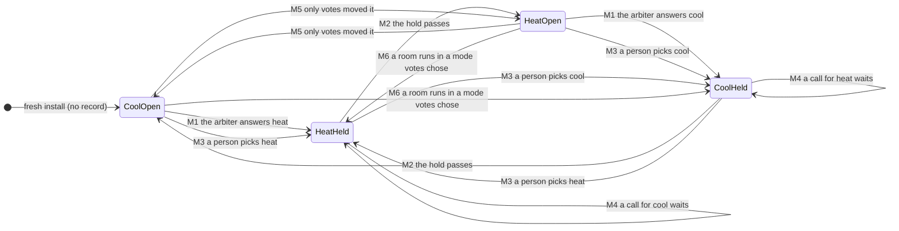

| Id | What happens | Code |
| --- | --- | --- |
| M1 | With the gate open, the first calling room in rank order decides. With nothing calling, Resting mode decides, once no room still runs in the shared mode. The new mode is stamped and stored before any head is sent it. | `_compute`, `arbitrate`, `shared_mode`, `_apply`, `_write_back_mode`, `_stamp_mode_change`, `_record_mode` |
| M2 | The gate reads `elapsed >= hysteresis` on the monotonic clock. A timer re-renders the entities at the hold's end and decides nothing; another wakes the plan for a flip the hold deferred. | `_mode_change_elapsed`, `_arm_hold_end_timer`, `_sync_dwell_timer` |
| M3 | A person's pick is never gated. A changed direction stamps the hold at once. An apply already running recorded its direction before it sent any head, so the pick is the newer record. | `async_select_option`, `async_select_shared_mode` |
| M4 | With the gate shut, the mode stays, whatever is asked, at any rank. A head wanting the other mode parks at its idle action. | `shared_mode`, `head_action` |
| M5 | A change only hands-off votes made starts no hold. Not in this spec: `verification/modehold/MXZModeHold.tla` covers it. | `arbitrate`, `_write_back_mode` |
| M6 | Once a coordinated room runs in a mode votes chose, the mode is MXZ's and the hold starts. Also in `MXZModeHold.tla`. | `_write_back_mode` |

## Changes made at a head

In the spec for room 1's setpoint (`WithAdopt`; the enable is not:
[README](README.md#what-is-modeled-and-what-isnt)). A second writer of a room's target and
enable, kept apart from MXZ's writes to the head. On by default; with **Accept changes
made at the head** off the machine stays in `Watching`, and a change at a head is written over.

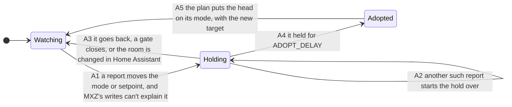

| Id | What happens | Code |
| --- | --- | --- |
| A1 | Every report passes MXZ's older writes, then is read against what is left. A write is remembered as it goes out. | `_on_head_change`, `_watch_head_change`, `DeliveryQueue._async_issue`, `MXZCoordinator.remember_head_write`, `_head_writes_caught_up`, `wrote`, `caught_up` |
| A2 | While the hold runs, `_apply` writes nothing to that head, and a command of MXZ's still waiting for the head is disowned. | `_head_change_settling`, `_apply`, `_arm_or_cancel`, `DeliveryQueue.disown` |
| A3 | Eco, a standby hold, Coordinator off, a start, a pause, a floor run, a hands-off room's disablement or a stale cloud report: the change counts for nothing. A head report that ends the hold this way, the head put back by hand say, asks for a compute, because the apply skipped that head and A2 disowned its waiting command. | `_head_adoption`, `drop_head_change`, `_watch_head_change`, `_on_head_change` |
| A4 | The room's own number and switch take the change, held to the room's bounds. What the head shows then replaces what it last showed in the memory. | `_on_heal_timer`, `_async_adopt_head_change`, `_head_change_seen`, `seen` |
| A5 | The next compute and apply. The head's heat or cool never reaches the shared mode. | `_apply` |

## A room's run

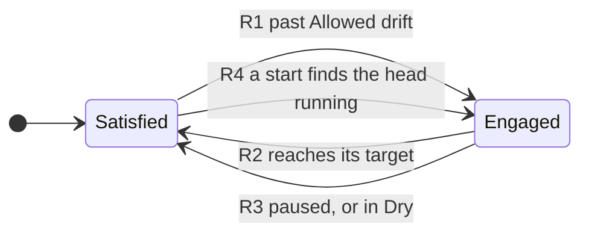

| Id | What happens | Code |
| --- | --- | --- |
| R1 | A room starts a run past its drift. Its call for the shared mode comes only past the larger Mode switch threshold. | `engage_with_latch`, `room_call` |
| R2 | The run lasts to the target, not to the drift. While engaged in the shared mode it keeps Resting mode waiting (`running`). | `engage_with_latch`, `arbitrate` |
| R3 | A paused room has no call, no run and an empty latch. Its run starts afresh on resume. | `_compute` |
| R4 | A restart seeds the latch from the head's mode at the first compute. | `_compute` |

## A door or window (a room with the pause on)

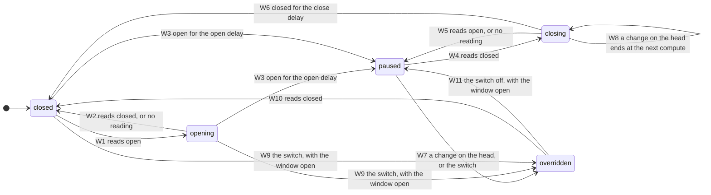

| Id | What happens | Code |
| --- | --- | --- |
| W1, W2, W3 | The delay counts from the reading, or from this coordinator's start if that is later. A start can lengthen a delay, never shorten it. No reading never starts a pause. | `OpeningPause.step`, `opening_state`, `opening_reading` |
| W3 | Entering the pause: the head goes straight to off, with no coil-dry run and no fan, setpoint or vane write. A speed picked on the off head is read and held. The state is stored at once. | `OpeningPause._transition`, `_apply`, `FanHold.read`, `OpeningPause._save` |
| W4, W5, W6 | A closed reading counts down the close delay. Opening again starts it over. No reading doesn't end a pause. | `opening_state`, `opening_due` |
| W7 | A real mode change on a paused head, to anything but off, not MXZ's own, takes the room over at once. So does the Window Override switch. The room is coordinated normally: MXZ doesn't turn the head back off. | `_on_head_change`, `OpeningPause.take_over`, `OpeningPause.async_set_override` |
| W8 | With the window already closed and the close delay running, a change on the head is recorded, and the closed reading ends it at the next compute: the room goes on closing and the head is sent off again. This is the documented "until the window closes", at its edge. | `_on_head_change`, `OpeningPause.step` |
| W9 | The switch with the window open is an override with no pause to end. With no reading, it leaves the room closed and waits: the next open reading is overridden. | `OpeningPause.async_set_override`, `opening_state` |
| W10 | A closed reading ends an override at once, so the next opening pauses again. | `OpeningPause.step` |
| W11 | Turning the switch off with the window open counts the window again: paused once it has been open for the open delay, opening until then. | `OpeningPause.async_set_override` |

## A head's fan

A hold ends only on a gesture: the Fan auto switch, or an observed `auto`.

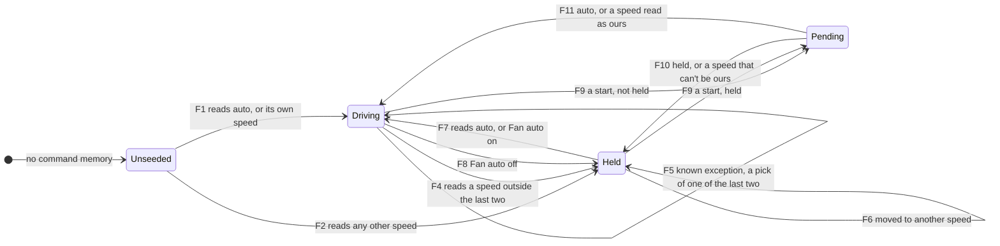

| Id | What happens | Code |
| --- | --- | --- |
| F1, F2 | With no memory, `auto` sets the baseline. A speed the ladder would stay on is adopted (a hold placed there is lost: documented), a fan_only idle on an established entry reads as ours (#25), and anything else seeds a hold. | `FanHold._observe_latch`, `FanHold._seed_matches_boost`, `FanHold._seed_is_own_idle` |
| F3 | Boost picks a rung and writes it once. A rewrite of the commanded token doesn't roll the memory (#14). | `FanHold.async_apply`, `fan_for_delta`, `FanHold._async_write` |
| F4 | A speed that is neither of the last two writes (`FanEcho.last`, `FanEcho.prior`), and not in `FanEcho.older` either, is a person's. MXZ makes no fan write while held. | `FanHold._observe_latch`, `FanEcho.own`, `FanHold._hold_at` |
| F5 | One of the two remembered speeds reads as MXZ's echo: not held, and boost writes over it. So does an older write, until the head's reports pass it (F1). A pick of the speed showing can't be read at all. | `FanHold._observe_latch`, `FanEcho.own`, `FanEcho.wrote`, `FanEcho.caught_up` |
| F6 | A hold's memory is the held speed, so any other speed moves it. | `FanHold._hold_at` |
| F7, F8 | Fan auto on adopts the showing speed and hands it back. Fan auto off holds it. At `auto`, off does nothing. | `FanHold.async_set_auto`, `FanHold._adopt` |
| F9 | The switch restores the held or not-held truth and, if not held, the remembered speeds with any older writes, limited to what boost could write. | `MXZZoneFanAutoSwitch.async_added_to_hass`, `FanHold.restore` |
| F10, F11 | The first speed read settles it. Held stays held at that speed. Not held: a speed boost could never write holds; one in memory, or any in-ceiling rung with no memory or in a fan_only idle, is ours; otherwise it conservatively holds. | `FanHold._reconcile_restored_hold` |

## An apply's commands

One per head, in `ci-apply` (`WithSplit`). The mode is already recorded when the first runs.

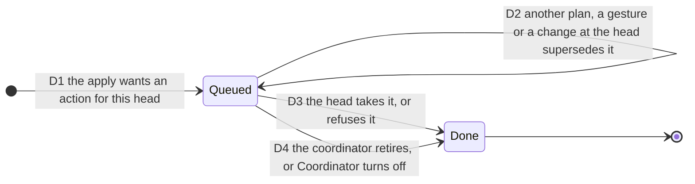

| Id | What happens | Code |
| --- | --- | --- |
| D1 | One task per head, which waits for the head's lock. The apply records the mode, then waits until every head is done or a new input comes in. | `DeliveryQueue.queue`, `_write_back_mode`, `DeliveryQueue.async_wait` |
| D2 | A superseded command issues nothing more. A change at the head that will be adopted disowns it. | `DeliveryQueue.owned`, `DeliveryQueue.disown` |
| D3 | Whatever a head's handler raises is that room's: its row reads rejected and the next update tries again. Only a fault in MXZ's own steps fails the plan. | `DeliveryQueue._deliver`, `DeliveryQueue._async_issue`, `DeliveryQueue._finish` |
| D4 | A retired coordinator's command sends nothing more; what it sent stays sent. | `DeliveryQueue.retire` |

## Lifecycle

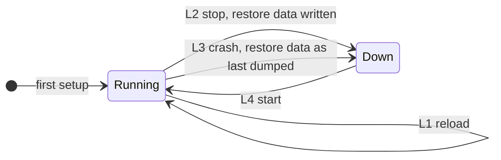

| Id | What happens | Code |
| --- | --- | --- |
| L1, L2 | The Fan auto switch's state goes to restore data at a reload or a stop, and every 15 minutes by Home Assistant. | `extra_restore_state_data`, `FanHold.command_memory` |
| L3 | The mode record and the door/window store were written at every change, so they survive. The Fan auto truth is as last dumped. | `_record_mode`, `OpeningPause._save` |
| L4 | The record gives the mode, whether votes set it, and what is left of the hold; the store gives each room's door/window state and override; each room resumes from its head. | `async_load_mode_record`, `mode_change_stamp`, `restore_shared_mode`, `async_load_openings`, `OpeningRecord.restored` |

## User flows, drawn from the model

The charts above were drawn by hand from the code. These five were drawn by the pstack
`/statechart` skill from `tla/MXZCoordinator.tla` itself, cut down so the whole graph fits,
with labels in the words of a person in the house. So each is what TLC checked, not a
reading of it, and the hand-drawn chart beside it can be held against it. Each was replayed
on the real code wherever it shows a bug.

The files are in [`charts/`](charts): a config per chart, a view per flow (its labels), and
`Charts.tla`, which extends the spec with the cuts a config can't write and adds no step and
no rule. To draw one again, copy `Charts.tla`, `tla/MXZCoordinator.tla`, the chart's `.cfg`
and its view into one scratch folder outside the repository, and run `/statechart` on
`Charts.tla` with that config and view (`adopt-restart.cfg` uses `adopt.ts`).
`tests/test_formal_contract.py` checks that each config sets every constant, names only
rules and cuts that exist, and has its view. Each chart counts TLC states at the bounds in
its config, at commit `ca78324`; a busier model makes `/statechart` draw only the bug paths.

A chart draws no arrow for a step that stays inside one of its states: time passing that
changes nothing a person sees, say, or a restart that brings back everything.

### The shared mode changes, then holds

[`charts/mode.cfg`](charts/mode.cfg), view `mode.ts`. One room that calls for cool or for
heat, a hold of 1 tick, time 0 to 1, a person's pick, and restarts: 261 states. Rules that
hold: `NoFlipInDwell`, `NoExtraWait`, `HoldClockKept`, `RestartRestores`, `HeadsFollowMode`.

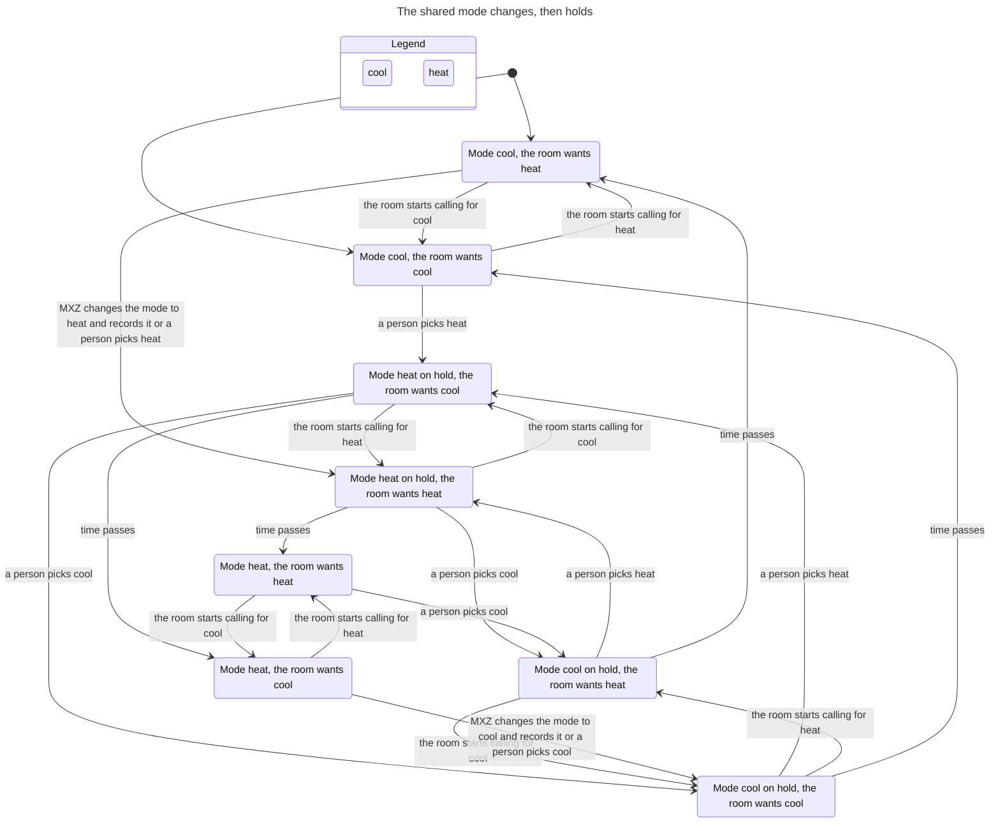

What it shows: a call for the other mode waits out the hold, and MXZ changes the mode once
it has passed; a person's pick changes it at once and starts the hold too. The chart has no
"Home Assistant restarts" arrow: every restart lands in the state it left, hold included.
What it leaves out: a second room, Resting mode, hands-off votes and wall-clock steps (the
mode-hold model's), and each head's command as its own step (`ci-apply`, checked by
`tools/formal_area.py check apply`).

### A door or window pauses its room

[`charts/window.cfg`](charts/window.cfg), view `window.ts`. One room that always calls for
cool, delays of 1 tick, time 0 to 2, a person's change at the head to cool or off
(`CoolOrOff`; fan only or heat is the same takeover), no reload or restart: 481 states. Rules
that hold: `PauseStopsHead`, `OverrideHolds`, `HeadsFollowMode`.

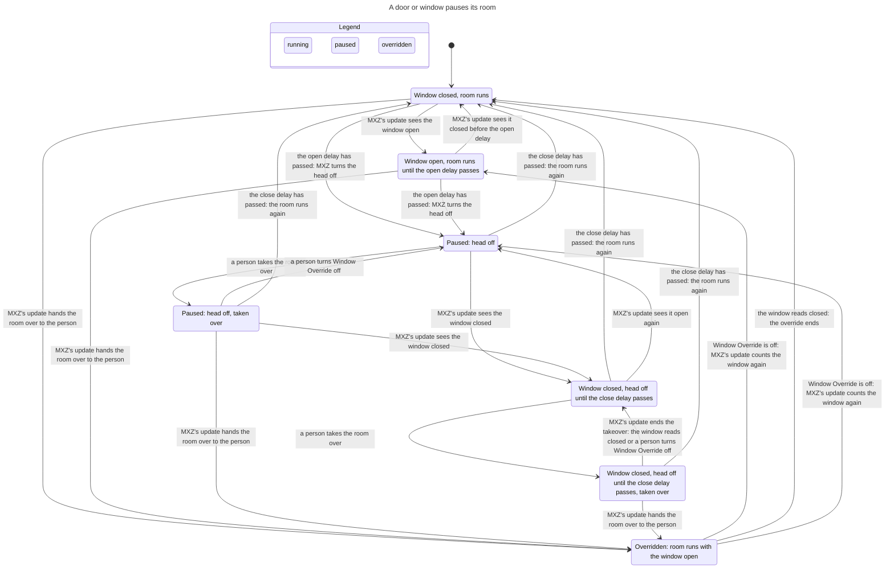

What it shows: every transition W1 to W11 of the hand-drawn chart. A takeover on a paused
head shows as "taken over" until MXZ's next update hands the room to the person; on the
close delay, the closed reading ends it at that update instead (W8). Two arrows the hand
chart doesn't draw, both from a paused room straight back to "Window closed, room runs":
when the window has read closed for the whole close delay before MXZ's next update, that one
update goes from paused to running, with no update in between to show the close delay. What
it leaves out: starts, which put it past the chart budget (`ci-window` checks them), a second
room, the fan (`ci-window-fan`), notices, vanes and standby.

### A person's fan pick and Fan auto

[`charts/fan.cfg`](charts/fan.cfg), view `fan.ts`. One room that always reads hot, so MXZ
only ever writes medium; a person picks medium, high or auto at the remote (`NoLow` leaves
out low, a second speed MXZ never writes); Fan auto on and off; no start: 250 states. Rules
that hold: `ManualFanKept`, `ManualFanShown`, `NoFalseHold`.

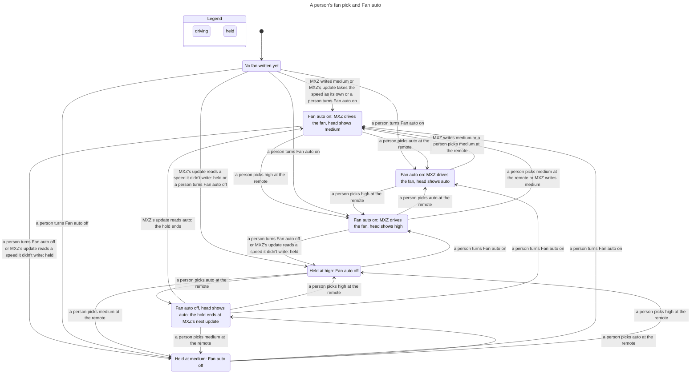

What it shows: a speed MXZ didn't write is held at its next update, and the hold ends only on
Fan auto or a reading of auto (F4, F7, F8). The arrow from "head shows high" to "MXZ writes
medium" is the documented exception (F5): a pick of a speed MXZ remembers writing, here high
adopted by Fan auto on and then written over by medium, reads as MXZ's echo
(`NeverKnownExceptionLosesAPick` reaches it in `ci-fan`). What it leaves out: starts and
crashes (`ci-fan`, `ci-fan-crash`), a head that reports late (`ci-fan-lag`), and the ladder's
other rungs.

### A change made at the head becomes the room's target

[`charts/adopt.cfg`](charts/adopt.cfg), view `adopt.ts`. Room 1's setpoint with a head one
write behind, targets set in Home Assistant, presses at the head of the same two values
(`TwoValues`), no reload or restart: 280 states. Rules that hold: `OwnWriteNeverAdopted`,
`HoldBlocksWrite`, `StartWriteNeverAdopted`. Rule that breaks: `QueuedWriteNeverAdopted`,
open finding SM-10.

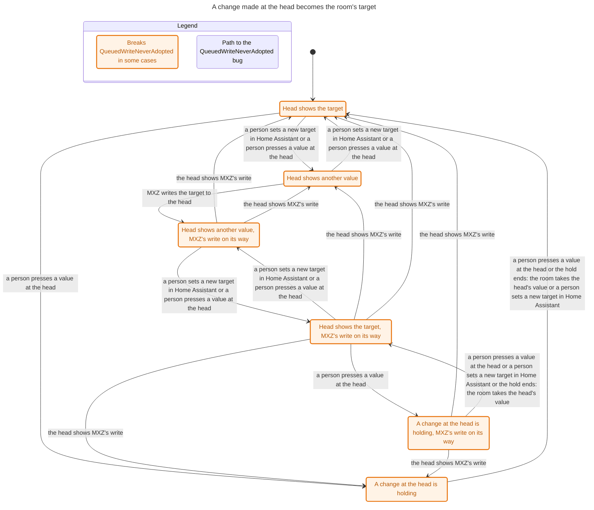

Every state is marked because the model goes on past the bug and the bug's mark stays on.
SM-10's shortest path, in the report's words, with the target starting at 70:

0. Head shows the target.
1. A person sets a new target in Home Assistant (72).
2. MXZ writes the target to the head; the head lags.
3. A person presses a value at the head: 72, the value on its way, read as MXZ's own.
4. A person presses a value at the head: 70. A change at the head is holding.
5. The hold ends: the room takes the head's value, 70.
6. The head shows MXZ's write, 72, which the press in step 3 dropped from the memory.
7. The hold ends: the room takes 72, over the person's 70.

Replayed on the real code at `ca78324`, one step per action, on invented heads: the target
ends at 72 where the person left 70. The control, the same steps without step 3, keeps the
person's value. What it leaves out: a head two writes behind (`ci-adopt`), the enable, the
heat/cool choice, and every gate but startup quiet.

### A pre-restart write after startup quiet

[`charts/adopt-restart.cfg`](charts/adopt-restart.cfg), view `adopt.ts`. The same, with
process starts and startup quiet instead of `QueuedWriteNeverAdopted`: 2,776 states, past
the chart budget, so it draws only the path to the bug. Rule that breaks:
`StartWriteNeverAdopted`, open finding SM-1.

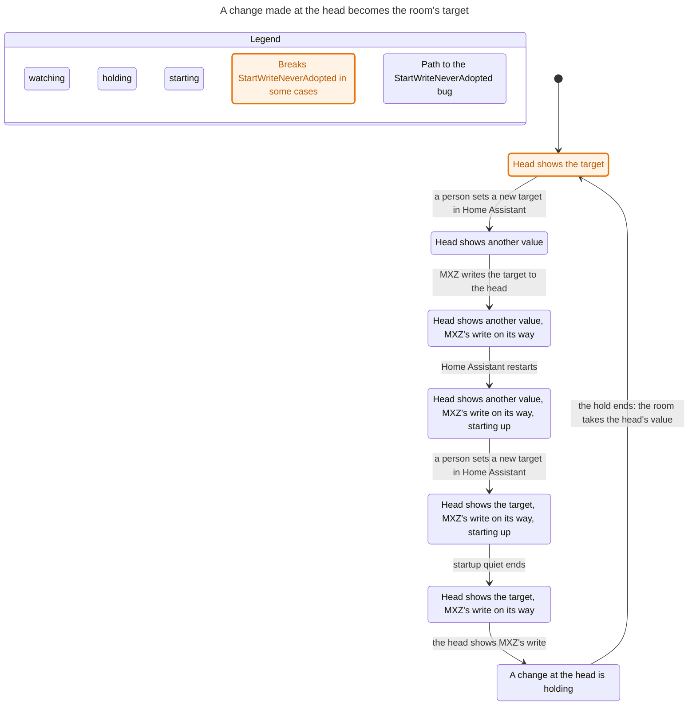

This path does not happen on the real code, so here the model is wrong. Step 4 has a
person set the target back in Home Assistant between the restart and MXZ's first write after
it. In the integration, MXZ's first update after a start writes the target again at once
(replayed at `ca78324`: the head's queue holds MXZ's new writes of 72 before the person's
change), so the late 72 reads as MXZ's own and nothing is adopted. SM-1 itself is real: on
its probe in [STATE-MACHINES.md](../STATE-MACHINES.md#sm-1-a-late-report-of-mxzs-own-pre-restart-write-is-adopted-as-a-persons-press) (target 72 then 74 at a lagging head, a
restart, the reports after startup quiet) the replay at `ca78324` ends at 72 where the person
left 74. The
model doesn't make MXZ write first after a start; that would change the spec and is left for
the SM-1 decision.
